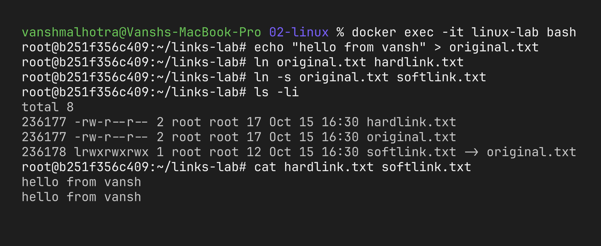
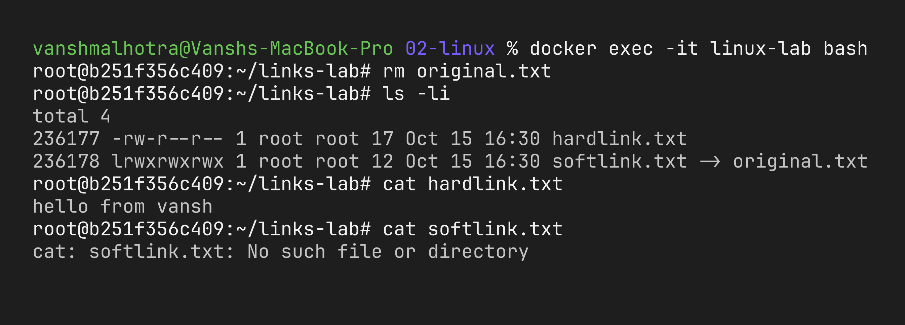
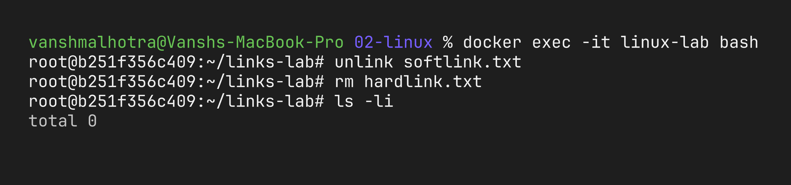
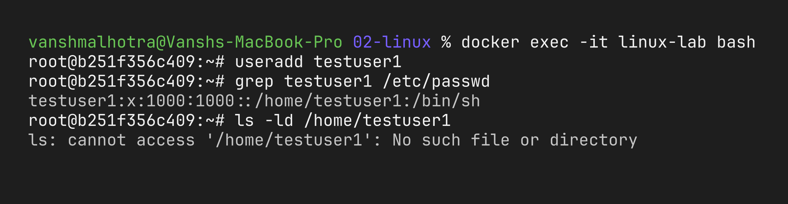
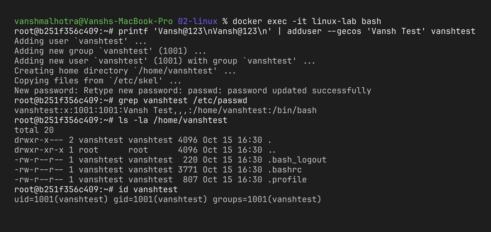
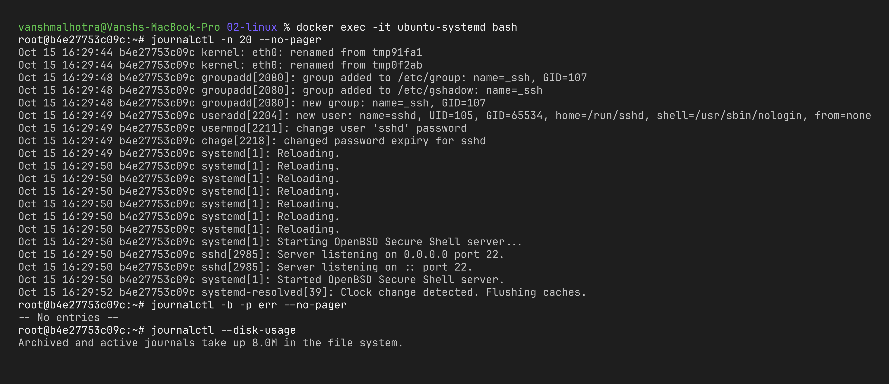
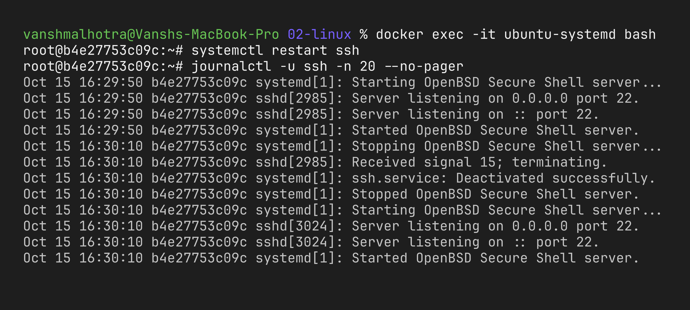
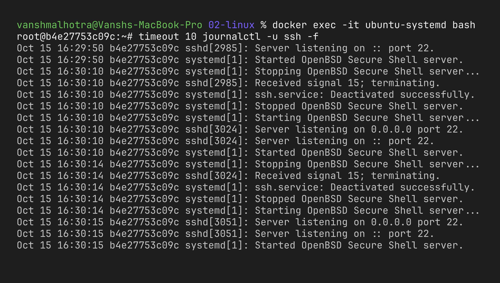
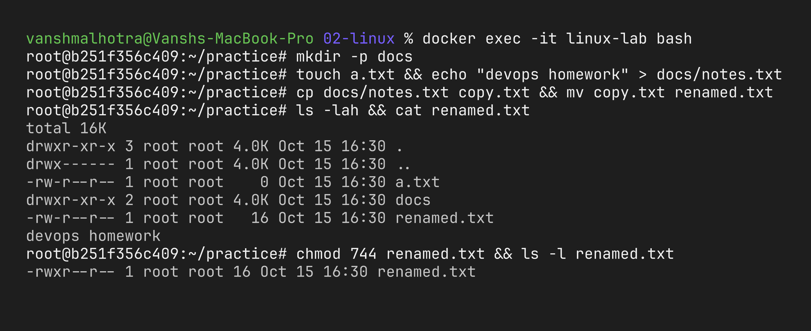
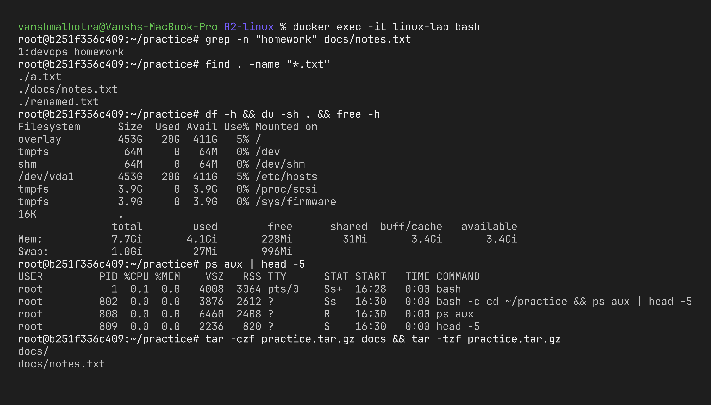

# Session 2 – Linux Fundamentals

**Name:** Vansh Malhotra  
**Roll No:** 24bcs10268

In this homework I practised four Linux topics: soft vs hard links, `adduser` vs `useradd`, reading logs with `journalctl`, and the common commands from the Linux cheat sheet.

**Where I ran things:** I'm on macOS, so for Tasks 1, 2 and 4 I used an Ubuntu container:

```bash
docker run -it --name linux-lab ubuntu:22.04 bash
# inside the container:
apt update && apt install -y adduser vim less procps iproute2
```

For Task 3 (`journalctl`) a normal Docker container is not enough, because containers don't run **systemd** as PID 1, so there is no journal to read. I didn't have Multipass, so I used a systemd-enabled Ubuntu 22.04 container instead (a small image based on `ubuntu:22.04` with `systemd` installed and `/sbin/init` as the command, run with `--privileged --cgroupns=host -v /sys/fs/cgroup:/sys/fs/cgroup:rw`), then installed `openssh-server` in it. A real Ubuntu VM (e.g. Multipass) or a cloud instance works too.

---

## Task 1: Soft Link & Hard Link

### What I learnt

Every file in Linux has an **inode** – a small record that stores the file's metadata and where its data actually lives on disk. A filename is just a label pointing to an inode.

- A **hard link** is simply *another name* for the same inode. Both names are equal; there is no "original" and "copy". The data is deleted only when the last name pointing to it is removed (the link count becomes 0).
- A **soft link** (symbolic link / symlink) is a separate small file whose content is the *path* of the target. It's like a shortcut on Windows. If the target is deleted or moved, the symlink is left pointing at nothing (a "dangling" link).

| | Hard link | Soft link (symlink) |
| :--- | :--- | :--- |
| Command | `ln target link` | `ln -s target link` |
| Inode | Same inode as the target | Has its own new inode |
| What it stores | Points directly to the data | Stores the path of the target |
| If target is deleted | Still works, data is still there | Breaks (dangling link) |
| Works across filesystems/partitions | No | Yes |
| Can point to a directory | No (not allowed for normal users) | Yes |
| `ls -l` shows | Normal file, link count goes up | `l` at start and `link -> target` |
| File size | Same as target | Size of the path string |

### Commands

```bash
ln  original.txt hardlink.txt     # create a hard link
ln -s original.txt softlink.txt   # create a soft link
ls -li                            # -i shows inode numbers
readlink softlink.txt             # shows where a symlink points
unlink softlink.txt               # delete a link (rm also works)
```

### Practice – creating links

```bash
mkdir ~/links-lab && cd ~/links-lab
echo "hello from vansh" > original.txt
ln original.txt hardlink.txt
ln -s original.txt softlink.txt
ls -li
cat hardlink.txt softlink.txt
```



**What I observed:** `original.txt` and `hardlink.txt` had exactly the same inode number and the link count column showed `2`. `softlink.txt` had its own inode and started with `l` in the permissions.

### Practice – deleting the original

```bash
rm original.txt
ls -li
cat hardlink.txt
cat softlink.txt
```



**What I observed:** the hard link still worked because the data's inode was still referenced by one name. The soft link broke because the path it stores (`original.txt`) no longer exists. In `ls -l` the broken symlink is usually shown in red.

### Practice – deleting the links

```bash
unlink softlink.txt
rm hardlink.txt
ls -li
```



Bonus I tried: a symlink to a directory works (`ln -s /var/log logs`), but a hard link to a directory fails with `hard link not allowed for directory`.

### Interview Questions (prepared)

**Q1. What is the difference between a soft link and a hard link?**  
A hard link is another name for the same inode, so it shares the data and survives if the original name is deleted. A soft link is a separate file that only stores a path to the target, so it breaks if the target is removed or moved.

**Q2. What is an inode?**  
A data structure that stores a file's metadata (owner, permissions, size, timestamps, pointers to data blocks) – everything except the file name.

**Q3. Why can't a hard link span across filesystems?**  
Inode numbers are only unique inside one filesystem. A hard link just reuses an inode number, so it can't refer to an inode on another partition.

**Q4. Why are hard links to directories not allowed?**  
It could create loops in the directory tree (a directory containing itself), which would confuse tools like `find` and break the tree structure.

**Q5. How do you find a broken symlink?**  
`find . -xtype l` lists dangling symlinks. `ls -l` also shows them (often in red).

**Q6. When is a soft link useful in real life?**  
Switching versions, e.g. `/usr/bin/python3 -> python3.10`, or `current -> releases/v2` in deployments, or nginx's `sites-enabled` symlinks pointing to `sites-available`.

**Q7. How do you check how many hard links a file has?**  
The second column in `ls -l`, or `stat file` ("Links: 2").

---

## Task 2: `adduser` vs `useradd`

### What I learnt

| | `useradd` | `adduser` |
| :--- | :--- | :--- |
| What it is | Low-level native binary, same on all distros | Friendly Perl script (Debian/Ubuntu) that internally calls `useradd` |
| Home directory | Not created unless you pass `-m` | Created automatically |
| Copies `/etc/skel` (`.bashrc`, `.profile`) | Only with `-m` | Yes |
| Default shell | `/bin/sh` unless `-s` is given | `/bin/bash` (from `/etc/adduser.conf`) |
| Password | Not set – need to run `passwd` separately | Asks for the password interactively |
| Full name / GECOS info | Only via `-c` | Asks interactively |
| Best for | Scripts and automation, non-Debian distros | Humans creating users manually on Ubuntu/Debian |

**Which one is preferred on Ubuntu and why?**  
On Ubuntu, `adduser` is the recommended command (even the `useradd` man page on Debian/Ubuntu says to use `adduser` instead). It gives sensible defaults in one step: home directory, skeleton files, bash shell, a password, and a matching group. With `useradd` it's easy to forget `-m` or `-s` and end up with a user who has no home folder and a weird `sh` prompt. `useradd` is still useful inside scripts (and on RHEL/CentOS where `adduser` is just a link to `useradd`) because it's non-interactive: `useradd -m -s /bin/bash devuser`.

### Practice – `useradd` (to see the difference)

```bash
useradd testuser1
grep testuser1 /etc/passwd
ls -ld /home/testuser1
```



### Practice – creating the test user with `adduser` (recommended)

```bash
adduser vanshtest          # enter password + details when asked
grep vanshtest /etc/passwd
ls -la /home/vanshtest
id vanshtest
```



**What I observed:** `useradd` only made an entry in `/etc/passwd` – no home directory and the shell was `/bin/sh`. `adduser` did everything in one go and even asked for a password. Login check: `su - vanshtest` and then `whoami`.

Cleanup:

```bash
userdel testuser1
deluser --remove-home vanshtest
```

---

## Task 3: `journalctl`

### What I learnt

Modern Linux distributions (Ubuntu, Debian, RHEL, Fedora) use **systemd** as the init system. systemd has its own logging service called **journald**, which collects logs from the kernel, the boot process and every systemd service into one central (binary) journal. `journalctl` is the command used to read and filter that journal.

Why it's useful: instead of searching through many files in `/var/log/`, I can filter by service, time, priority or boot from one command. When a service fails to start, `journalctl -u <service>` is usually the first thing to check.

### Useful options

| Command | What it does |
| :--- | :--- |
| `journalctl` | All logs, oldest first (opens in a pager) |
| `journalctl -n 20` | Last 20 lines |
| `journalctl -f` | Follow logs live (like `tail -f`) |
| `journalctl -r` | Newest first |
| `journalctl -b` | Logs from the current boot only |
| `journalctl --list-boots` | List previous boots |
| `journalctl -k` | Kernel messages only (like `dmesg`) |
| `journalctl -p err` | Only priority `err` and worse |
| `journalctl -u ssh` | Logs of one service (unit) |
| `journalctl -u ssh --since "1 hour ago"` | Service logs in a time window |
| `journalctl --since "2026-10-15 10:00" --until "2026-10-15 11:00"` | Exact time range |
| `journalctl -xe` | Jump to the end with extra explanations |
| `journalctl -o json-pretty` | Output as JSON |
| `journalctl --disk-usage` | How much space the journal uses |
| `sudo journalctl --vacuum-time=7d` | Delete logs older than 7 days |

### Practice – system logs

```bash
journalctl --version
journalctl -n 20 --no-pager
journalctl -b -p err --no-pager
journalctl --disk-usage
```



### Practice – logs for a specific service

I used the `ssh` service (and `cron`) because they are present on a normal Ubuntu VM. To generate some fresh logs I restarted the service first.

```bash
systemctl status ssh
sudo systemctl restart ssh
journalctl -u ssh -n 20 --no-pager
journalctl -u ssh --since "10 minutes ago" --no-pager
journalctl -u cron --since today --no-pager
```



### Practice – following logs live

```bash
journalctl -u ssh -f
# in a second terminal: sudo systemctl restart ssh
```



**What I observed:** with `-u` I only saw the lines from that one service (start/stop events from systemd plus the service's own output), which is much easier than grepping `/var/log/syslog`. `-f` worked just like `tail -f`.

---

## Task 4: Linux Command Cheat Sheet

I went through the cheat sheet and practised each group of commands inside the Ubuntu container.

### Files and directories

| Command | Purpose | Example |
| :--- | :--- | :--- |
| `pwd` | Print current directory | `pwd` |
| `ls` | List files | `ls -lah` |
| `cd` | Change directory | `cd /var/log`, `cd ..`, `cd ~` |
| `mkdir` | Make directory | `mkdir -p project/src` |
| `touch` | Create empty file / update timestamp | `touch notes.txt` |
| `cp` | Copy | `cp -r src backup` |
| `mv` | Move or rename | `mv old.txt new.txt` |
| `rm` | Delete | `rm file`, `rm -r dir` |
| `find` | Search for files | `find / -name "*.conf"` |
| `tree` | Show directory tree | `tree -L 2` |

### Viewing and editing files

| Command | Purpose | Example |
| :--- | :--- | :--- |
| `cat` | Print a file | `cat /etc/os-release` |
| `less` | Scroll through a file | `less /etc/passwd` |
| `head` / `tail` | First / last lines | `head -n 5 f`, `tail -f app.log` |
| `wc` | Count lines/words | `wc -l /etc/passwd` |
| `grep` | Search text | `grep -rn "error" /var/log` |
| `vim` / `nano` | Text editors | `vim file.txt` |
| `echo` | Print text / write to a file | `echo hi > a.txt` |

### Permissions and ownership

| Command | Purpose | Example |
| :--- | :--- | :--- |
| `chmod` | Change permissions | `chmod 755 script.sh`, `chmod +x script.sh` |
| `chown` | Change owner | `chown vansh:vansh file` |
| `umask` | Default permission mask | `umask` |

(r = 4, w = 2, x = 1 → `755` = owner rwx, group r-x, others r-x.)

### Users and groups

| Command | Purpose | Example |
| :--- | :--- | :--- |
| `whoami` / `id` | Current user / uid, gid, groups | `id` |
| `adduser` / `useradd` | Create user | `adduser dev` |
| `usermod` | Modify user | `usermod -aG sudo dev` |
| `passwd` | Change password | `passwd dev` |
| `su` / `sudo` | Switch user / run as root | `su - dev`, `sudo apt update` |

### Processes and services

| Command | Purpose | Example |
| :--- | :--- | :--- |
| `ps` | List processes | `ps aux` |
| `top` / `htop` | Live process monitor | `top` |
| `kill` | Stop a process | `kill -9 1234` |
| `systemctl` | Manage services | `systemctl status nginx` |
| `journalctl` | Read service logs | `journalctl -u nginx` |

### Disk and system info

| Command | Purpose | Example |
| :--- | :--- | :--- |
| `df` | Disk space per filesystem | `df -h` |
| `du` | Size of a folder | `du -sh /var/log` |
| `free` | RAM usage | `free -h` |
| `uname` | Kernel info | `uname -a` |
| `uptime` | How long system is up + load | `uptime` |
| `lsblk` | Block devices | `lsblk` |

### Networking

| Command | Purpose | Example |
| :--- | :--- | :--- |
| `ip a` | Show IP addresses | `ip a` |
| `ping` | Test reachability | `ping -c 4 google.com` |
| `curl` / `wget` | HTTP requests / download | `curl -I https://example.com` |
| `ss` | Open ports | `ss -tulpn` |

### Archives and packages

| Command | Purpose | Example |
| :--- | :--- | :--- |
| `tar` | Create / extract archives | `tar -czf b.tar.gz dir`, `tar -xzf b.tar.gz` |
| `apt` | Install packages (Ubuntu) | `apt update && apt install -y tree` |

### Shell operators

| Operator | Meaning |
| :--- | :--- |
| `\|` | Pipe output of one command into another (`ps aux \| grep nginx`) |
| `>` / `>>` | Redirect output (overwrite / append) |
| `2>` | Redirect errors |
| `&&` | Run next command only if previous succeeded |
| `$(cmd)` | Use a command's output inside another command |

### Practice session

```bash
cd ~ && mkdir -p practice/docs && cd practice
touch a.txt && echo "devops homework" > docs/notes.txt
cp docs/notes.txt copy.txt && mv copy.txt renamed.txt
ls -lah && cat renamed.txt
chmod 744 renamed.txt && ls -l renamed.txt
grep -n "homework" docs/notes.txt
find . -name "*.txt"
df -h && du -sh . && free -h
ps aux | head -5
tar -czf practice.tar.gz docs && tar -tzf practice.tar.gz
```





**What I understood:** most day-to-day DevOps work on Linux comes down to these few groups – moving around files, checking permissions, looking at processes/services and logs, and checking disk/network. Combining them with pipes (`|`) and redirection (`>`) is what makes the shell powerful.

Cleanup: `exit` the container, then `docker rm -f linux-lab`.
