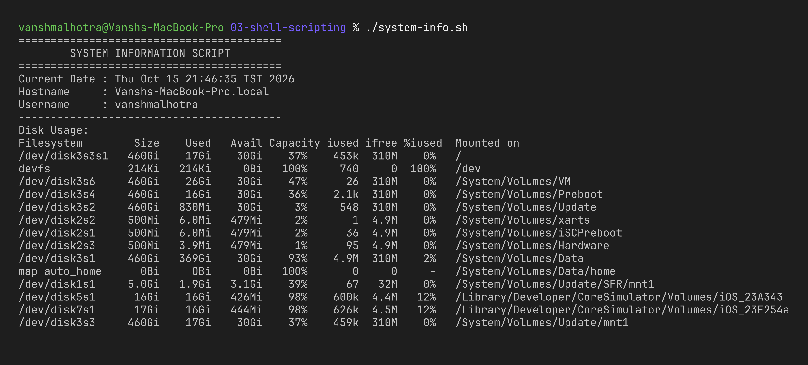
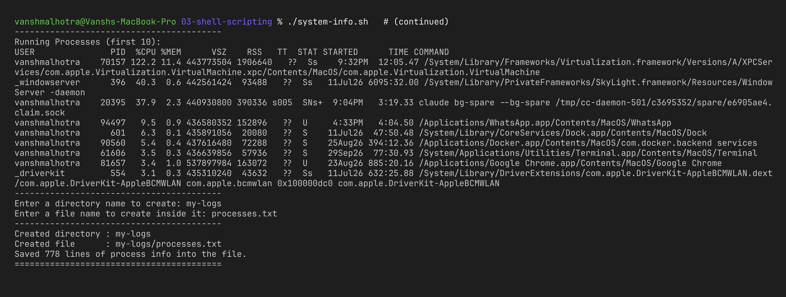
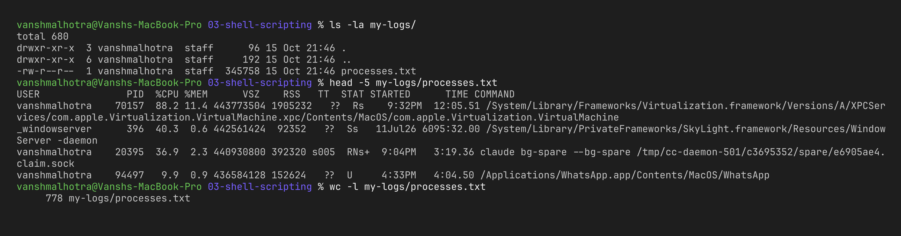
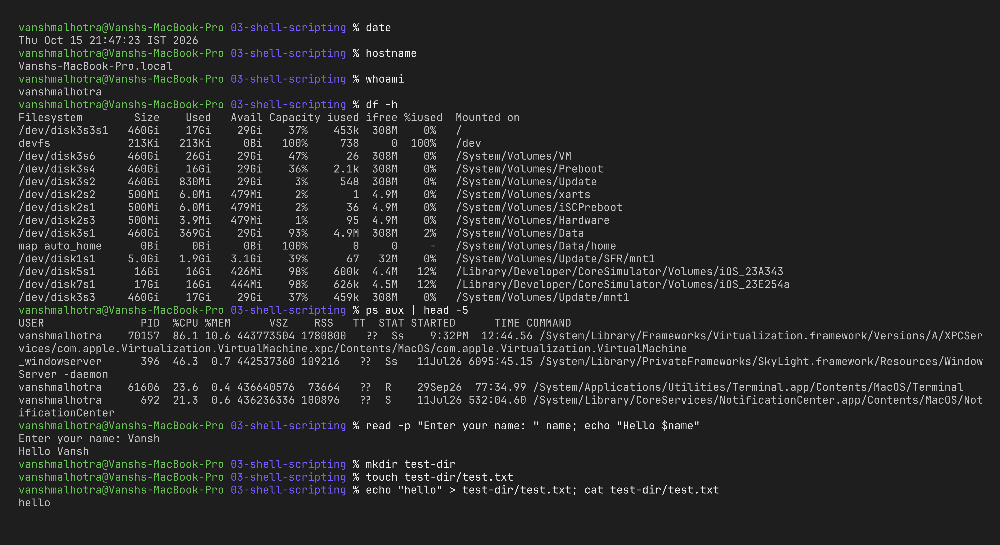

# Session 3 – Shell Scripting

**Name:** Vansh Malhotra  
**Roll No:** 24bcs10268

## Task: System Information Script

For this homework I wrote a small Bash script, [`system-info.sh`](./system-info.sh), that collects some basic information about the machine and saves the list of running processes into a file chosen by the user.

The script:

- prints the current **date**, the **hostname** and the **username**
- prints **disk usage** with `df -h`
- prints the **running processes** with `ps aux`
- stores data in **variables** (`current_date`, `host_name`, `user_name`, `dir_name`, `file_name`)
- takes **user input** with `read -p`
- creates a **directory** with `mkdir` and a **file** with `touch`
- writes the process list into that file using **`>` output redirection**

## The script

```bash
#!/bin/bash
# Store system info in variables
current_date=$(date)
host_name=$(hostname)
user_name=$(whoami)

echo "Current Date : $current_date"
echo "Hostname     : $host_name"
echo "Username     : $user_name"

echo "Disk Usage:"
df -h

echo "Running Processes (first 10):"
ps aux | head -10

# Take input from the user
read -p "Enter a directory name to create: " dir_name
read -p "Enter a file name to create inside it: " file_name

# Create the directory and the file
mkdir -p "$dir_name"
touch "$dir_name/$file_name"

# Save the full process list into the file (> overwrites)
ps aux > "$dir_name/$file_name"
```

(The file in the repo also has some `echo` lines for nicer formatting.)

## How I ran it

```bash
cd assignments-solution/03-shell-scripting
chmod +x system-info.sh
./system-info.sh
```

When it asked for input I typed `my-logs` for the directory and `processes.txt` for the file.

## Output of all commands

### 1. Running the script (date, hostname, username, disk usage)



### 2. Running processes + user input



### 3. Verifying the directory and file were created

```bash
ls -la my-logs/
head -5 my-logs/processes.txt
wc -l my-logs/processes.txt
```



### 4. Each command on its own

I also ran every command used in the script separately to understand what it does:

```bash
date
hostname
whoami
df -h
ps aux | head -5
read -p "Enter your name: " name; echo "Hello $name"
mkdir test-dir
touch test-dir/test.txt
echo "hello" > test-dir/test.txt; cat test-dir/test.txt
```



The generated `my-logs/` and `test-dir/` folders are not committed (they're just output from running the script). Cleanup: `rm -rf my-logs test-dir`.

## What I learnt

| Concept | How I used it |
| :--- | :--- |
| Shebang `#!/bin/bash` | Tells the system to run the file with bash |
| Variables | `user_name=$(whoami)` – no spaces around `=`, read back with `$user_name` |
| Command substitution `$(...)` | Runs a command and stores its output in a variable |
| `echo` | Prints text and variables |
| `df -h` | Disk usage in human-readable form (G, M) |
| `ps aux` | Shows all running processes with user, PID, CPU and memory |
| `read -p` | Shows a prompt and saves what the user types into a variable |
| `mkdir -p` | Creates a directory; `-p` means no error if it already exists |
| `touch` | Creates an empty file |
| `>` | Redirects output into a file, **overwriting** it (`>>` would append) |
| `chmod +x` | Makes the script executable so I can run it with `./` |

One thing I noticed: I quoted the variables (`"$dir_name"`) so the script still works if someone types a name with spaces.
