# Session 4 – Networking

**Name:** Vansh Malhotra  
**Roll No:** 24bcs10268

## Task 1: Practice from the devops-hero repo

I went through the networking notes and commands shared in the **devops-hero** GitHub repo from class and practised them on my own machine. My short notes on the basics are below, and Task 2 has every command with its output and what I understood.

### IP address basics

- An **IP address** identifies a device on a network. IPv4 is **32 bits**, written as 4 numbers (octets) from 0–255, e.g. `192.168.1.10`.
- The **subnet mask** tells which part is the *network* and which part is the *host*. `255.255.255.0` (or `/24` in CIDR) → first 3 octets are the network.
- Usable hosts in a subnet = 2^(host bits) − 2 (one address for the network, one for broadcast). For `/24`: 2^8 − 2 = **254**.

| Class | First octet | Default mask | CIDR |
| :--- | :--- | :--- | :--- |
| A | 1 – 126 | 255.0.0.0 | /8 |
| B | 128 – 191 | 255.255.0.0 | /16 |
| C | 192 – 223 | 255.255.255.0 | /24 |
| D | 224 – 239 | multicast | – |
| E | 240 – 255 | reserved / experimental | – |

(127.x.x.x is reserved for loopback, e.g. `127.0.0.1` = localhost.)

**Private IP ranges** (used inside home/office networks, not routable on the internet):

- `10.0.0.0/8`
- `172.16.0.0/12` (172.16 – 172.31)
- `192.168.0.0/16`

**Example:** `192.168.1.0/24` → network `192.168.1.0`, broadcast `192.168.1.255`, hosts `192.168.1.1 – 192.168.1.254`.

### Ports I should remember

| Port | Service |
| :--- | :--- |
| 22 | SSH |
| 53 | DNS |
| 80 / 443 | HTTP / HTTPS |
| 3306 | MySQL |
| 5432 | PostgreSQL |
| 6443 | Kubernetes API server |

---

## Task 2: Networking Commands – Output and What I Understood

I ran these on my Mac. Some Linux-only commands (`ip`, `ss`, `hostname -I`) I ran inside an Ubuntu container:

```bash
docker run -it --rm ubuntu:22.04 bash
apt update && apt install -y iproute2 iputils-ping dnsutils traceroute curl wget net-tools
```

### 1. `ifconfig` / `ip addr` – show network interfaces

```bash
ifconfig en0          # macOS
ip addr               # Linux
```

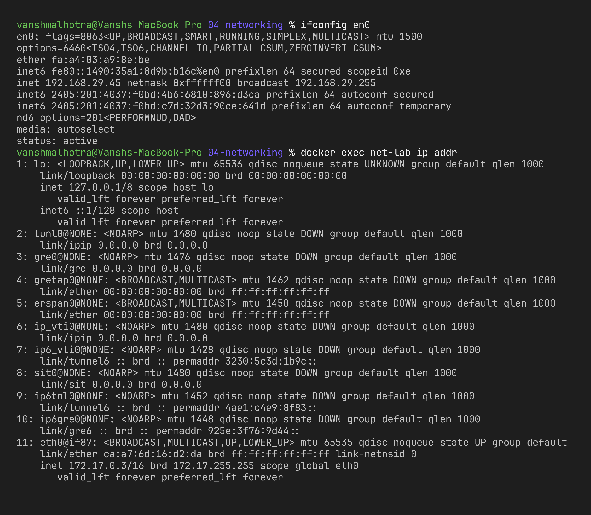

**What I understood:** this shows every network interface on the machine, its IPv4/IPv6 address, subnet mask and MAC (`ether`) address. `lo` / `lo0` is the loopback interface (`127.0.0.1`). `ip addr` is the modern Linux replacement for `ifconfig`.

### 2. `hostname` / `hostname -I`

```bash
hostname
hostname -I           # Linux only – prints all IPs of the host
```

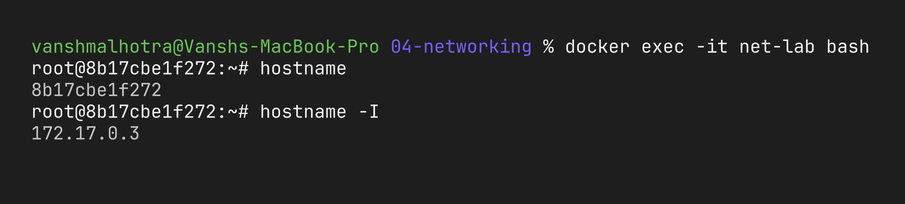

**What I understood:** `hostname` prints the machine's name; `-I` quickly prints its IP addresses without all the extra info from `ip addr`.

### 3. `ping` – check if a host is reachable

```bash
ping -c 4 google.com
```

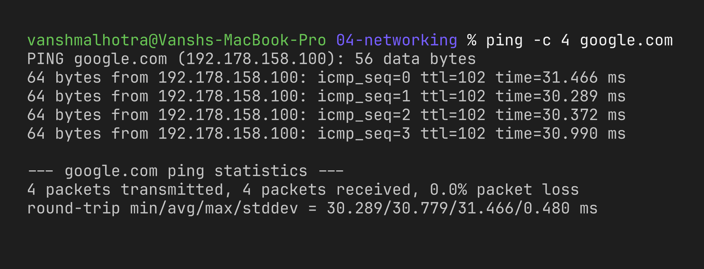

**What I understood:** `ping` sends ICMP echo requests and waits for replies. It tells me whether the host is reachable, the round-trip time (latency) and packet loss. `-c 4` stops after 4 packets (on Linux it would otherwise run forever).

### 4. `nslookup` – DNS lookup

```bash
nslookup github.com
```

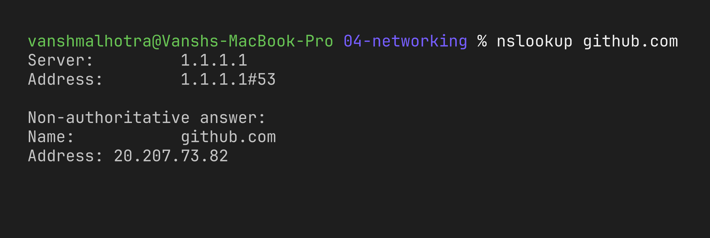

**What I understood:** DNS converts names into IP addresses. `nslookup` shows which DNS server answered and what IP it returned. "Non-authoritative answer" means it came from a cache/resolver, not GitHub's own DNS server.

### 5. `dig` – detailed DNS lookup

```bash
dig google.com
dig +short google.com
dig google.com MX +short
```

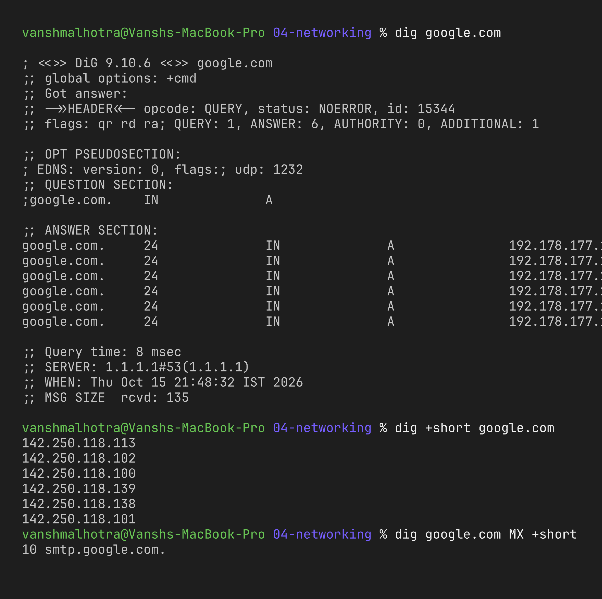

**What I understood:** `dig` gives more detail than `nslookup` – record type (A, MX, CNAME…), TTL and query time. `+short` prints just the answer, which is handy in scripts.

### 6. `traceroute` – path packets take

```bash
traceroute -m 15 8.8.8.8
```

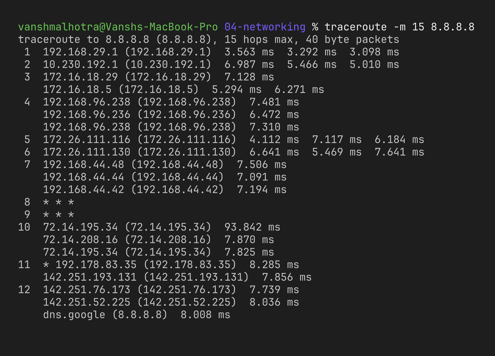

**What I understood:** each line is one router (hop) on the way to the destination. The first hop is my Wi-Fi router, then my ISP, then Google's network. `* * *` just means that router doesn't reply to these probes, not that the network is broken. It's useful to find *where* a connection slows down or fails.

### 7. `netstat` / `ss` – open ports and connections

```bash
netstat -an | grep LISTEN | head      # macOS
ss -tulpn                             # Linux
```

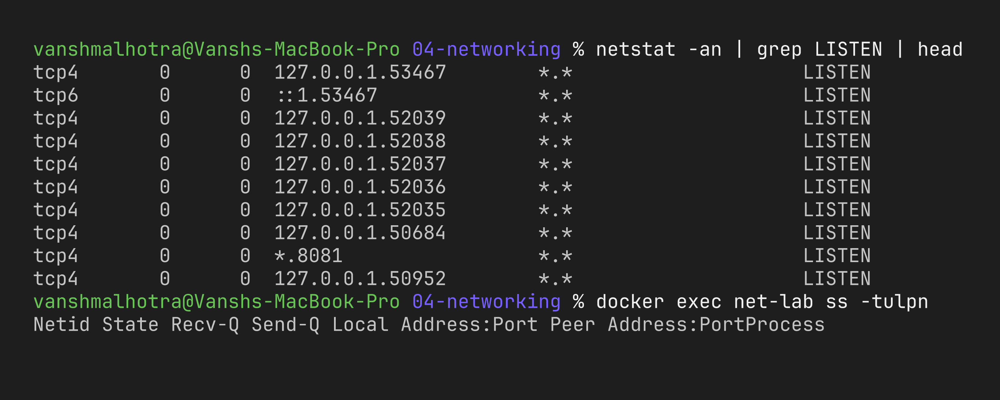

**What I understood:** shows which ports are open and which programs are listening. `-t` TCP, `-u` UDP, `-l` listening, `-p` process, `-n` numeric. I use this to check "is my app really listening on port 8080?". `ss` is the newer, faster replacement for `netstat` on Linux.

### 8. `route` / `ip route` – routing table

```bash
netstat -rn | head       # macOS
ip route                 # Linux
```

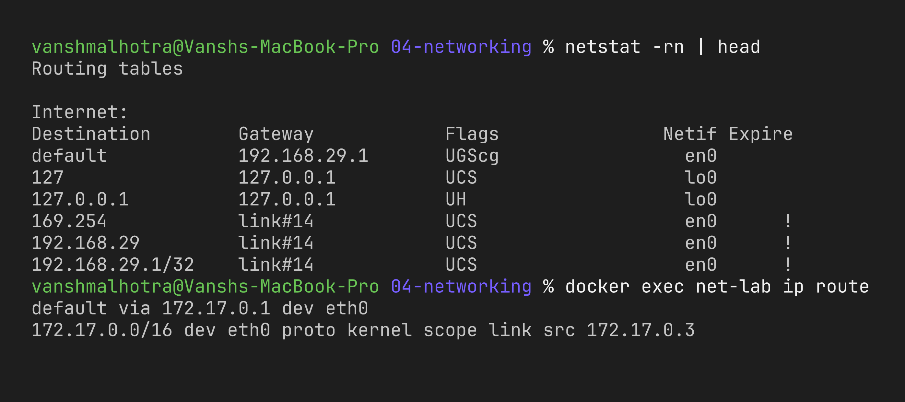

**What I understood:** the routing table decides where packets go. The `default` route points to my gateway (router) – anything not on my local network is sent there.

### 9. `arp -a` – IP to MAC mapping

```bash
arp -a
```

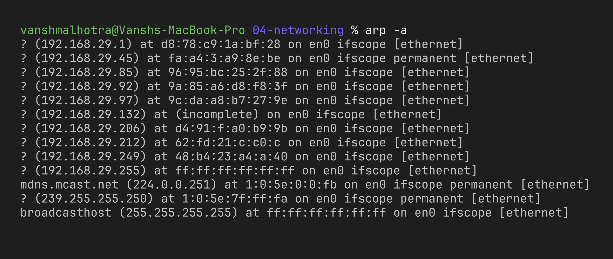

**What I understood:** ARP maps IP addresses to MAC addresses on the local network. The entry for my gateway IP shows my router's MAC address.

### 10. `curl` – make HTTP requests

```bash
curl -sI https://example.com
curl -s -o /dev/null -w "HTTP %{http_code} from %{remote_ip}\n" https://api.github.com
```

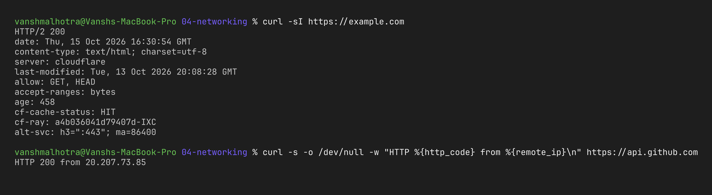

**What I understood:** `curl` talks to web servers from the terminal. `-I` shows only the headers (status code, server, content type). `HTTP 200` means OK. I'll use this a lot to test APIs and containers later.

### 11. `wget` – download files

```bash
wget https://example.com -O example.html
ls -l example.html
```

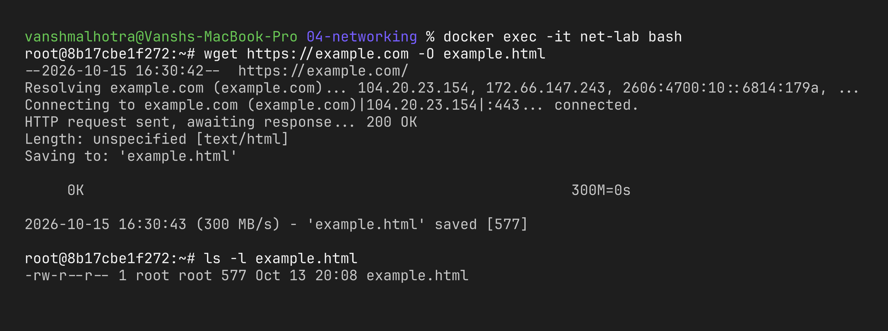

**What I understood:** `wget` is mainly for downloading files (it can resume and download recursively), while `curl` is more for talking to APIs. (wget isn't installed on my Mac by default, so I ran this one inside the Ubuntu container; `brew install wget` also works.)

### 12. `nc` (netcat) – test if a port is open

```bash
nc -zv google.com 443
```

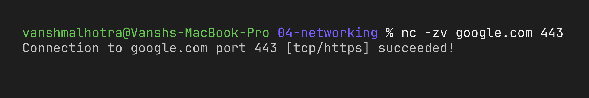

**What I understood:** ping only checks if the host is up, but `nc -z` checks if a specific **port** is reachable. Very useful when debugging firewalls or security groups.

### Quick summary

| Purpose | macOS | Linux |
| :--- | :--- | :--- |
| Show IP | `ifconfig` | `ip addr`, `hostname -I` |
| Reachability | `ping -c 4 host` | `ping -c 4 host` |
| DNS | `nslookup`, `dig` | `nslookup`, `dig`, `host` |
| Path | `traceroute` | `traceroute`, `mtr` |
| Open ports | `netstat -an`, `lsof -i` | `ss -tulpn` |
| Routes | `netstat -rn` | `ip route` |
| ARP | `arp -a` | `ip neigh` |
| HTTP | `curl`, `wget` | `curl`, `wget` |
| Port test | `nc -zv host port` | `nc -zv host port` |
