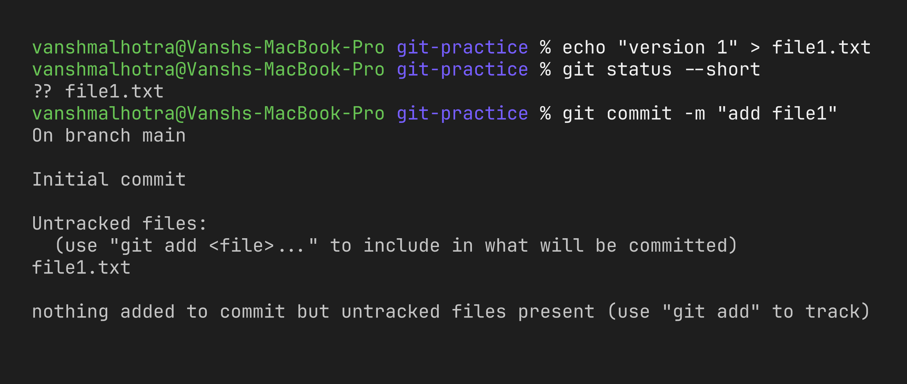
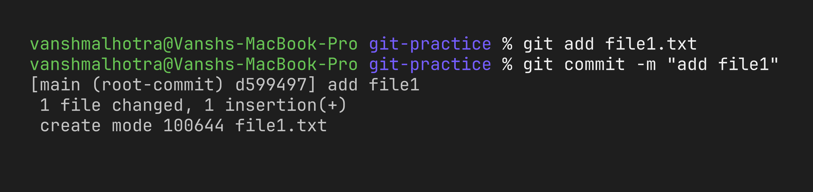
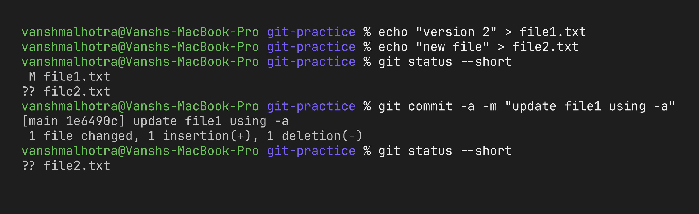
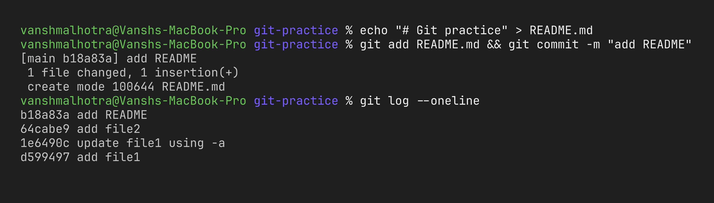
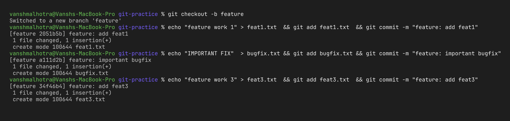
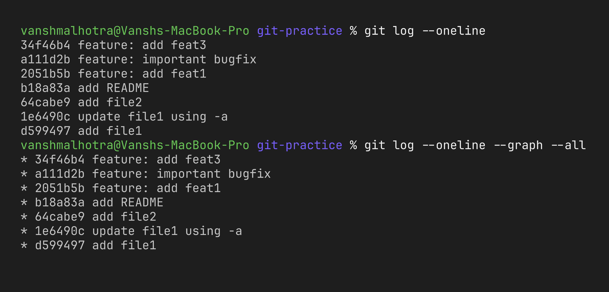
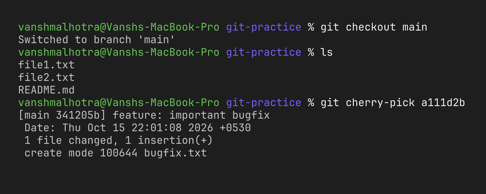
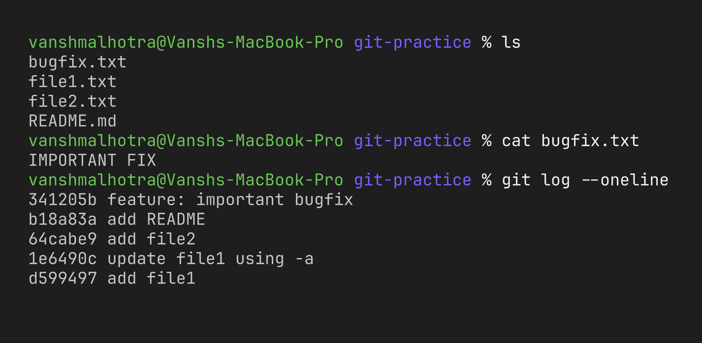

# Session 5 – Git & GitHub

**Name:** Vansh Malhotra  
**Roll No:** 24bcs10268

I did both tasks in a fresh practice repository so I don't mess up any real project. All commands are also in [`git-practice.sh`](./git-practice.sh) in the order I ran them (I ran them by hand step by step to take screenshots).

```bash
mkdir -p /tmp/git-practice && cd /tmp/git-practice
git init -b main
```

---

## Task 1: `git commit -m` vs `git commit -a -m`

### What I learnt

| Command | What it does |
| :--- | :--- |
| `git commit -m "msg"` | Commits **only what is already staged** (added with `git add`). Changed files that weren't added are left out. |
| `git commit -a -m "msg"` | Automatically stages **all modified and deleted tracked files** and commits them – so it skips the `git add` step. |

The catch: `-a` only works for files Git is already **tracking**. A brand new (untracked) file is never included by `-a`; it still needs `git add` the first time.

### Test 1 – `git commit -m` without staging

```bash
echo "version 1" > file1.txt
git status --short
git commit -m "add file1"
```



### Test 2 – stage first, then `git commit -m`

```bash
git add file1.txt
git commit -m "add file1"
```



### Test 3 – modify a tracked file + create a new file, then `git commit -a -m`

```bash
echo "version 2" > file1.txt       # tracked file changed
echo "new file" > file2.txt        # untracked file
git status --short
git commit -a -m "update file1 using -a"
git status --short
```



### What I observed

- `git commit -m` alone did nothing because nothing was staged.
- `git commit -a -m` picked up the change in `file1.txt` automatically – no `git add` needed.
- `file2.txt` was **not** committed by `-a` because it was untracked. I had to `git add file2.txt` and commit it normally.
- So `-a -m` is a shortcut for "commit all my edits to existing files", but it can also accidentally commit edits I didn't want, so I should check `git status` first.

```bash
git add file2.txt && git commit -m "add file2"
```

---

## Task 2: Git Cherry-Pick

**Cherry-pick** copies one specific commit from another branch onto the current branch, without merging the entire branch. Useful when, for example, one bug fix on a feature branch is needed on `main` right now.

### Step 1 – commits on `main`

Together with the commits from Task 1 I added one more, so `main` has 4 commits:

```bash
echo "# Git practice" > README.md
git add README.md && git commit -m "add README"
git log --oneline
```



### Step 2 – new branch with 3 commits

```bash
git checkout -b feature
echo "feature work 1" > feat1.txt  && git add feat1.txt  && git commit -m "feature: add feat1"
echo "IMPORTANT FIX"  > bugfix.txt && git add bugfix.txt && git commit -m "feature: important bugfix"
echo "feature work 3" > feat3.txt  && git add feat3.txt  && git commit -m "feature: add feat3"
```



### Step 3 – find the commit I want

```bash
git log --oneline
git log --oneline --graph --all
```



I picked the **"feature: important bugfix"** commit – I only want the fix on main, not feat1/feat3.

### Step 4 – cherry-pick into `main`

```bash
git checkout main
ls                                   # bugfix.txt is not here yet
git cherry-pick <hash-of-bugfix-commit>
```



### Step 5 – verify on `main`

```bash
ls
cat bugfix.txt
git log --oneline
```



### What I observed

- Only the bugfix commit came to `main`; `feat1.txt` and `feat3.txt` stayed only on `feature`.
- The cherry-picked commit on `main` has a **different hash** from the original on `feature` but the **same message and the same change**. That's because a commit hash depends on its parent, and the parent is different on `main`.
- If there's a conflict, I fix the files, `git add` them and run `git cherry-pick --continue` (or `--abort` to cancel).

### Cherry-pick cheat sheet

```bash
git cherry-pick <hash>            # one commit
git cherry-pick <hash1> <hash2>   # several commits
git cherry-pick A..B              # a range (A excluded)
git cherry-pick --continue        # after fixing a conflict
git cherry-pick --abort           # cancel
```

Cleanup when done: `rm -rf /tmp/git-practice`.
