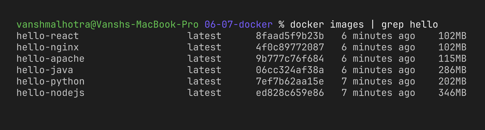
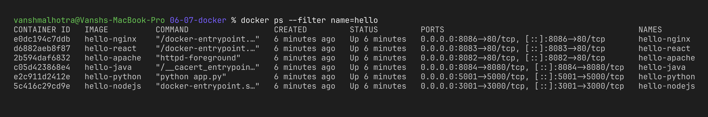
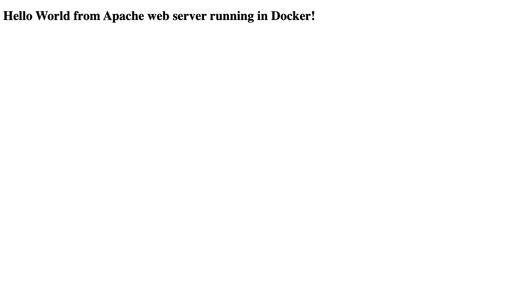
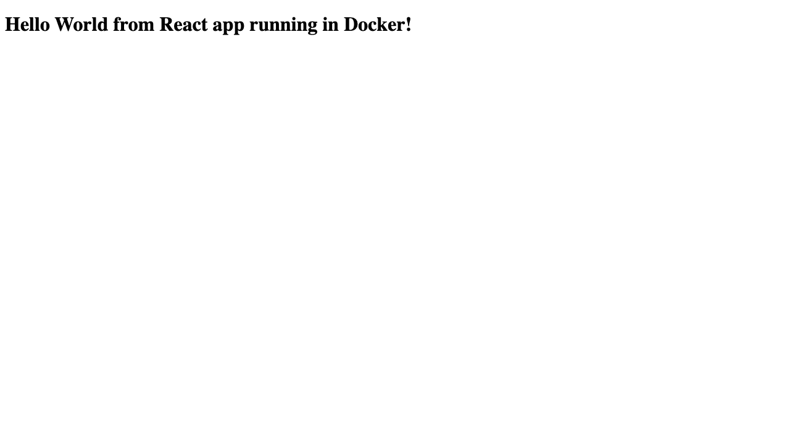
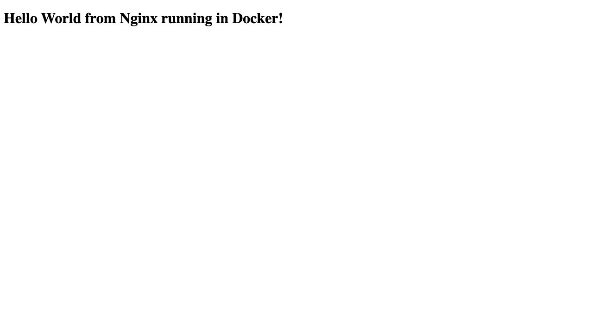
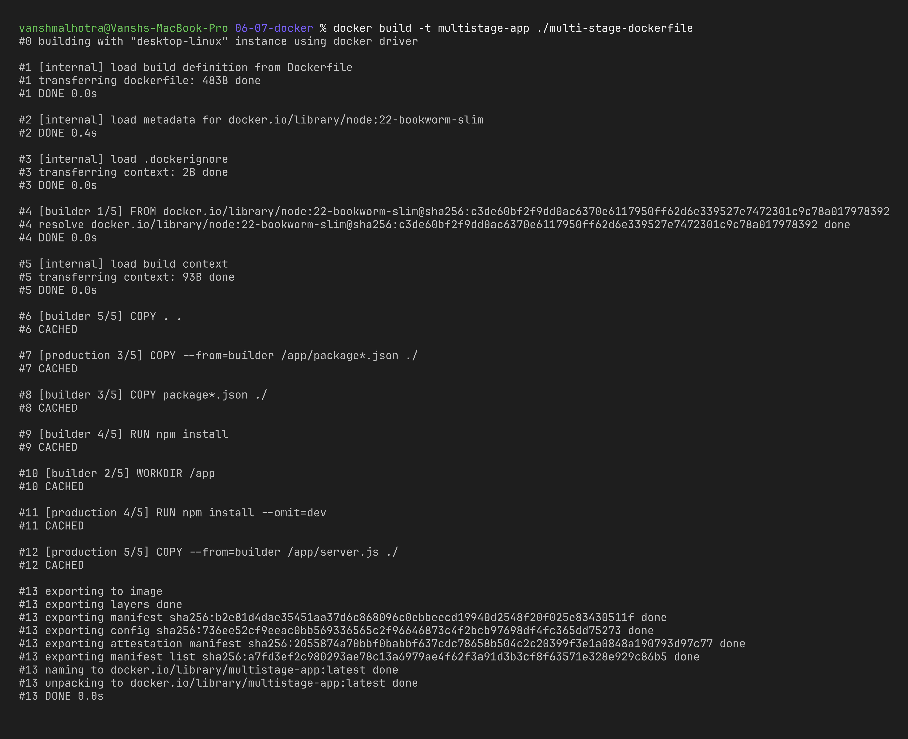
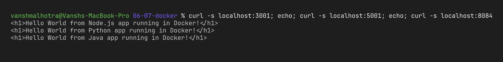

# Session 6 & 7 – Docker Fundamentals, Docker Images & Multi-Stage Builds

**Name:** Vansh Malhotra  
**Roll No:** 24bcs10268

In these two sessions I learnt how to put an application inside a Docker image, run it as a container and open it in the browser. I made six small "Hello World" apps in different languages/servers, and then I tried a multi-stage Dockerfile to see how it makes the final image smaller.

---

## Session 6 – Hello World Applications

Each app is in its own folder with its code and its own `Dockerfile`:

| Folder | What it is | Base image | Port inside container | Port on my laptop |
| :--- | :--- | :--- | :--- | :--- |
| `nodejs-app/` | Node.js server (built-in `http` module) | `node:22-bookworm-slim` | 3000 | 3001 |
| `python-app/` | Python server (built-in `http.server`) | `python:3.13-slim` | 5000 | 5001 |
| `java-app/` | Java 21 server (`com.sun.net.httpserver`) | `eclipse-temurin` JDK → JRE | 8080 | 8084 |
| `Apache-app/` | Static page served by Apache httpd | `httpd:alpine` | 80 | 8082 |
| `React-app/` | React + Vite app, built then served by nginx | `node` → `nginx:alpine` | 80 | 8083 |
| `nginx-app/` | Static page served by nginx | `nginx:alpine` | 80 | 8086 |

I gave every app a different host port so all six can run at the same time without a "port is already allocated" error.

### Step 1 – Build all the images

```bash
cd assignments-solution/06-07-docker

docker build -t hello-nodejs ./nodejs-app
docker build -t hello-python ./python-app
docker build -t hello-java   ./java-app
docker build -t hello-apache ./Apache-app
docker build -t hello-react  ./React-app
docker build -t hello-nginx  ./nginx-app

docker images | grep hello
```



### Step 2 – Run all the containers

```bash
docker run -d --name hello-nodejs -p 3001:3000 hello-nodejs
docker run -d --name hello-python -p 5001:5000 hello-python
docker run -d --name hello-java   -p 8084:8080 hello-java
docker run -d --name hello-apache -p 8082:80   hello-apache
docker run -d --name hello-react  -p 8083:80   hello-react
docker run -d --name hello-nginx  -p 8086:80   hello-nginx

docker ps --filter name=hello    # only my hello-* containers (I have other containers running too)
```

`-d` runs the container in the background, and `-p host:container` connects a port on my laptop to the port the app listens on inside the container.



### Step 3 – Check "Hello World" in the browser

**Node.js** → http://localhost:3001


**Python** → http://localhost:5001


**Java** → http://localhost:8084


**Apache** → http://localhost:8082



**React** → http://localhost:8083



**Nginx** → http://localhost:8086



**What I observed:** All six pages showed their Hello World message. The React page is a bit different – if I `curl` it I only get an empty `<div id="root">` and a JS file, because React draws the text in the browser using JavaScript. So for React the browser screenshot is the real proof, not curl.

---

## Session 7 – Task 1: Multi-Stage Dockerfile

The code is in [`multi-stage-dockerfile/`](./multi-stage-dockerfile/). It is a small Express server that prints **Hello World from Docker multi-stage build** on port **8080**.

```dockerfile
# Stage 1: Build
FROM node:22-bookworm-slim AS builder
WORKDIR /app
COPY package*.json ./
RUN npm install
COPY . .

# Stage 2: Production
FROM node:22-bookworm-slim AS production
WORKDIR /app
COPY --from=builder /app/package*.json ./
RUN npm install --omit=dev
COPY --from=builder /app/server.js ./
EXPOSE 8080
CMD ["npm", "start"]
```

### Why multi-stage?

In a normal Dockerfile everything you used to build the app (compilers, dev dependencies, source files, caches) stays inside the final image. With multi-stage I can have one stage that does the heavy building and then start a **fresh** stage and only `COPY --from=builder` the things needed to run. Benefits I noted:

- **Smaller image** → faster to push/pull and less disk used.
- **More secure** → fewer tools and packages inside the image means fewer things that can have vulnerabilities.
- **Clean separation** → build stuff and runtime stuff are clearly separated in one Dockerfile.

You can see it clearly in my `java-app` (JDK for compiling, only JRE for running) and `React-app` (Node to build, only nginx to serve the static files).

### Steps

```bash
cd assignments-solution/06-07-docker

# 1. build the image
docker build -t multistage-app ./multi-stage-dockerfile

# 2. run the container on port 8080
docker run -d --name multistage -p 8080:8080 multistage-app

# 3. access the app
curl http://localhost:8080

# 4. check the running container
docker ps
```



The full write-up for Task 2 (with my name, enrollment number and the proof screenshots) is in [`multi-stage-build.md`](./multi-stage-build.md).

---

## Session 7 – Task 3: Docker Application Deployment

I deployed three different types of applications with Docker (they are the same apps from Session 6):

1. **Node.js** – `hello-nodejs` → http://localhost:3001
2. **Python** – `hello-python` → http://localhost:5001
3. **Java** – `hello-java` → http://localhost:8084

(Apache, nginx and React were also deployed above, so in total I did 6 types.)



---

## Commands I used

```bash
docker build -t <name> <folder>     # build an image from a Dockerfile
docker images                       # list images
docker run -d -p HOST:CTR <image>   # run container in background with port mapping
docker ps                           # list running containers
docker logs <container>             # see what the app printed
docker exec -it <container> sh      # open a shell inside a container
docker stop <container>             # stop it
docker rm <container>               # delete it
```

### Cleanup

```bash
docker rm -f hello-nodejs hello-python hello-java hello-apache hello-react hello-nginx multistage
```
