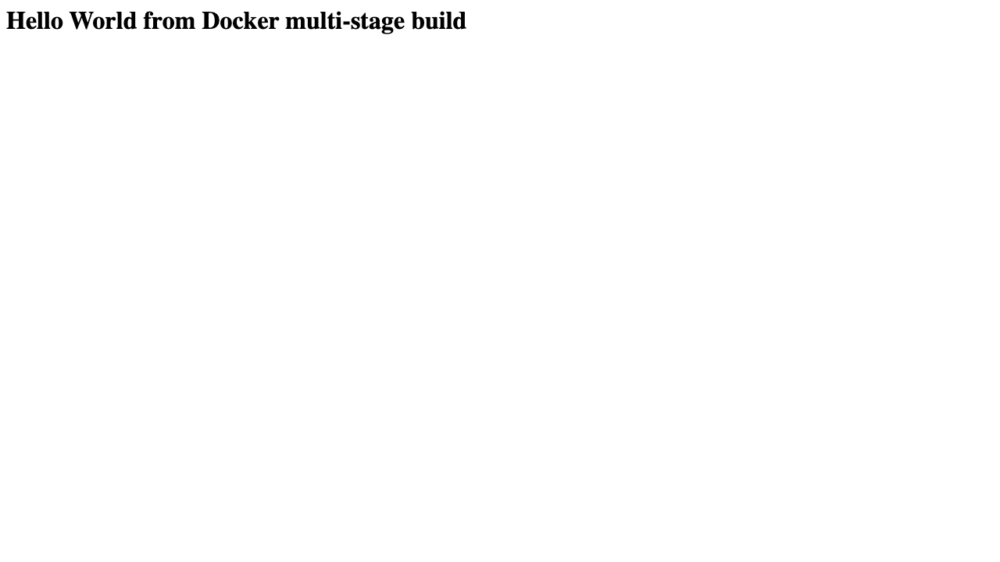
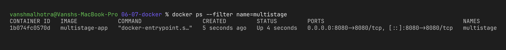

# Docker Multi-Stage Build – Documentation

**Name:** Vansh Malhotra  
**Enrollment Number:** 24bcs10268

## What I did

1. Took the multi-stage Dockerfile project (folder [`multi-stage-dockerfile/`](./multi-stage-dockerfile/)).
2. Built the image with the multi-stage Dockerfile.
3. Ran a container from it, mapping port 8080.
4. Opened the app and checked that it shows **Hello World from Docker multi-stage build**.
5. Checked the running container with `docker ps` to confirm it is on port 8080.

```bash
cd assignments-solution/06-07-docker
docker build -t multistage-app ./multi-stage-dockerfile
docker run -d --name multistage -p 8080:8080 multistage-app
curl http://localhost:8080
docker ps
```

## Proof 1 – Application running successfully



## Proof 2 – `docker ps` showing the container on port 8080



## What I understood

The first stage (`builder`) installs the npm packages and copies the code. The second stage (`production`) starts again from a clean base image, installs only the production dependencies and copies just `server.js`. So the final image doesn't carry anything extra from the build stage. The `-p 8080:8080` flag is what lets me open the app from my laptop's browser.
