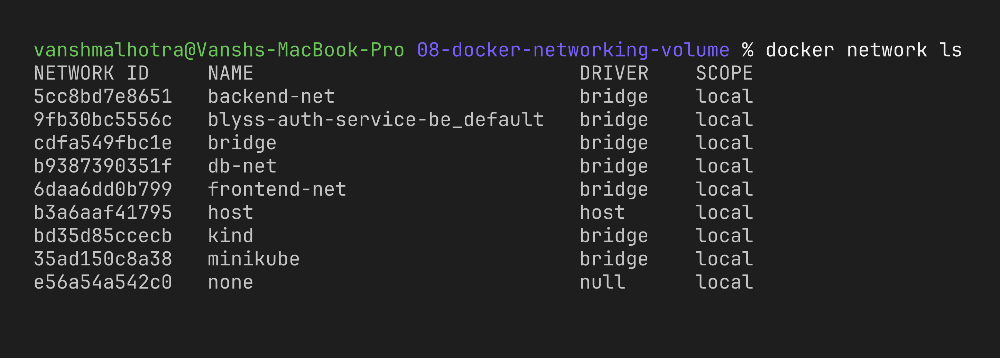
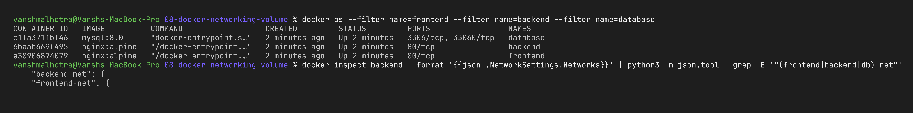
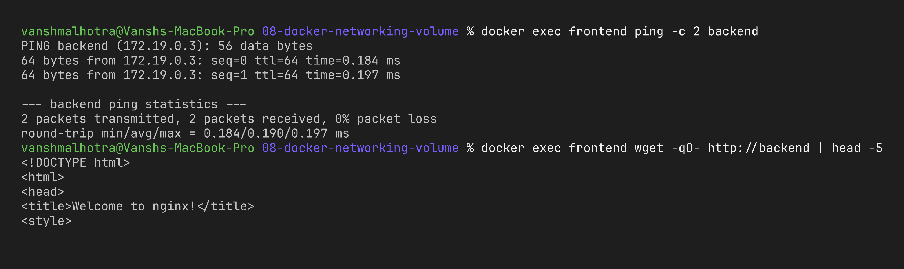
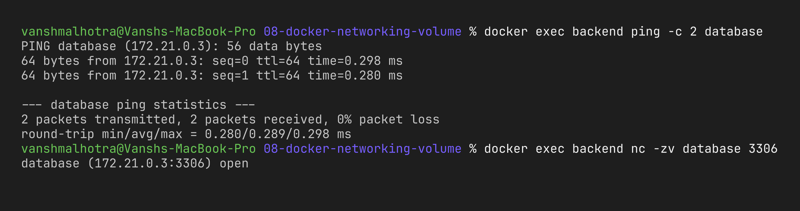
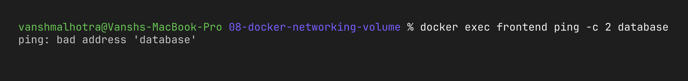
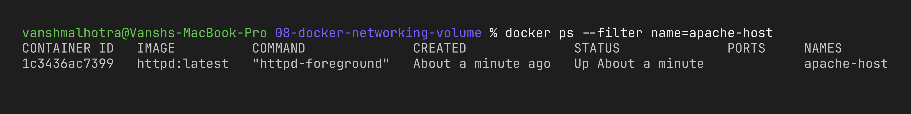
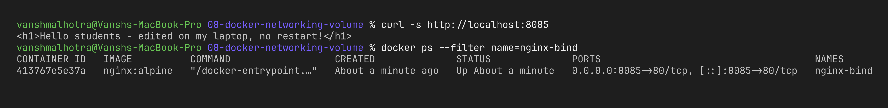

# Session 8 – Docker Networking & Volumes

**Name:** Vansh Malhotra  
**Roll No:** 24bcs10268

In this session I learnt how containers talk to each other using Docker networks, what host networking does, how bind mounts let me edit files live, and what overlay networks are for.

---

## Task 1 – Container Networking (Frontend, Backend, Database)

### My plan

- 3 containers: **frontend** (nginx), **backend** (nginx), **database** (MySQL 8).
- 3 user-defined bridge networks: `frontend-net`, `backend-net`, `db-net`.
- The **backend** is connected to **2 networks** (`frontend-net` and `backend-net`), so it is the "middle man".
- The frontend should reach the backend, the backend should reach the database, but the frontend should **not** be able to reach the database directly.

```text
   frontend-net                 backend-net                  db-net
 ┌─────────────────────┐   ┌──────────────────────┐   ┌─────────────┐
 │ frontend   backend ─┼───┼─ backend   database ─┼───┼─ database   │
 │ (nginx)    (nginx)  │   │ (nginx)    (mysql)   │   │ (mysql)     │
 └─────────────────────┘   └──────────────────────┘   └─────────────┘
```

### Commands

```bash
# create 3 networks
docker network create frontend-net
docker network create backend-net
docker network create db-net
docker network ls

# create the 3 containers
docker run -d --name frontend --network frontend-net nginx:alpine
docker run -d --name backend  --network frontend-net nginx:alpine
docker run -d --name database --network db-net \
  -e MYSQL_ROOT_PASSWORD=rootpass -e MYSQL_DATABASE=appdb mysql:8.0

# put backend on a 2nd network, and database on backend-net too
docker network connect backend-net backend
docker network connect backend-net database

# check backend really has 2 networks
docker inspect backend --format '{{json .NetworkSettings.Networks}}' | python3 -m json.tool | grep -E '"(frontend|backend|db)-net"'
```





### Connectivity checks

MySQL takes around 20–30 seconds to start, so I waited a bit before testing port 3306.

```bash
# 1. frontend -> backend (same network: frontend-net)  → should WORK
docker exec frontend ping -c 2 backend
docker exec frontend wget -qO- http://backend | head -5

# 2. backend -> database (same network: backend-net)   → should WORK
docker exec backend ping -c 2 database
docker exec backend nc -zv database 3306

# 3. frontend -> database (no common network)           → should FAIL
docker exec frontend ping -c 2 database
```







### What I observed

- On a **user-defined** network, Docker has its own DNS, so containers can find each other just by **container name** (`backend`, `database`). On the default `bridge` network this name lookup does not work.
- The frontend could not even resolve the name `database` because they don't share any network. This is network isolation – the frontend can only get data through the backend, which is how a real 3-tier app should be.
- One container can be on many networks. The backend got one IP address per network.

---

## Task 2 – Host Network (Apache2)

```bash
docker pull httpd:latest
docker run -d --name apache-host --network host httpd:latest
docker ps
curl http://localhost:80
```

With `--network host` the container does **not** get its own network – it uses the host's network directly. That's why I didn't use `-p 80:80`; Apache just binds to port 80 of the host. (If I add `-p` with host network, Docker ignores it and prints a warning.)

**Note for Mac:** On Linux this works straight away. On Docker Desktop for Mac, containers actually run inside a small Linux VM, so the "host" is that VM and not my Mac. Host networking on Mac only works on **Docker Desktop 4.34 or newer** after turning on **Settings → Resources → Network → Enable host networking** and restarting Docker Desktop. Without this setting, `localhost:80` on the Mac won't show the Apache page. Also port 80 must be free (nothing else running on it).




### What I observed

Apache was reachable directly on port 80 with no port mapping. Host networking is a bit faster (no NAT) but there is no isolation, and two containers can't both use port 80 on the same host.

---

## Task 3 – Bind Mount

The folder is [`bindmount-site/`](./bindmount-site/) and its `index.html` just says `Hello students`.

```bash
cd assignments-solution/08-docker-networking-volume

# (how I created it)
mkdir -p bindmount-site
echo '<h1>Hello students</h1>' > bindmount-site/index.html

# mount the folder into nginx's web root
docker run -d --name nginx-bind -p 8085:80 \
  -v "$(pwd)/bindmount-site":/usr/share/nginx/html nginx:alpine

curl http://localhost:8085
```


Now I changed the file **on my laptop**, without touching the container:

```bash
echo '<h1>Hello students - edited on my laptop, no restart!</h1>' > bindmount-site/index.html
curl http://localhost:8085
docker ps --filter name=nginx-bind    # STATUS still shows the same "Up X minutes"
```



After taking the screenshot I put the file back to the original:

```bash
echo '<h1>Hello students</h1>' > bindmount-site/index.html
```

### What I observed

A bind mount connects a folder on my machine directly to a folder inside the container. Both sides see the same files, so any change shows up instantly – no rebuild and no restart. This is really useful during development. The difference from a **named volume** (`docker volume create`) is that a volume is managed by Docker and stored in Docker's own area, while a bind mount uses any path I choose on the host.

---

## Task 4 – Overlay Network (Research)

### What is it?

An overlay network is a Docker network that **spans multiple Docker hosts**. Containers running on different machines can talk to each other as if they were on the same LAN, using container/service names.

A normal `bridge` network only works on **one** host. Overlay is for clusters.

### How it works across hosts

- Overlay networks need **Docker Swarm** mode (`docker swarm init` on a manager, `docker swarm join` on workers).
- The swarm managers keep track of the network (which containers are on it and their IPs) and share this info with all nodes.
- Docker uses **VXLAN**: when a container on Host A sends a packet to a container on Host B, the packet is wrapped (encapsulated) inside a UDP packet (port **4789**) and sent over the real network between the hosts. Host B unwraps it and delivers it to the right container. Each container just thinks it's on a normal network.
- Ports needed between hosts: **2377/tcp** (swarm management), **7946/tcp+udp** (node discovery), **4789/udp** (VXLAN data).
- Traffic can also be encrypted with `--opt encrypted` (uses IPsec).

### Use cases

- Swarm services that have replicas on many nodes (e.g. web on node 1, database on node 2).
- Microservices that need to find each other by name across machines.
- Built-in load balancing between replicas of a service across the cluster.
- Using `--attachable` so even normal `docker run` containers can join the overlay (useful for debugging).

### Example commands

```bash
docker swarm init
docker network create -d overlay --attachable my-overlay
docker service create --name web --network my-overlay --replicas 3 nginx:alpine
docker run -it --rm --network my-overlay alpine ping -c 2 web

# cleanup
docker service rm web
docker network rm my-overlay
docker swarm leave --force
```

### Bridge vs Host vs Overlay (my summary)

| Network | Scope | Isolation | When I would use it |
| :--- | :--- | :--- | :--- |
| bridge | single host | yes, own IP per container | normal single-machine apps |
| host | single host | no, shares host network | when I need max performance or many ports |
| overlay | many hosts | yes | Swarm clusters / multi-host apps |

In Kubernetes the same idea (pods on different nodes talking to each other) is done by CNI plugins like Flannel or Calico, many of which also use VXLAN.

---

## Cleanup

```bash
docker rm -f frontend backend database apache-host nginx-bind
docker network rm frontend-net backend-net db-net
```
