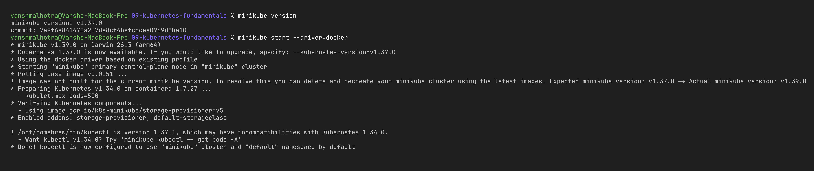
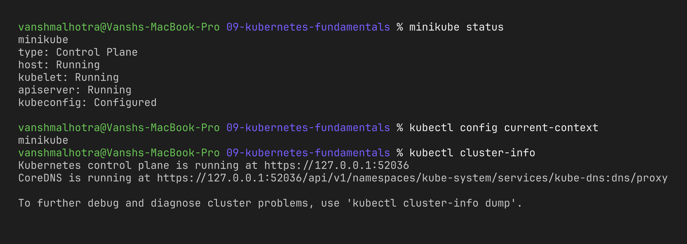
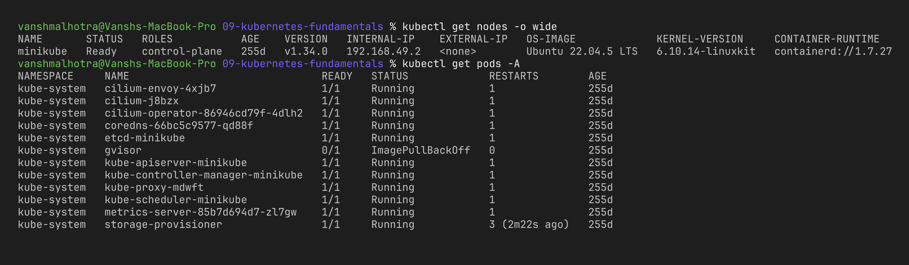
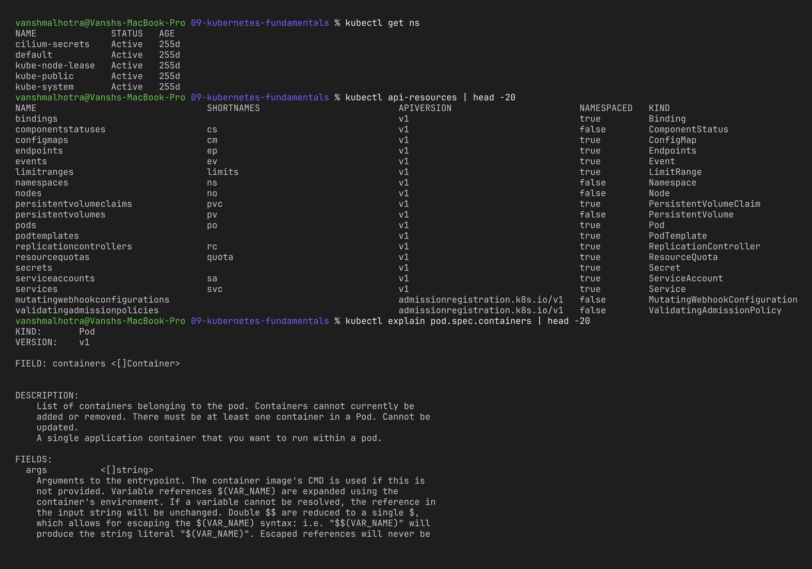
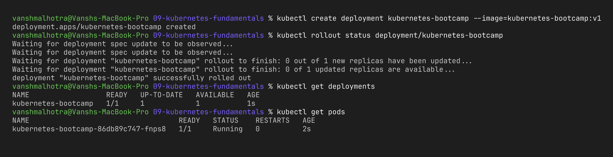
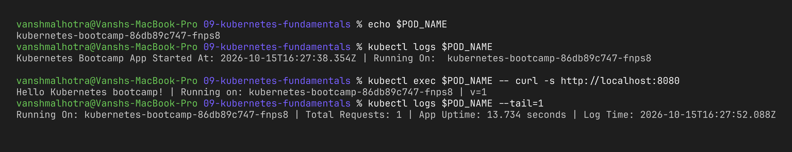
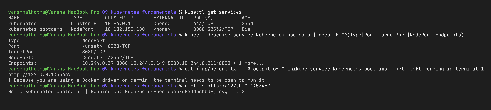
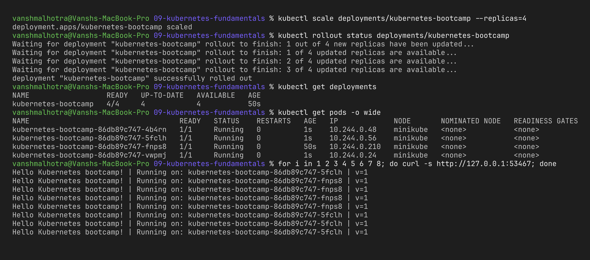
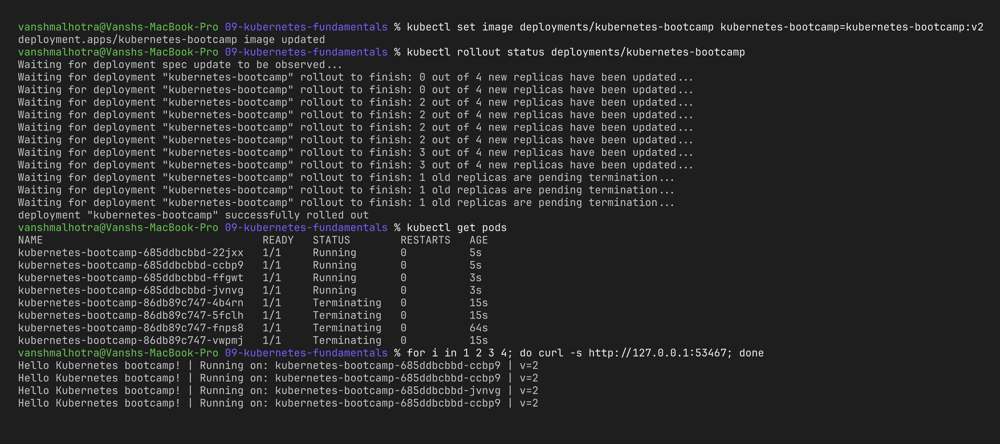
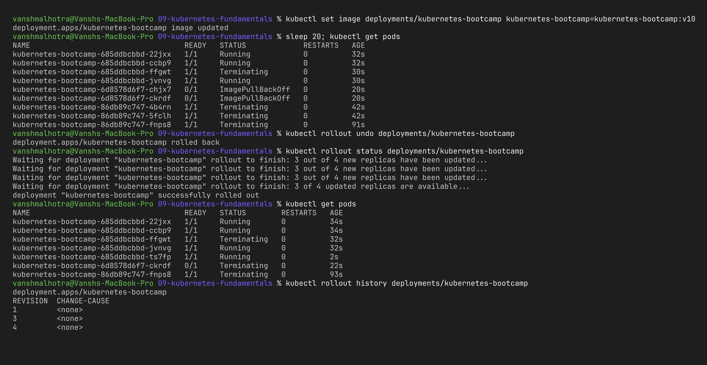

# Session 9 – Kubernetes Fundamentals

**Name:** Vansh Malhotra  
**Roll No:** 24bcs10268

In this session I installed Minikube on my Mac, started a local Kubernetes cluster, checked that it was healthy, studied the architecture and then did the official "Kubernetes Basics" tutorial by hand (deploy → explore → expose → scale → update).

---

## Task 1 – Install and configure Minikube

Minikube runs a single-node Kubernetes cluster on my laptop. Since I already have Docker Desktop, I used the Docker driver so Minikube runs as a container instead of a full VM.

```bash
# install (macOS)
brew install minikube
brew install kubectl          # skip if kubectl is already installed

minikube version
kubectl version --client

# start the cluster using Docker as the driver
minikube start --driver=docker

# (optional) make docker the default driver for next time
minikube config set driver docker
```

When `minikube start` finishes it also sets my kubectl context to `minikube`, so every `kubectl` command after this talks to the new cluster.



---

## Task 2 – Verify cluster status

```bash
minikube status                 # host, kubelet, apiserver, kubeconfig should all be Running/Configured
kubectl config current-context  # should print "minikube"
kubectl cluster-info            # address of the control plane + CoreDNS
kubectl get nodes -o wide       # one node called "minikube" in Ready state
kubectl get pods -A             # system pods in kube-system
```





What I observed: in `kube-system` I could actually see the control-plane components running as pods (`etcd-minikube`, `kube-apiserver-minikube`, `kube-scheduler-minikube`, `kube-controller-manager-minikube`) plus `coredns`, `kube-proxy` and `storage-provisioner`. So the architecture below is not just theory, it is visible inside the cluster.

---

## Task 3 – Kubernetes Architecture (short notes)

A Kubernetes cluster has two parts: the **control plane** (the brain that makes decisions) and the **worker nodes** (where my containers actually run). In Minikube both live on the same single node.

```text
                 kubectl / dashboard / CI
                           │
┌──────────────────── CONTROL PLANE ────────────────────┐
│                                                       │
│   kube-apiserver  ◄──►  etcd                          │
│        ▲   ▲                                          │
│        │   └──── kube-scheduler                       │
│        └──────── kube-controller-manager              │
│                  cloud-controller-manager (cloud only)│
└───────────────────────────┬───────────────────────────┘
                            │
┌──────────── WORKER NODE ──┴───────────────────────────┐
│   kubelet ──► container runtime (containerd/docker)   │
│   kube-proxy (Service networking rules)               │
│   [Pod] [Pod] [Pod]                                   │
└───────────────────────────────────────────────────────┘
```

### Control plane components

| Component | What it does (my understanding) |
| :--- | :--- |
| **kube-apiserver** | The front door of the cluster. Every request (kubectl, other components) goes through it. It validates the request and saves it in etcd. It is the only component that talks to etcd directly. |
| **etcd** | A distributed key-value database that stores the whole state of the cluster (all objects, their spec and status). If etcd is lost, the cluster "forgets" everything, so it is backed up in production. |
| **kube-scheduler** | Watches for new Pods that don't have a node yet and picks the best node based on CPU/memory requests, taints/tolerations, affinity rules etc. It only *decides*, it doesn't start the pod. |
| **kube-controller-manager** | Runs many control loops (Deployment, ReplicaSet, Node, Job, Endpoint controllers…). Each loop compares *desired state* with *actual state* and fixes the difference. Example: if a ReplicaSet wants 3 pods and only 2 exist, it creates one more. |
| **cloud-controller-manager** | Only on cloud clusters (EKS, GKE, AKS). Talks to the cloud provider's API to create load balancers, attach disks and manage node lifecycle. Minikube doesn't have a real one. |

### Worker node components

| Component | What it does |
| :--- | :--- |
| **kubelet** | Agent running on every node. It receives pod specs from the API server and makes sure those containers are running and healthy (it also runs the probes). |
| **kube-proxy** | Maintains network rules (iptables/IPVS) on the node so that traffic sent to a Service IP gets forwarded to one of the backing pods. |
| **Container runtime** | The software that actually pulls images and runs containers, e.g. containerd or CRI-O (talks to kubelet through CRI). |

### How a Deployment actually gets created (flow)

1. I run `kubectl apply -f deployment.yaml` → request goes to the **API server**.
2. API server validates it and stores it in **etcd**.
3. The **Deployment controller** notices the new Deployment and creates a ReplicaSet; the ReplicaSet controller creates Pod objects.
4. The **scheduler** sees Pods with no node and assigns them to a node.
5. The **kubelet** on that node sees the Pod assigned to it and asks the **container runtime** to start the containers.
6. **kube-proxy** updates rules so a Service can reach those pods.

---

## Task 4 – Basic Kubernetes objects and commands

### Objects I learnt

| Object | One-line meaning |
| :--- | :--- |
| **Pod** | Smallest deployable unit; one or more containers sharing network and storage. |
| **ReplicaSet** | Keeps a fixed number of identical pods running. |
| **Deployment** | Manages ReplicaSets and gives rolling updates and rollbacks. This is what we normally use. |
| **Service** | Stable IP/DNS name in front of a group of pods (pods come and go, the Service stays). |
| **Namespace** | Virtual partition inside the cluster to separate teams/environments. |
| **ConfigMap / Secret** | Configuration and sensitive data injected into pods. |
| **Node** | A machine (VM or physical) that runs pods. |

### Commands I practised

```bash
kubectl get nodes                          # list nodes
kubectl get pods                           # list pods in default namespace
kubectl get pods -A                        # pods in all namespaces
kubectl get all                            # pods, services, deployments, replicasets
kubectl get ns                             # namespaces
kubectl describe pod <pod-name>            # detailed info + events
kubectl logs <pod-name>                    # container logs
kubectl exec -it <pod-name> -- sh          # shell inside the container
kubectl apply -f file.yaml                 # create/update from YAML
kubectl delete -f file.yaml                # delete what the YAML created
kubectl explain deployment.spec            # built-in docs for any field
kubectl api-resources                      # all object types in the cluster
```



---

## Task 5 – Kubernetes Basics tutorial (hands-on)

I followed the 6 modules of the official tutorial (kubernetes.io → Tutorials → Learn Kubernetes Basics) but on my own Minikube instead of the browser playground.

### Module 1 & 2 – Create a cluster and deploy an app

**Apple Silicon note:** the tutorial image `gcr.io/google-samples/kubernetes-bootcamp:v1` (and `jocatalin/kubernetes-bootcamp:v2`) is built only for amd64. On my M-series Mac the pod went straight into `CrashLoopBackOff` with `exec /bin/sh: exec format error`. So I rebuilt the same tiny Node.js app for arm64 (code in [`bootcamp-arm64/`](bootcamp-arm64/), same responses: `Hello Kubernetes bootcamp! | Running on: <pod> | v=1`) and loaded it into Minikube:

```bash
docker build -t kubernetes-bootcamp:v1 --build-arg VERSION=1 bootcamp-arm64
docker build -t kubernetes-bootcamp:v2 --build-arg VERSION=2 bootcamp-arm64
minikube image load kubernetes-bootcamp:v1
minikube image load kubernetes-bootcamp:v2
```

(On an Intel machine the original `gcr.io/google-samples/kubernetes-bootcamp:v1` works as-is.)

```bash
kubectl create deployment kubernetes-bootcamp --image=kubernetes-bootcamp:v1
kubectl get deployments
kubectl get pods
```



### Module 3 – Explore the app (pods and nodes)

```bash
export POD_NAME=$(kubectl get pods -l app=kubernetes-bootcamp -o jsonpath='{.items[0].metadata.name}')
echo $POD_NAME
kubectl describe pod $POD_NAME
kubectl logs $POD_NAME
kubectl exec $POD_NAME -- env
kubectl exec -it $POD_NAME -- bash
# inside the container:
#   cat server.js
#   curl http://localhost:8080
#   exit
```



### Module 4 – Expose the app with a Service

```bash
kubectl expose deployment/kubernetes-bootcamp --type=NodePort --port=8080
kubectl get services
kubectl describe service kubernetes-bootcamp

# minikube gives me a URL that reaches the NodePort from my Mac
minikube service kubernetes-bootcamp --url
curl $(minikube service kubernetes-bootcamp --url)

# labels
kubectl get pods -l app=kubernetes-bootcamp
kubectl label pods $POD_NAME version=v1
kubectl describe pods $POD_NAME | grep -A3 Labels
```

Note: on macOS with the Docker driver, `minikube service --url` keeps a tunnel open in that terminal, so I ran it in one terminal and the `curl` in another.



### Module 5 – Scale the app

```bash
kubectl scale deployments/kubernetes-bootcamp --replicas=4
kubectl get deployments
kubectl get pods -o wide
kubectl describe deployments/kubernetes-bootcamp
# hit the service a few times, different pod names answer (load balancing)
for i in 1 2 3 4 5; do curl -s <url-from-minikube-service>; done

# scale back down
kubectl scale deployments/kubernetes-bootcamp --replicas=2
kubectl get pods
```



### Module 6 – Rolling update and rollback

```bash
kubectl set image deployments/kubernetes-bootcamp \
  kubernetes-bootcamp=kubernetes-bootcamp:v2     # tutorial: docker.io/jocatalin/kubernetes-bootcamp:v2
kubectl rollout status deployments/kubernetes-bootcamp
kubectl get pods
curl <url-from-minikube-service>          # now says v=2

# try a bad image (tag that doesn't exist) and roll back
kubectl set image deployments/kubernetes-bootcamp \
  kubernetes-bootcamp=kubernetes-bootcamp:v10
kubectl get pods                          # new pods stuck in ErrImagePull/ImagePullBackOff
kubectl rollout undo deployments/kubernetes-bootcamp
kubectl rollout status deployments/kubernetes-bootcamp
kubectl rollout history deployments/kubernetes-bootcamp
```





### Cleanup

```bash
kubectl delete service kubernetes-bootcamp
kubectl delete deployment kubernetes-bootcamp
minikube stop          # keeps the cluster, just stops it
# minikube delete      # removes the cluster completely
```

---

## What I learnt

- Minikube is the easiest way to get a real Kubernetes cluster on a laptop; with the Docker driver it starts in about a minute.
- The control plane components are themselves pods in `kube-system`, which made the architecture much easier to understand.
- Kubernetes is **declarative**: I tell it "I want 4 replicas" and the controllers keep working until that is true.
- Pods are temporary, so we never connect to pod IPs directly – a Service gives a stable endpoint.
- Rolling updates replace pods gradually with zero downtime, and if something goes wrong `kubectl rollout undo` brings the old version back.
