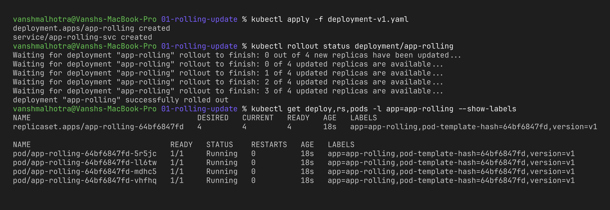
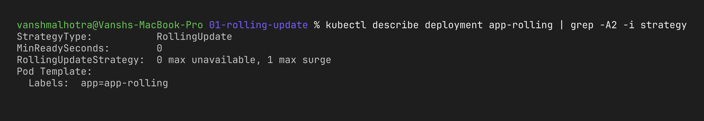
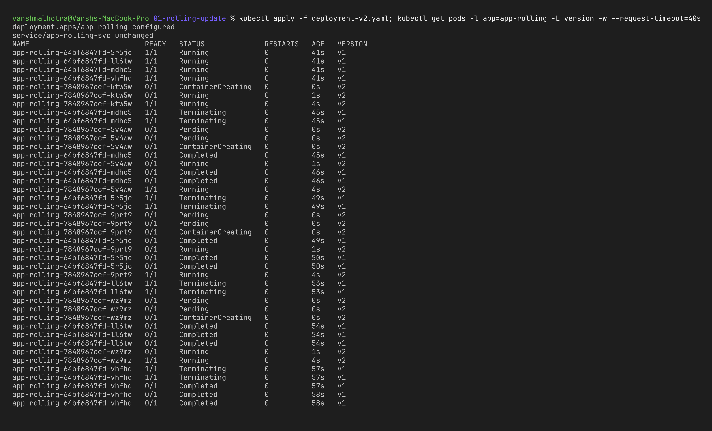
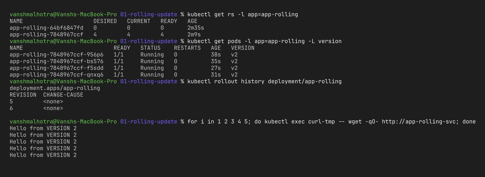

# Session 10 – Strategy 1: Rolling Update

**Name:** Vansh Malhotra  
**Roll No:** 24bcs10268

## What is a rolling update?

Rolling update is the default strategy of a Deployment. Instead of stopping everything, Kubernetes creates a new pod, waits for it to become **Ready**, and only then removes an old pod. It repeats this until all pods are on the new version, so users never see downtime.

Two settings control the speed:

- `maxSurge: 1` → during the update there can be at most **1 extra pod** (so 5 pods max for 4 replicas).
- `maxUnavailable: 0` → never go **below 4 ready pods**. Together this means "add one new, remove one old".

The `readinessProbe` is important here – without it Kubernetes would think a pod is ready the moment the container starts.

To make the versions easy to tell apart, v1 serves `Hello from VERSION 1` and v2 serves `Hello from VERSION 2`.

## Step 1 – Create the Deployment (v1)

```bash
kubectl apply -f deployment-v1.yaml
kubectl rollout status deployment/app-rolling
kubectl get deploy,rs,pods -l app=app-rolling --show-labels
```



## Step 2 – Check the rolling update configuration

```bash
kubectl describe deployment app-rolling | grep -A2 -i strategy
```



## Step 3 – Perform the update (v1 → v2)

I opened a second terminal to watch the pods live while the update runs:

```bash
# terminal 2
kubectl get pods -l app=app-rolling -L version -w

# terminal 1
kubectl apply -f deployment-v2.yaml
kubectl rollout status deployment/app-rolling
```



## Step 4 – Verify old and new pods

```bash
kubectl get rs -l app=app-rolling          # old RS scaled to 0, new RS has 4
kubectl get pods -l app=app-rolling -L version
kubectl rollout history deployment/app-rolling

# check the app actually serves v2
kubectl run curl-tmp --rm -it --image=busybox:1.36 --restart=Never -- \
  sh -c 'for i in 1 2 3 4 5; do wget -qO- http://app-rolling-svc; done'
```

(For the screenshots I kept one busybox pod running – `kubectl run curl-tmp --image=busybox:1.36 --restart=Never -- sleep 3600` – and ran the same loop from my Mac as `for i in 1 2 3 4 5; do kubectl exec curl-tmp -- wget -qO- http://app-rolling-svc; done`. The same `curl-tmp` pod is reused in the blue-green and canary folders.)



## Step 5 (bonus) – Rollback

```bash
kubectl rollout undo deployment/app-rolling
kubectl rollout status deployment/app-rolling
kubectl get pods -l app=app-rolling -L version   # back to v1
```


## What I observed

- During the update the number of pods went up to 5 for a moment, then back to 4 – exactly what `maxSurge: 1` says.
- There were always 4 ready pods, so the service never went down.
- The Deployment did not delete the old ReplicaSet, it just scaled it to 0. That old ReplicaSet is what makes `rollout undo` so quick.
- `rollout history` shows a new revision number every time the pod template changes.
