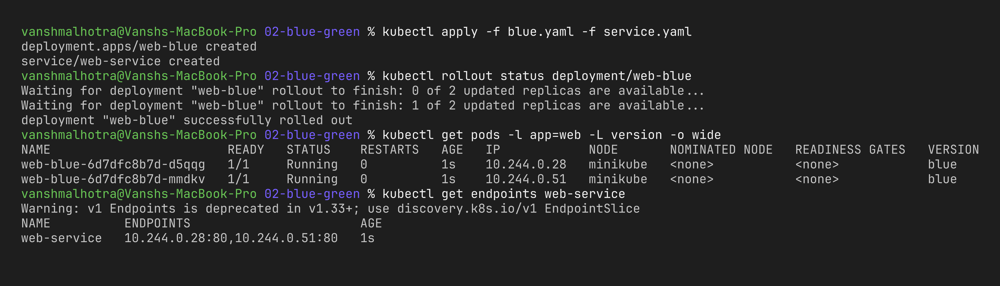
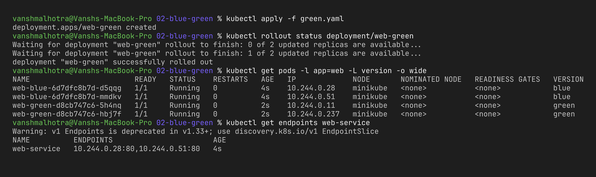
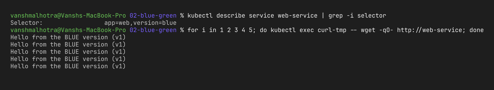
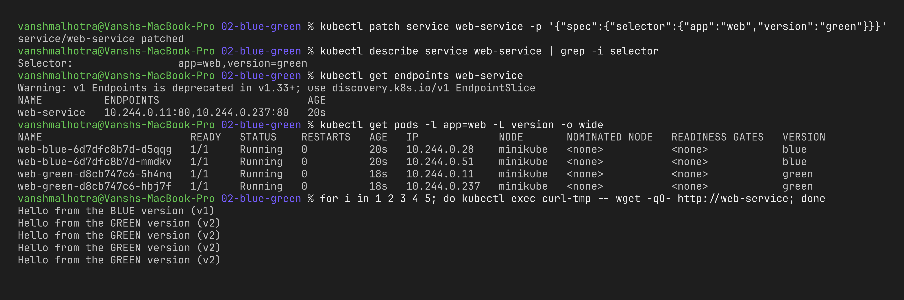

# Session 10 – Strategy 2: Blue-Green Deployment

**Name:** Vansh Malhotra  
**Roll No:** 24bcs10268

## What is Blue-Green?

In blue-green I run **two full copies** of the app at the same time:

- **Blue** = the current live version (v1)
- **Green** = the new version (v2)

Users only reach the version that the **Service selector** points to. When green is tested and ready, I change the selector from `version: blue` to `version: green` and **100% of traffic switches instantly**. If something breaks, I just flip it back.

Kubernetes doesn't have a built-in "blue-green" type – I built it using two Deployments + one Service with labels.

## Step 1 – Create the Blue version and the Service

```bash
kubectl apply -f blue.yaml
kubectl apply -f service.yaml
kubectl get deploy,pods -l app=web -L version
kubectl get endpoints web-service
```



## Step 2 – Create the Green version (not live yet)

```bash
kubectl apply -f green.yaml
kubectl get pods -l app=web -L version -o wide
kubectl get endpoints web-service          # still only blue IPs
```

Before switching I can test green directly, without touching users:

```bash
kubectl port-forward deployment/web-green 8081:80
# in another terminal
curl http://localhost:8081                 # Hello from the GREEN version (v2)
```



## Step 3 – Verify the active version (before switch)

```bash
kubectl run curl-tmp --rm -it --image=busybox:1.36 --restart=Never -- \
  sh -c 'for i in 1 2 3 4 5; do wget -qO- http://web-service; done'
```



(For the screenshots I ran the same loop from my Mac against a long-running busybox pod: `for i in 1 2 3 4 5; do kubectl exec curl-tmp -- wget -qO- http://web-service; done`.)

## Step 4 – Switch traffic to Green

```bash
kubectl patch service web-service -p '{"spec":{"selector":{"app":"web","version":"green"}}}'
kubectl describe service web-service | grep -i selector
kubectl get endpoints web-service          # now the green pod IPs
```

Then verify again:

```bash
kubectl run curl-tmp --rm -it --image=busybox:1.36 --restart=Never -- \
  sh -c 'for i in 1 2 3 4 5; do wget -qO- http://web-service; done'
```



## Step 5 – Rollback (switch back to Blue)

```bash
kubectl patch service web-service -p '{"spec":{"selector":{"app":"web","version":"blue"}}}'
kubectl get endpoints web-service
```

Once I'm happy with green, I can delete blue: `kubectl delete -f blue.yaml`.

## What I observed

- The switch was almost instant – the Service endpoints changed right away and no pods were restarted. In my loop the very first request (sent immediately after the patch) still got BLUE because the node's proxy rules take a moment to update; every request after that got GREEN.
- Both versions were running at the same time, so this needs **double the resources** during the release.
- Rollback is just one patch command, which is the biggest advantage of blue-green.
