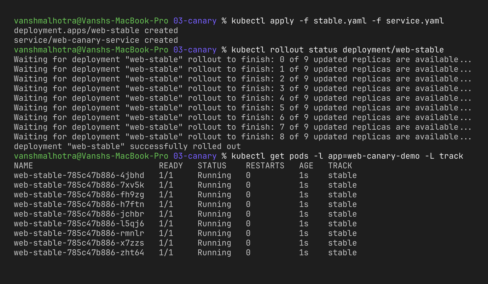
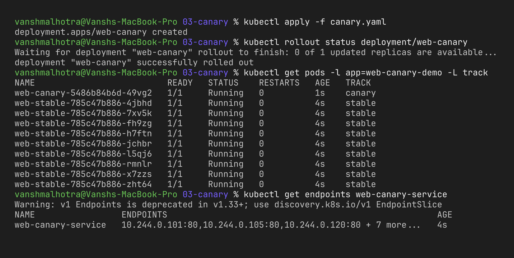
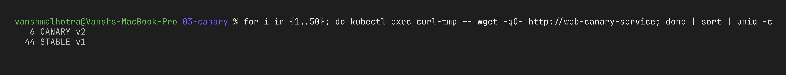
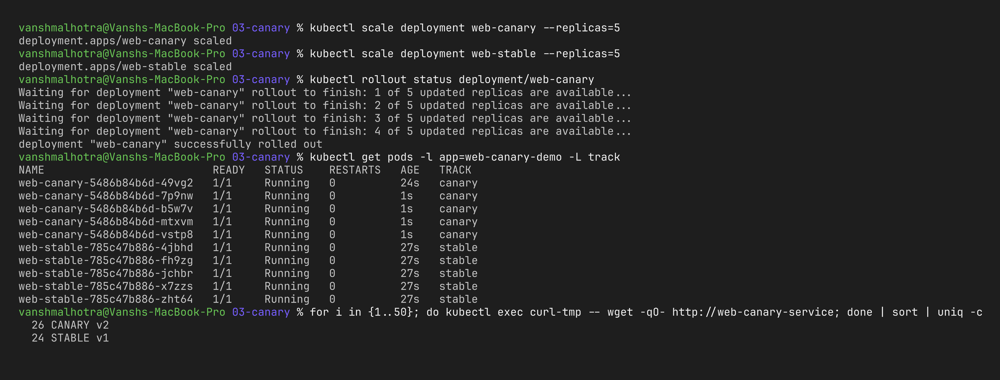

# Session 10 – Strategy 3: Canary Deployment

**Name:** Vansh Malhotra  
**Roll No:** 24bcs10268

## What is a Canary deployment?

The name comes from the "canary in a coal mine". The idea is to release the new version to a **small percentage of users** first. If the canary looks healthy (no errors, good latency), I slowly increase its share; if not, I delete it and only a few users were affected.

## How I split the traffic

Plain Kubernetes has no "send 10% here" setting, so I used the **replica ratio** trick:

- `web-stable` → **9 pods**, label `app: web-canary-demo, track: stable`
- `web-canary` → **1 pod**, label `app: web-canary-demo, track: canary`
- `web-canary-service` selects only `app: web-canary-demo`, so it load-balances across **all 10 pods**

1 out of 10 pods = roughly **10%** of requests go to the canary. (For exact percentages you'd use an Ingress controller with canary annotations or a service mesh like Istio.)

## Step 1 – Deploy the stable version

```bash
kubectl apply -f stable.yaml
kubectl apply -f service.yaml
kubectl get pods -l app=web-canary-demo -L track
```



## Step 2 – Deploy the canary version

```bash
kubectl apply -f canary.yaml
kubectl get pods -l app=web-canary-demo -L track
kubectl get endpoints web-canary-service      # 10 IPs behind one service
```



## Step 3 – Send traffic and verify both versions

I sent 50 requests from a temporary pod and counted the answers:

```bash
kubectl run curl-tmp --rm -it --image=busybox:1.36 --restart=Never -- \
  sh -c 'for i in $(seq 1 50); do wget -qO- http://web-canary-service; done | sort | uniq -c'
```

(For the screenshots I ran the same loop from my Mac against a long-running busybox pod: `for i in {1..50}; do kubectl exec curl-tmp -- wget -qO- http://web-canary-service; done | sort | uniq -c`. My run gave 44 × STABLE / 6 × CANARY.)

Expected result: around **45 × STABLE v1** and **5 × CANARY v2** (it's random, so it won't be exactly 45/5 every time).



## Step 4 – Promote or roll back

```bash
# canary looks good -> give it more traffic (5:5 = 50%)
kubectl scale deployment web-canary --replicas=5
kubectl scale deployment web-stable --replicas=5

# canary is bad -> remove it, 100% back on stable
kubectl delete -f canary.yaml
```



## What I observed

- With 9:1 replicas the canary got roughly 10% of the requests, and when I changed it to 5:5 it went to about 50%.
- Both versions were serving users at the same time under one Service – the label selector is what makes this work.
- The downside of the replica trick is that the percentage depends on pod count, so I can't do 1% without running 100 pods. That's why real projects use Ingress/Istio weights for canary.
