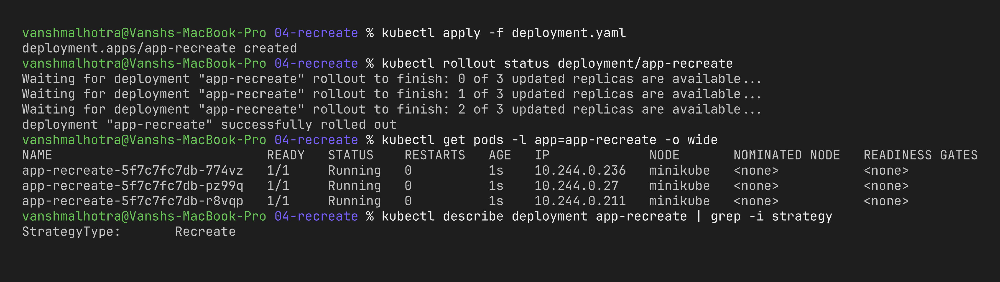
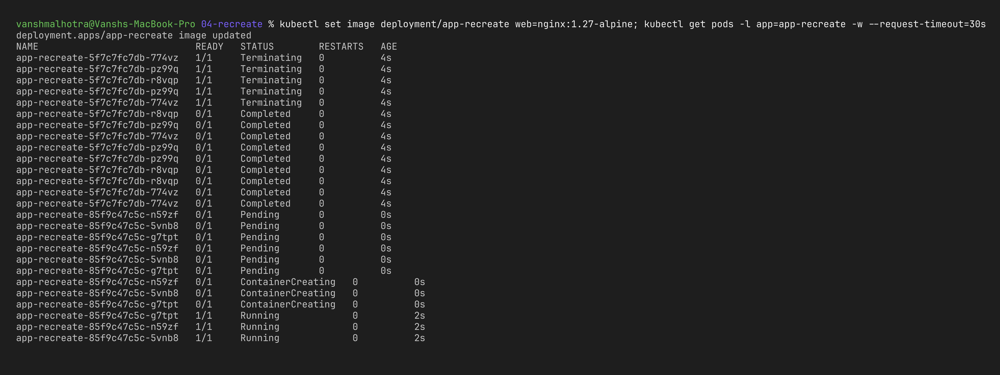
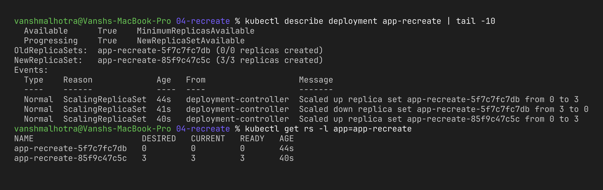

# Session 10 – Strategy 4: Recreate Deployment

**Name:** Vansh Malhotra  
**Roll No:** 24bcs10268

## What is Recreate?

With `strategy: type: Recreate` Kubernetes **terminates all the old pods first** and only after they are gone does it create the new pods. So for a short time there are **zero pods** and the app is down.

Why would anyone use it? When two versions **cannot run together** – for example the new version changes the database schema, or the app holds an exclusive lock on a file/volume (ReadWriteOnce).

## Step 1 – Deploy the application

```bash
kubectl apply -f deployment.yaml
kubectl rollout status deployment/app-recreate
kubectl get pods -l app=app-recreate -o wide
kubectl describe deployment app-recreate | grep -i strategy
```



## Step 2 – Update the application and watch

Terminal 2 (watch first):

```bash
kubectl get pods -l app=app-recreate -w
```

Terminal 1 (trigger the update):

```bash
kubectl set image deployment/app-recreate web=nginx:1.27-alpine
kubectl rollout status deployment/app-recreate
```



## Step 3 – Check the events

```bash
kubectl describe deployment app-recreate | tail -10
kubectl get rs -l app=app-recreate
```



## What I observed

- All old pods were terminated together, and new pods only started after that. There was a gap where no pod was Ready → **downtime**.
- In the events the old ReplicaSet was scaled to 0 first and the new one was scaled up after – opposite of rolling update where both happen in small steps.
- It's the simplest strategy and uses no extra resources, but I would only use it for dev/test or for apps that really can't run two versions at once.
