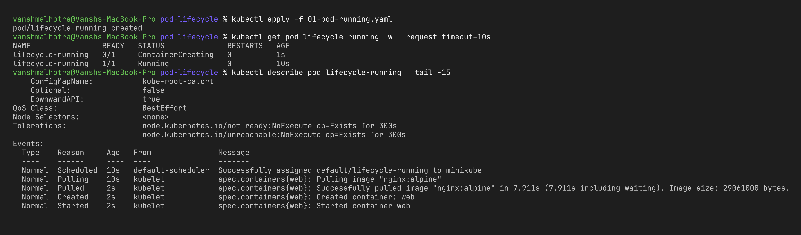
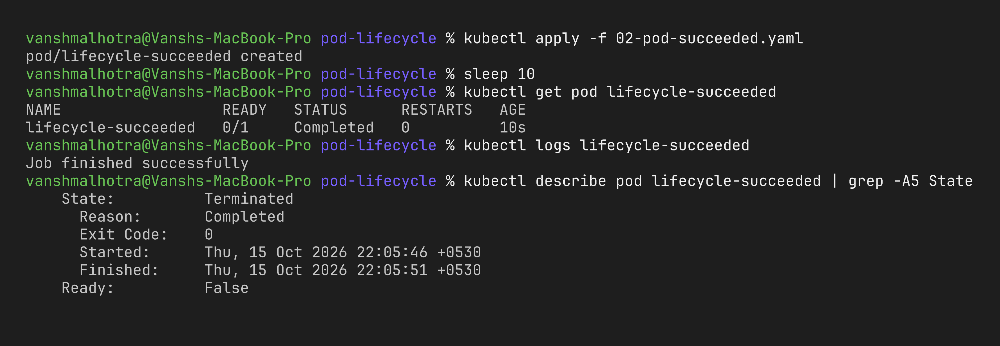
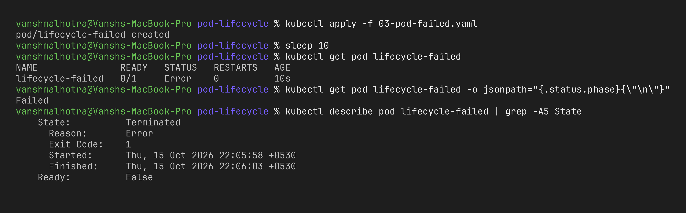
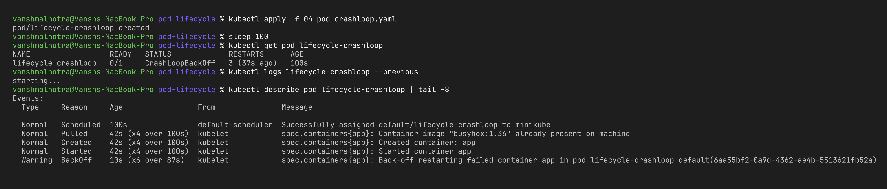
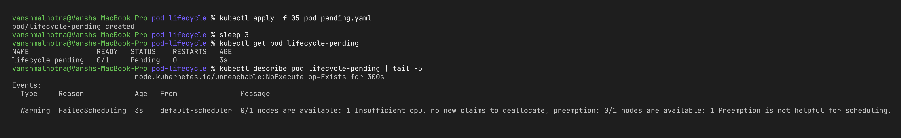
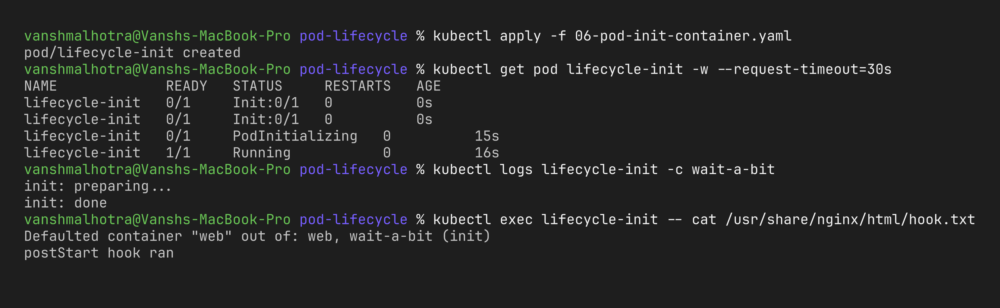

# Session 10 – Task 2: Pod Lifecycle

**Name:** Vansh Malhotra  
**Roll No:** 24bcs10268

## Theory – Pod phases

A Pod's `status.phase` is always one of these five:

| Phase | Meaning |
| :--- | :--- |
| **Pending** | Pod is accepted by the cluster but not running yet – waiting to be scheduled, or images are still downloading. |
| **Running** | Pod is on a node and at least one container is running (or starting/restarting). |
| **Succeeded** | All containers exited with code 0 and won't be restarted. |
| **Failed** | All containers stopped and at least one exited with a non-zero code (and won't be restarted). |
| **Unknown** | The control plane can't talk to the node, so it doesn't know the state. |

Things like `CrashLoopBackOff`, `ImagePullBackOff` and `ContainerCreating` are **not phases** – they are container *reasons* shown in the STATUS column of `kubectl get pods`.

```text
          ┌──────────┐
 create → │ Pending  │ ── scheduled + images pulled + init containers done
          └────┬─────┘
               ▼
          ┌──────────┐   exit 0, restartPolicy Never/OnFailure   ┌───────────┐
          │ Running  │ ─────────────────────────────────────────►│ Succeeded │
          └────┬─────┘                                           └───────────┘
               │ exit ≠ 0, restartPolicy Never                   ┌───────────┐
               └────────────────────────────────────────────────►│  Failed   │
               │ exit ≠ 0, restartPolicy Always                  └───────────┘
               └──► restart with back-off (10s, 20s, 40s … 5m) = CrashLoopBackOff
```

**restartPolicy** decides what happens when a container exits: `Always` (default, used by Deployments), `OnFailure` (Jobs), `Never`.

For every YAML below I did the same 3 steps: **apply → check status → check details**.

---

## 1. Running – `01-pod-running.yaml`

```bash
kubectl apply -f 01-pod-running.yaml
kubectl get pod lifecycle-running -w            # Pending -> ContainerCreating -> Running
kubectl describe pod lifecycle-running
kubectl get pod lifecycle-running -o jsonpath='{.status.phase}{"\n"}'
```



**What I observed:** the pod was briefly `ContainerCreating` while nginx was pulled, then `Running`. The events show the exact order: the scheduler assigns the node, kubelet pulls the image, creates and starts the container. nginx never exits, so it stays Running.

---

## 2. Succeeded – `02-pod-succeeded.yaml`

```bash
kubectl apply -f 02-pod-succeeded.yaml
kubectl get pod lifecycle-succeeded -w          # Running -> Completed
kubectl logs lifecycle-succeeded
kubectl describe pod lifecycle-succeeded | grep -A5 State
```



**What I observed:** the container ran its command, exited with 0 and because `restartPolicy: Never` it was not restarted. `kubectl get` shows `Completed` but the actual phase is `Succeeded`. This is how Jobs/batch tasks behave.

---

## 3. Failed – `03-pod-failed.yaml`

```bash
kubectl apply -f 03-pod-failed.yaml
kubectl get pod lifecycle-failed -w             # Running -> Error
kubectl get pod lifecycle-failed -o jsonpath='{.status.phase}{"\n"}'
kubectl describe pod lifecycle-failed | grep -A5 State
```



**What I observed:** same idea as Succeeded but the script did `exit 1`. With `restartPolicy: Never` Kubernetes gives up immediately, so the phase becomes `Failed`.

---

## 4. CrashLoopBackOff – `04-pod-crashloop.yaml`

```bash
kubectl apply -f 04-pod-crashloop.yaml
kubectl get pod lifecycle-crashloop -w          # watch RESTARTS go up
kubectl describe pod lifecycle-crashloop | grep -A10 "Last State"
kubectl logs lifecycle-crashloop --previous     # logs of the crashed attempt
```



**What I observed:** this time `restartPolicy: Always`, so kubelet kept restarting the container. Each restart waited longer (10s, 20s, 40s…) – that waiting period is the "back-off". The phase stays `Running` (it is technically running/restarting) but the STATUS shows `CrashLoopBackOff`. `logs --previous` is very useful here because the current container may not have printed anything yet.

---

## 5. Pending – `05-pod-pending.yaml`

```bash
kubectl apply -f 05-pod-pending.yaml
kubectl get pod lifecycle-pending
kubectl describe pod lifecycle-pending | tail -5
```



**What I observed:** I asked for 50 CPUs and my Minikube node only has a few, so the scheduler could not find any node. The pod stays `Pending` forever and the reason is in the Events. Fix = lower the request (or add bigger nodes).

---

## 6. Init container + lifecycle hooks – `06-pod-init-container.yaml`

```bash
kubectl apply -f 06-pod-init-container.yaml
kubectl get pod lifecycle-init -w               # Init:0/1 -> PodInitializing -> Running
kubectl logs lifecycle-init -c wait-a-bit       # logs of the init container
kubectl exec lifecycle-init -- cat /usr/share/nginx/html/hook.txt
kubectl delete pod lifecycle-init               # takes ~5s extra because of preStop
```



**What I observed:** the main nginx container did not start until the init container finished its 15-second sleep – the pod stayed in `Init:0/1` (still phase Pending) during that time. The `postStart` hook wrote a file as soon as nginx started, and the `preStop` hook delayed deletion by 5 seconds, which is how apps get time for graceful shutdown.

---

## Summary of what I learnt

- Phase is the high-level state; the STATUS column gives the more detailed reason.
- `restartPolicy` decides between Failed and CrashLoopBackOff for the same crashing command.
- `kubectl describe` → **Events** at the bottom is the first place to look when a pod is stuck.
- Init containers run in order and must succeed before the app container starts.

## Cleanup

```bash
kubectl delete -f .
```
