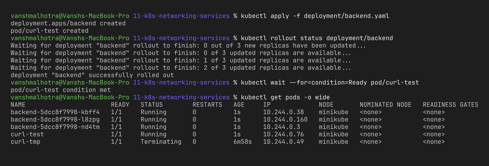
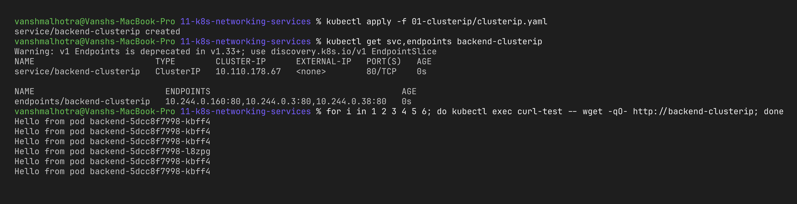
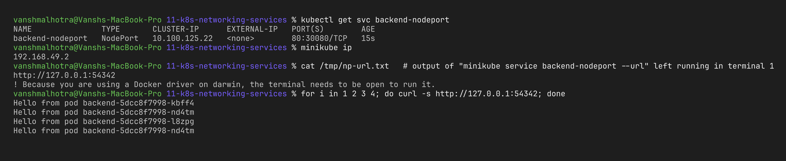
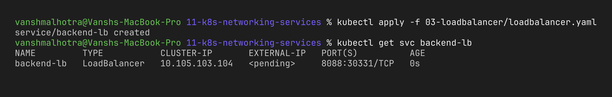
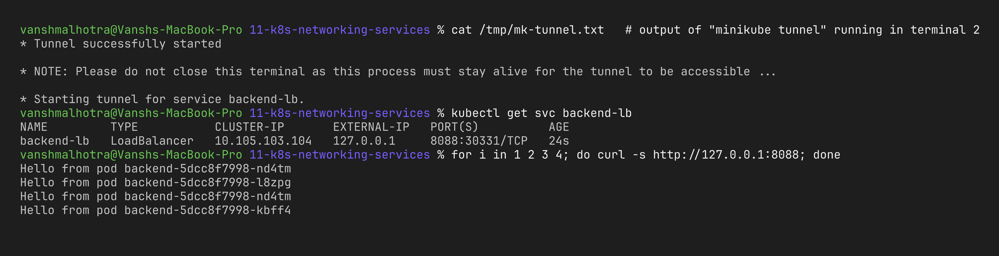
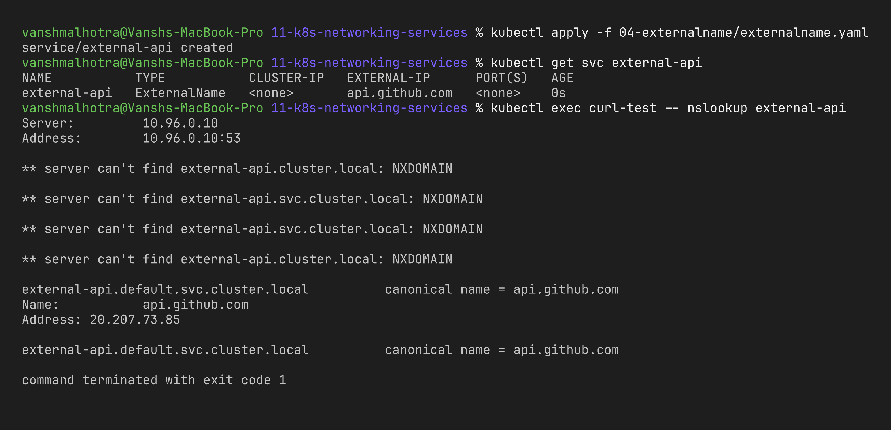
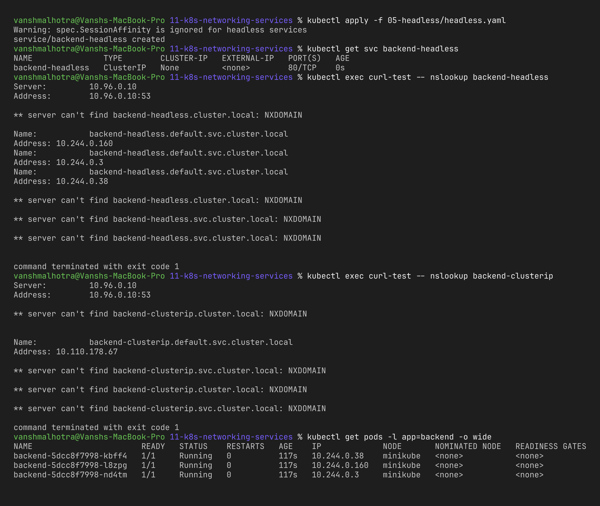
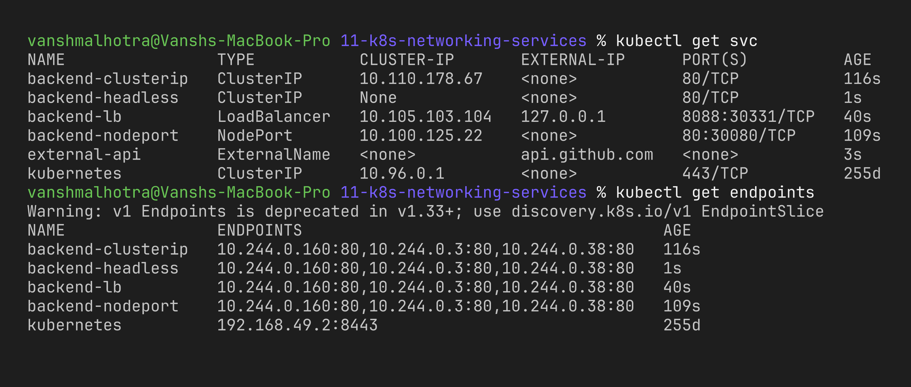

# Session 11 – Kubernetes Networking & Services

**Name:** Vansh Malhotra  
**Roll No:** 24bcs10268

In this session I deployed one backend app and put **all 5 Service types** in front of it, tested each one, and wrote notes comparing Kubernetes objects, FQDNs and CoreDNS. Cluster used: Minikube (`minikube start --driver=docker`).

## Folder structure

```text
11-k8s-networking-services/
├── deployment/backend.yaml        3 nginx pods (label app=backend) + a busybox test pod
├── 01-clusterip/clusterip.yaml
├── 02-nodeport/nodeport.yaml
├── 03-loadbalancer/loadbalancer.yaml
├── 04-externalname/externalname.yaml
├── 05-headless/headless.yaml
├── comparison/README.md           Task 2 – object comparisons
├── fqdn/README.md                 Task 3 – FQDN
├── coredns/README.md              Task 4 – CoreDNS
└── screenshots/
```

## Why do we need Services?

Pods are temporary – every time a pod is recreated it gets a **new IP**. A Service gives a **stable virtual IP and DNS name** and load-balances across all pods that match its `selector`. kube-proxy on every node programs the rules that forward Service traffic to the pod IPs (the "endpoints").

| Type | Reachable from | How |
| :--- | :--- | :--- |
| **ClusterIP** | Inside the cluster only | Virtual IP + DNS name |
| **NodePort** | Outside, via `<NodeIP>:<30000-32767>` | ClusterIP + a port opened on every node |
| **LoadBalancer** | Outside, via an external IP | NodePort + cloud load balancer |
| **ExternalName** | Inside the cluster | DNS CNAME to an outside hostname, no pods |
| **Headless** | Inside the cluster | No virtual IP, DNS returns every pod IP |

---

## Step 0 – Deploy the backend

The backend pods print their own name (`Hello from pod backend-xxxx`), so I can see the load balancing.

```bash
kubectl apply -f deployment/backend.yaml
kubectl get pods -l app=backend -o wide
kubectl get pod curl-test
```



---

## 1. ClusterIP

**What it is:** the default type. Gets an internal virtual IP that only works inside the cluster. Used for internal communication like frontend → backend or app → database.

```bash
kubectl apply -f 01-clusterip/clusterip.yaml
kubectl get svc backend-clusterip
kubectl get endpoints backend-clusterip       # should list the 3 pod IPs
kubectl describe svc backend-clusterip

# test from inside the cluster
kubectl exec curl-test -- sh -c 'for i in 1 2 3 4 5 6; do wget -qO- http://backend-clusterip; done'
kubectl exec curl-test -- nslookup backend-clusterip
```



**What I observed:** EXTERNAL-IP is `<none>` – it can't be reached from my Mac. From inside the cluster, the name `backend-clusterip` resolved to the ClusterIP and different pod names answered, so traffic is spread over all 3 pods.

---

## 2. NodePort

**What it is:** builds on ClusterIP and also opens a fixed port (30000–32767, here **30080**) on every node. Anyone who can reach the node can reach the app on `<NodeIP>:30080`.

```bash
kubectl apply -f 02-nodeport/nodeport.yaml
kubectl get svc backend-nodeport              # PORT(S) 80:30080/TCP
minikube ip

# on macOS + docker driver the node IP isn't directly reachable, so minikube opens a tunnel:
minikube service backend-nodeport --url       # keep this terminal open
curl <url-printed-above>                      # in another terminal
```



**What I observed:** the service got a ClusterIP *and* the node port. On Linux `curl $(minikube ip):30080` works directly, but on my Mac I had to use `minikube service --url` because the Minikube node runs inside Docker's network.

---

## 3. LoadBalancer

**What it is:** builds on NodePort and asks the cloud provider (AWS ELB, GCP LB…) for an external load balancer with a public IP. On Minikube there is no cloud, so `minikube tunnel` plays the role of the cloud load balancer.

```bash
kubectl apply -f 03-loadbalancer/loadbalancer.yaml
kubectl get svc backend-lb                    # EXTERNAL-IP <pending> at first

# terminal 2 (keep it running; ports below 1024 would need a sudo password, that is why I used 8088)
minikube tunnel

# terminal 1
kubectl get svc backend-lb                    # EXTERNAL-IP now 127.0.0.1
curl http://127.0.0.1:8088
```





**What I observed:** without a cloud provider the external IP stays `<pending>` forever – that's normal and not an error. Once the tunnel was running, Minikube assigned `127.0.0.1` as the EXTERNAL-IP and `curl http://127.0.0.1:8088` was answered by the backend pods (it opens in the browser too).

---

## 4. ExternalName

**What it is:** a Service with **no selector and no pods**. It just returns a DNS **CNAME** pointing to an outside hostname. Useful to give an external dependency (a managed DB, a third-party API) an internal name, so if the address changes I only update the Service, not every app.

```bash
kubectl apply -f 04-externalname/externalname.yaml
kubectl get svc external-api                  # EXTERNAL-IP shows api.github.com
kubectl exec curl-test -- nslookup external-api
```



**What I observed:** no ClusterIP and no endpoints were created. DNS simply answered with a CNAME to `api.github.com` and then GitHub's real IPs. (A plain HTTP request to it wouldn't work well because GitHub expects HTTPS with its own Host header – ExternalName only does DNS, not proxying.)

---

## 5. Headless

**What it is:** a Service with `clusterIP: None`. There is no virtual IP and no load balancing by kube-proxy. Instead, DNS returns **the IP of every pod**. Used by StatefulSets (databases like MongoDB, Kafka, Cassandra) where clients need to talk to a specific pod.

```bash
kubectl apply -f 05-headless/headless.yaml
kubectl get svc backend-headless              # CLUSTER-IP = None
kubectl exec curl-test -- nslookup backend-headless
kubectl exec curl-test -- nslookup backend-clusterip     # compare: only one IP
kubectl get pods -l app=backend -o wide       # the IPs match the nslookup answer
```



**What I observed:** the headless service returned 3 A-records (one per pod), the same IPs as `kubectl get pods -o wide`. The normal ClusterIP service only returned its single virtual IP.

---

## All services together

```bash
kubectl get svc
kubectl get endpoints
```



---

## Tasks 2, 3, 4

- [comparison/README.md](comparison/README.md) – Deployment vs ReplicaSet, Deployment vs DaemonSet vs StatefulSet, ReplicaSet vs Service
- [fqdn/README.md](fqdn/README.md) – FQDN and Kubernetes DNS names
- [coredns/README.md](coredns/README.md) – CoreDNS

## Cleanup

```bash
kubectl delete -f 01-clusterip/ -f 02-nodeport/ -f 03-loadbalancer/ -f 04-externalname/ -f 05-headless/
kubectl delete -f deployment/
```
