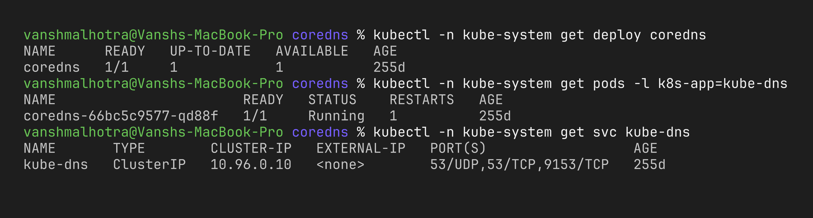
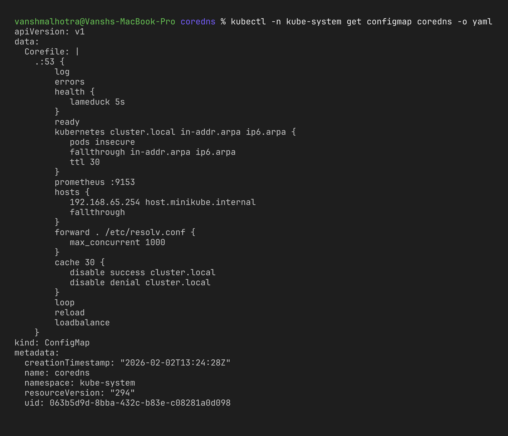
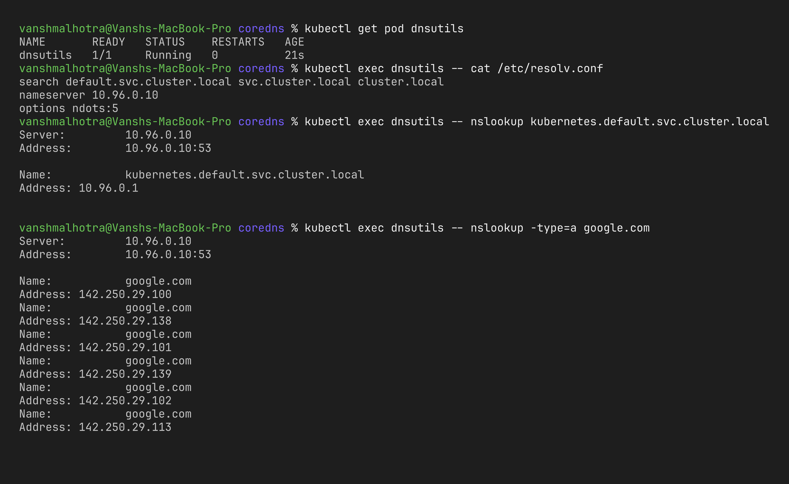

# Session 11 – Task 4: CoreDNS

**Name:** Vansh Malhotra  
**Roll No:** 24bcs10268

## What is CoreDNS?

CoreDNS is a DNS server written in Go and a graduated CNCF project. In Kubernetes it runs as a **Deployment (usually 2 pods) in the `kube-system` namespace**, behind a Service that is still called `kube-dns` for backward compatibility. Every pod in the cluster uses it as its DNS server.

It is built from **plugins** – each line in its config file (the Corefile) turns on a plugin like `kubernetes`, `forward`, `cache`, `health`, etc.

```bash
kubectl -n kube-system get deploy coredns
kubectl -n kube-system get pods -l k8s-app=kube-dns
kubectl -n kube-system get svc kube-dns
```



## Why Kubernetes uses CoreDNS

- **Service discovery:** pod IPs keep changing, so apps need names. CoreDNS gives every Service a name automatically.
- **Automatic updates:** it watches the API server, so when I create or delete a Service the DNS record appears/disappears straight away – no manual zone files.
- **Flexible:** the plugin system lets one binary do cluster DNS, caching, forwarding to upstream DNS, metrics, health checks and rewrites.
- **Simpler than the old kube-dns,** which needed 3 containers (kubedns + dnsmasq + sidecar). CoreDNS became the default in Kubernetes 1.13.

## How service discovery works

1. I create a Service → it gets stored in etcd via the API server.
2. CoreDNS's `kubernetes` plugin is watching Services and EndpointSlices through the API server.
3. It immediately serves records for it:

| Record | When | Answer |
| :--- | :--- | :--- |
| **A / AAAA** | Normal Service | the ClusterIP |
| **A (multiple)** | Headless Service | every ready pod IP |
| **CNAME** | ExternalName Service | the external hostname |
| **SRV** | Named ports | port number + target name |
| **PTR** | Reverse lookup | IP → name |

4. The kubelet sets every pod's `/etc/resolv.conf` to point at the `kube-dns` ClusterIP, so pods automatically use CoreDNS.

## How a DNS query is resolved (step by step)

```text
Pod: wget http://backend-clusterip
  │
  │ 1. resolver reads /etc/resolv.conf
  │    nameserver 10.96.0.10, search default.svc.cluster.local ..., ndots:5
  │ 2. name has < 5 dots → try with search domains first
  ▼
backend-clusterip.default.svc.cluster.local ?  ──► kube-dns Service (10.96.0.10)
                                                       │ kube-proxy → a CoreDNS pod
                                                       ▼
                                   CoreDNS: zone cluster.local → kubernetes plugin
                                   found Service → answer A 10.96.x.x
  ▲                                                    │
  └──────────────── answer cached by `cache` plugin ◄──┘

External name (e.g. google.com):
  search domains fail (NXDOMAIN) → CoreDNS `forward` plugin → node's /etc/resolv.conf
  → upstream DNS (router / 8.8.8.8) → answer returned and cached
```

## CoreDNS configuration (Corefile)

The config lives in a ConfigMap:

```bash
kubectl -n kube-system get configmap coredns -o yaml
```

A typical Corefile (Minikube's one is very close to this – it also adds a `hosts` block for `host.minikube.internal`):

```text
.:53 {
    errors                         # log errors to stdout
    health {                       # liveness endpoint :8080/health
       lameduck 5s
    }
    ready                          # readiness endpoint :8181/ready
    kubernetes cluster.local in-addr.arpa ip6.arpa {
       pods insecure               # enables <ip-with-dashes>.ns.pod.cluster.local
       fallthrough in-addr.arpa ip6.arpa
       ttl 30
    }
    prometheus :9153               # metrics for Prometheus
    forward . /etc/resolv.conf {   # anything not cluster.local → upstream DNS
       max_concurrent 1000
    }
    cache 30                       # cache answers for 30 seconds
    loop                           # detect forwarding loops and stop
    reload                         # auto-reload when the ConfigMap changes
    loadbalance                    # shuffle A records (round robin)
}
```

Example customisation – sending a company domain to a private DNS server:

```text
mycompany.local:53 {
    forward . 10.0.0.53
}
```

After editing (`kubectl -n kube-system edit configmap coredns`) the `reload` plugin picks it up in about 30 seconds, or I can force it with `kubectl -n kube-system rollout restart deployment coredns`.



## How to troubleshoot DNS issues

My checklist, from simplest to deepest:

```bash
# 1. Is CoreDNS running?
kubectl -n kube-system get pods -l k8s-app=kube-dns

# 2. Does the kube-dns service have endpoints?
kubectl -n kube-system get endpoints kube-dns

# 3. Test from a debug pod
kubectl run dnsutils --image=busybox:1.36 --restart=Never -- sleep 600
kubectl exec dnsutils -- cat /etc/resolv.conf                                  # nameserver should be the kube-dns IP
kubectl exec dnsutils -- nslookup kubernetes.default.svc.cluster.local         # cluster DNS works?
kubectl exec dnsutils -- nslookup -type=a google.com                           # upstream forwarding works?
kubectl exec dnsutils -- nslookup backend-clusterip.default.svc.cluster.local
kubectl delete pod dnsutils
# note: busybox's nslookup does not apply the search list to dotted names, so
# `nslookup kubernetes.default` gives NXDOMAIN there – use the full name.

# 4. Check CoreDNS logs for errors
kubectl -n kube-system logs -l k8s-app=kube-dns --tail=50

# 5. Turn on query logging: add the word `log` in the Corefile, then watch the logs again
kubectl -n kube-system edit configmap coredns

# 6. Does the Service itself exist and have endpoints?
kubectl get svc,endpoints <service-name> -n <namespace>
```

| Symptom | Likely cause | Fix |
| :--- | :--- | :--- |
| `nslookup` times out for everything | CoreDNS pods down / NetworkPolicy blocking UDP 53 | Check pods, logs, allow port 53 |
| Internal names work, external don't | `forward` upstream broken | Check node DNS / forward target |
| `NXDOMAIN` for a service | Typo, or wrong namespace (short name used across namespaces) | Use `svc.namespace` or the full FQDN |
| Name resolves but connection fails | Not a DNS problem – Service has no endpoints (selector mismatch) | `kubectl get endpoints`, fix labels |
| CoreDNS in CrashLoopBackOff with "loop detected" | Upstream points back to CoreDNS | Fix node `/etc/resolv.conf` / forward target |



## What I learnt

- CoreDNS is just another Deployment in `kube-system`, and the whole cluster depends on it – if it's down, almost every app breaks.
- The Corefile is a chain of plugins; `kubernetes` answers cluster names and `forward` handles everything else.
- Many "DNS problems" are actually Service selector problems – the name resolves fine but there are no endpoints behind it.
