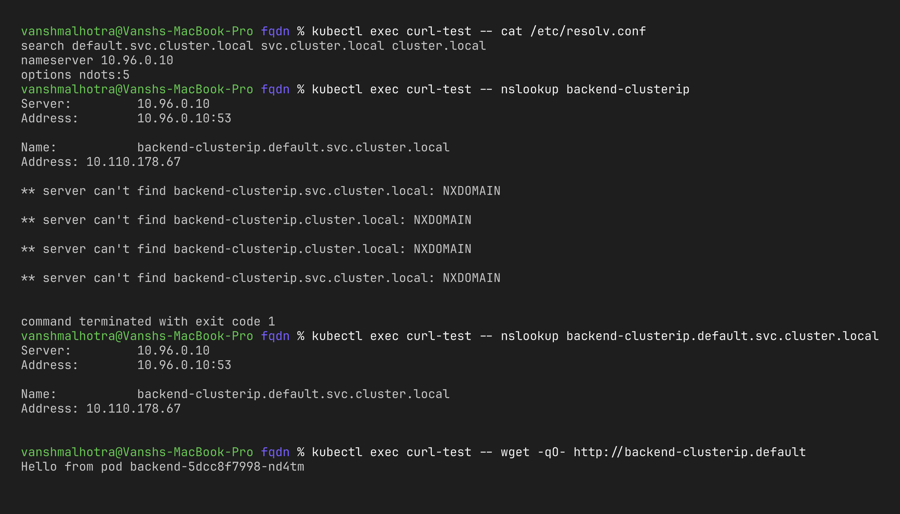
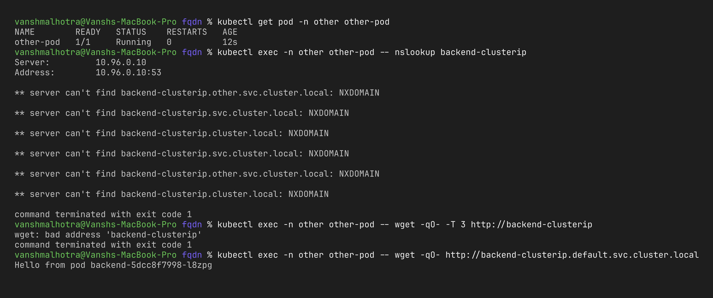

# Session 11 – Task 3: FQDN

**Name:** Vansh Malhotra  
**Roll No:** 24bcs10268

## What is an FQDN?

**FQDN = Fully Qualified Domain Name.** It is the complete domain name of a host, from the host label all the way up to the root, so it can only mean one thing.

```text
www.google.com.
 │     │    │  └── root (the trailing dot, usually hidden)
 │     │    └───── top-level domain (TLD)
 │     └────────── second-level domain
 └──────────────── host
```

`www` alone is a *partial* name – it only works if the resolver adds the rest using a **search list**. `www.google.com.` is fully qualified.

## Kubernetes Service DNS

Kubernetes runs its own DNS server (CoreDNS) inside the cluster. Every Service automatically gets a DNS record, so apps can call each other **by name** instead of by IP. The default cluster domain is `cluster.local`.

## Kubernetes DNS naming convention

| Object | FQDN format |
| :--- | :--- |
| Service | `<service>.<namespace>.svc.cluster.local` |
| Pod (by IP) | `<pod-ip-with-dashes>.<namespace>.pod.cluster.local` |
| Pod behind a headless Service (StatefulSet) | `<pod-name>.<service>.<namespace>.svc.cluster.local` |
| SRV record for a named port | `_<port-name>._<protocol>.<service>.<namespace>.svc.cluster.local` |

Example breakdown:

```text
backend-clusterip . default . svc . cluster.local
       │               │       │        └── cluster domain
       │               │       └─────────── "this is a service"
       │               └─────────────────── namespace
       └─────────────────────────────────── service name
```

## Namespace-based DNS

Each pod's `/etc/resolv.conf` has a search list based on **its own namespace**:

```text
search default.svc.cluster.local svc.cluster.local cluster.local
nameserver 10.96.0.10
options ndots:5
```

Because of this search list:

| From a pod in namespace `default`, I type… | It resolves to… |
| :--- | :--- |
| `backend-clusterip` | `backend-clusterip.default.svc.cluster.local` (same namespace) |
| `mysql.database` | `mysql.database.svc.cluster.local` (other namespace) |
| `mysql` | fails – it looks in `default`, but mysql is in `database` |
| `mysql.database.svc.cluster.local` | always works from anywhere |

So: **same namespace → short name is enough; different namespace → add at least `.namespace`.** The full FQDN always works.

`ndots:5` means: if a name has fewer than 5 dots, try the search domains first. That's why short names work, but it also means external names like `api.github.com` do a few extra lookups first (a small performance cost).

## Pod-to-Service communication

1. App in pod calls `http://backend-clusterip`.
2. Resolver appends the search domain → asks CoreDNS for `backend-clusterip.default.svc.cluster.local`.
3. CoreDNS answers with the ClusterIP.
4. kube-proxy forwards traffic from the ClusterIP to one backend pod.

## Hands-on

```bash
kubectl apply -f ../deployment/backend.yaml -f ../01-clusterip/clusterip.yaml
kubectl create namespace other
kubectl run other-pod -n other --image=busybox:1.36 --restart=Never -- sleep 3600

# resolv.conf of a pod
kubectl exec curl-test -- cat /etc/resolv.conf

# same namespace: short name, partial name, full FQDN
kubectl exec curl-test -- nslookup backend-clusterip
kubectl exec curl-test -- wget -qO- http://backend-clusterip.default   # partial name (see note below)
kubectl exec curl-test -- nslookup backend-clusterip.default.svc.cluster.local

# from a different namespace: short name fails, namespace-qualified works
kubectl exec -n other other-pod -- nslookup backend-clusterip
kubectl exec -n other other-pod -- wget -qO- http://backend-clusterip.default.svc.cluster.local
```

Note: busybox's `nslookup` does **not** apply the search list to names that already contain a dot, so `nslookup backend-clusterip.default` gives NXDOMAIN in busybox even though the name works for real apps. Normal programs (here `wget`) use the libc resolver, which does use the search list – so I tested the partial name with `wget`.





## Examples of Kubernetes FQDNs

| FQDN | What it points to |
| :--- | :--- |
| `kubernetes.default.svc.cluster.local` | The API server Service (exists in every cluster) |
| `kube-dns.kube-system.svc.cluster.local` | The CoreDNS Service |
| `backend-clusterip.default.svc.cluster.local` | My ClusterIP Service from this session |
| `backend-headless.default.svc.cluster.local` | Returns all 3 backend pod IPs |
| `mysql-0.mysql.database.svc.cluster.local` | Pod `mysql-0` of a StatefulSet with headless service `mysql` in namespace `database` |
| `10-244-0-12.default.pod.cluster.local` | Pod with IP 10.244.0.12 |
| `_http._tcp.backend-clusterip.default.svc.cluster.local` | SRV record (if the port is named `http`) |

## Cleanup

```bash
kubectl delete namespace other
```
