# Session 12 – Kubernetes Ingress, ConfigMaps & Secrets

**Name:** Vansh Malhotra  
**Roll No:** 24bcs10268

In this session I learnt how to keep configuration out of my container images (ConfigMaps and Secrets) and how to expose many HTTP apps through a single entry point (Ingress). I did everything on a local **minikube** cluster on my Mac.

## Folder structure

```
12-ingress-configmaps-secrets/
├── 01-configmap/configmap.yaml       # Task 1
├── 02-secret/secret.yaml             # Task 2
├── 03-ingress/app.yaml               # Task 3 – 2 deployments + 2 services
├── 03-ingress/ingress.yaml           # Task 3 – path based routing
├── ingress-vs-controller/README.md   # Task 4
├── troubleshooting/                  # Task 5
│   ├── broken-pod.yaml
│   └── fixed-pod.yaml
└── screenshots/
```

Before starting I made sure my cluster was up:

```bash
minikube start
kubectl get nodes
```

---

## Task 1: ConfigMap

A **ConfigMap** stores non-sensitive configuration (environment names, URLs, feature flags, whole config files) as key/value pairs. The idea is that the same image can run in dev, test and prod and only the ConfigMap changes.

My file [`01-configmap/configmap.yaml`](01-configmap/configmap.yaml) creates a ConfigMap `app-config` with three simple keys (`APP_ENV`, `APP_COLOR`, `DATABASE_HOST`) and one file-style key (`database.conf`). Then a Pod `configmap-demo` uses it in **three different ways**:

| Way | YAML field | Result inside container |
| :--- | :--- | :--- |
| One key → one env var | `env.valueFrom.configMapKeyRef` | `MY_APP_ENV=production` |
| All keys → env vars | `envFrom.configMapRef` | `APP_ENV`, `APP_COLOR`, `DATABASE_HOST` |
| All keys → files | `volumes.configMap` + `volumeMounts` | `/etc/app-config/<key>` files |

### Step 1 – Create the ConfigMap and Pod

```bash
kubectl apply -f 01-configmap/configmap.yaml
kubectl get configmap app-config
kubectl describe configmap app-config
kubectl get pod configmap-demo
```

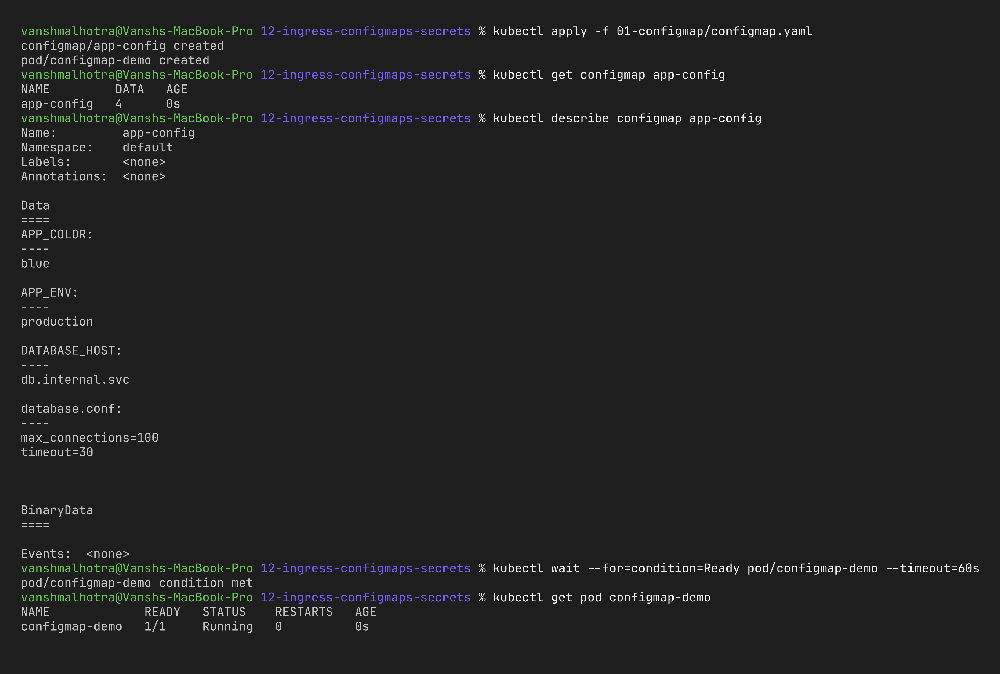

### Step 2 – Verify the values inside the container

```bash
# as environment variables
kubectl exec configmap-demo -- env | grep -E "APP_|DATABASE_HOST"

# as mounted files
kubectl exec configmap-demo -- ls /etc/app-config
kubectl exec configmap-demo -- cat /etc/app-config/database.conf
```

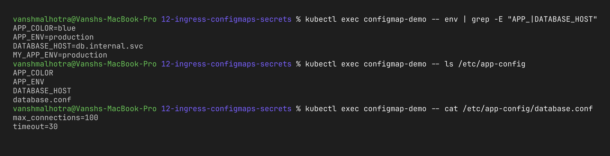

**What I observed:** All the values reached the container without me rebuilding any image. One thing I noticed while reading about it: if I edit the ConfigMap, the **mounted files** get updated automatically after some time, but **env vars do not** – the Pod has to be restarted to pick up new env values.

---

## Task 2: Secret

A **Secret** is like a ConfigMap but meant for sensitive data – passwords, API tokens, TLS keys. The values are stored **base64 encoded** in the YAML.

My file [`02-secret/secret.yaml`](02-secret/secret.yaml) creates `db-secret` with `DB_USER` and `DB_PASS` (fake demo values only!) and a Pod `secret-demo` that reads them as env vars **and** as files under `/etc/db-secret`.

I generated the base64 values like this:

```bash
echo -n 'demo-user' | base64              # ZGVtby11c2Vy
echo -n 'not-a-real-password' | base64    # bm90LWEtcmVhbC1wYXNzd29yZA==
```

(The `-n` is important, otherwise a newline also gets encoded into the password.)

### Step 1 – Create the Secret and Pod

```bash
kubectl apply -f 02-secret/secret.yaml
kubectl get secret db-secret
kubectl describe secret db-secret      # shows only sizes, not values
kubectl get pod secret-demo
```

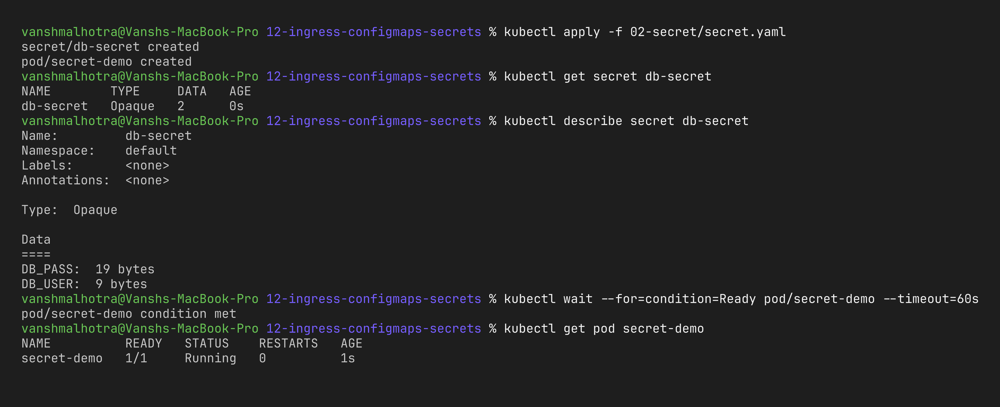

### Step 2 – Verify the value inside the container

```bash
kubectl exec secret-demo -- sh -c 'echo "DB_USER=$DB_USER DB_PASS=$DB_PASS"'
kubectl exec secret-demo -- cat /etc/db-secret/DB_USER
```

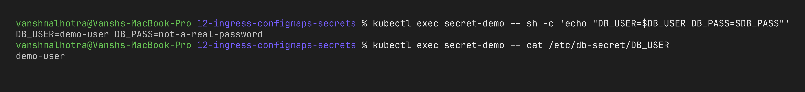

### Step 3 – Showing that base64 is NOT encryption

```bash
kubectl get secret db-secret -o jsonpath='{.data.DB_PASS}' | base64 -d
```

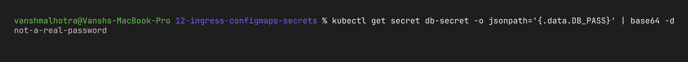

### Why Secrets should not be committed directly to Git

This was the most important learning for me in this task:

1. **base64 is only encoding, not encryption.** As shown above, anyone can decode it with one command. A Secret YAML in Git is basically a plain-text password.
2. **Git never forgets.** Even if I delete the file in the next commit, the password is still there in the history and in every clone/fork of the repo.
3. **Public repos get scanned by bots** within minutes looking for leaked keys (AWS keys especially).
4. Anyone with read access to the repo gets production access, which breaks the *least privilege* idea.

**What should be done instead:**
- Keep real secret files out of Git with `.gitignore` and create them directly with `kubectl create secret generic ... --from-literal` or from a CI/CD secret store (e.g. GitHub Actions secrets).
- Use **Sealed Secrets** (encrypted with a key only the cluster has, safe to commit) or **External Secrets Operator** that pulls values from AWS Secrets Manager / HashiCorp Vault.
- Enable encryption at rest for Secrets in etcd and restrict who can `get secrets` with RBAC.
- Run a secret scanner like **Gitleaks** in the pipeline.

In my repo the `secret.yaml` only contains obviously fake values (`demo-user`, `not-a-real-password`) just for learning.

| | ConfigMap | Secret |
| :--- | :--- | :--- |
| Meant for | normal config | sensitive data |
| Stored as | plain text | base64 (can be encrypted at rest) |
| `kubectl describe` | shows values | hides values |
| Examples | URLs, ports, flags | passwords, tokens, TLS certs |

---

## Task 3: Ingress

An **Ingress** lets me expose many services through one entry point using HTTP rules (host name and path) instead of giving every app its own NodePort or LoadBalancer.

For this demo I deployed two small apps using `hashicorp/http-echo`, which simply replies with a fixed text – that makes it very easy to see which backend answered:

- [`03-ingress/app.yaml`](03-ingress/app.yaml) → Deployments `app1`, `app2` (2 replicas each) + ClusterIP services `app1-service`, `app2-service`
- [`03-ingress/ingress.yaml`](03-ingress/ingress.yaml) → host `hello.local`, `/app1` → `app1-service`, `/app2` → `app2-service`

```
                      ┌── /app1 ──► app1-service ──► app1 pods (x2)
client ──► Ingress ───┤
   (hello.local)      └── /app2 ──► app2-service ──► app2 pods (x2)
```

### Step 1 – Enable the Ingress controller

minikube does not run an ingress controller by default, so I enabled the NGINX one:

```bash
minikube addons enable ingress
kubectl get pods -n ingress-nginx
```

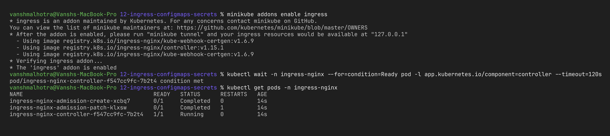

### Step 2 – Deploy the apps and services

```bash
kubectl apply -f 03-ingress/app.yaml
kubectl get deploy app1 app2
kubectl get pods -l 'app in (app1,app2)'
kubectl get svc app1-service app2-service
```

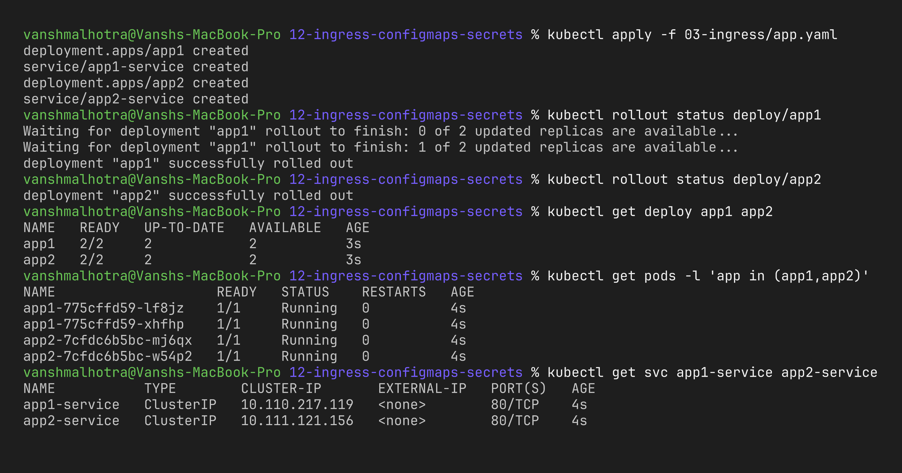

### Step 3 – Create the Ingress

```bash
kubectl apply -f 03-ingress/ingress.yaml
kubectl get ingress
kubectl describe ingress hello-ingress
```

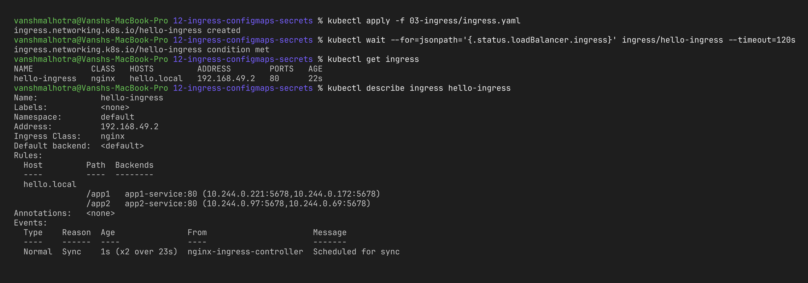

### Step 4 – Access the app through the Ingress and verify routing

On macOS with the Docker driver the minikube IP is not directly reachable. `minikube tunnel` needs sudo for port 80, so instead I port-forwarded the ingress controller's Service to port 8089 in a **separate terminal**:

```bash
kubectl -n ingress-nginx port-forward svc/ingress-nginx-controller 8089:80
```

Then in another terminal I sent requests with the `Host` header (this replaces adding a DNS entry):

```bash
curl -s -H "Host: hello.local" http://127.0.0.1:8089/app1
curl -s -H "Host: hello.local" http://127.0.0.1:8089/app2
curl -s -i -H "Host: hello.local" http://127.0.0.1:8089/nothing    # no rule -> 404
```

(`minikube tunnel` + `127.0.0.1 hello.local` in `/etc/hosts` would also work and lets you open `http://hello.local/app1` in the browser, but it asks for the sudo password.)

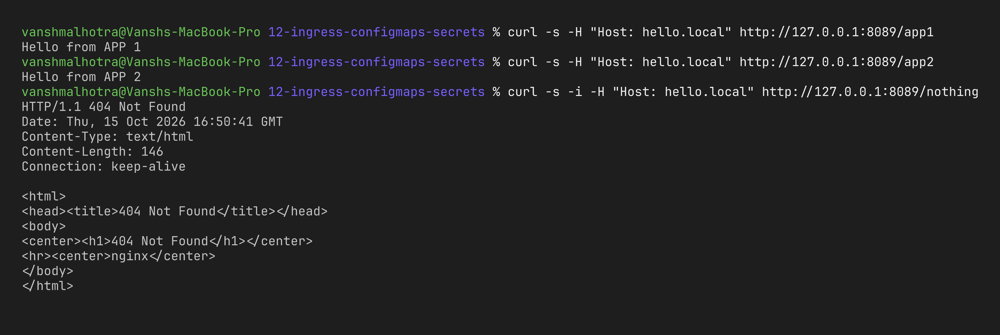

**What I observed:** One IP and one port served two completely different applications – the Ingress controller looked at the path and forwarded each request to the right Service. A path with no rule got a 404 from the controller's default backend, which proves the routing is really rule based.

---

## Task 4: Ingress vs Ingress Controller

Written separately in [`ingress-vs-controller/README.md`](ingress-vs-controller/README.md).

---

## Task 5: Troubleshooting

### Problem

I applied [`troubleshooting/broken-pod.yaml`](troubleshooting/broken-pod.yaml) and the pod never became Running.

```bash
kubectl apply -f troubleshooting/broken-pod.yaml
kubectl get pod broken-env-pod -w      # Ctrl+C once it shows the error
```

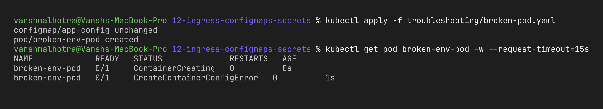

### Investigation

Note: `broken-pod.yaml` also applies `app-config` (with only `WELCOME_MSG`), so it overwrote the Task 1 ConfigMap – fine here since Task 1 was done.

The status `CreateContainerConfigError` means Kubernetes could not even build the container's configuration (env, volumes), so the app never started and `kubectl logs` would be empty. The best place to look is the events:

```bash
kubectl describe pod broken-env-pod | tail -n 15
kubectl get configmap
```

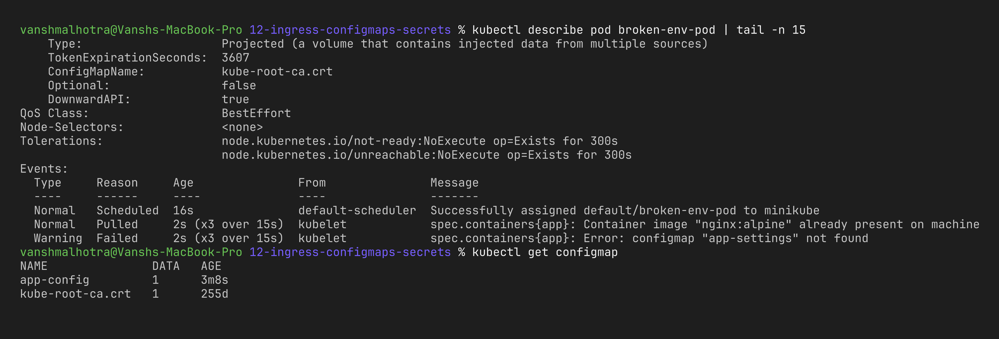

### Root cause

The pod asks for the env var `WELCOME_MSG` from a ConfigMap called **`app-settings`**, but the ConfigMap that actually exists in the namespace is called **`app-config`**. It is just a name mismatch in `configMapKeyRef.name`, but the kubelet refuses to start a container whose referenced ConfigMap does not exist.

### Fix

Env vars of a running pod cannot be edited, so I corrected the reference in [`troubleshooting/fixed-pod.yaml`](troubleshooting/fixed-pod.yaml) (`name: app-config`), deleted the broken pod and applied the fixed one:

```bash
kubectl delete pod broken-env-pod
kubectl apply -f troubleshooting/fixed-pod.yaml
kubectl get pod fixed-env-pod
kubectl logs fixed-env-pod
```

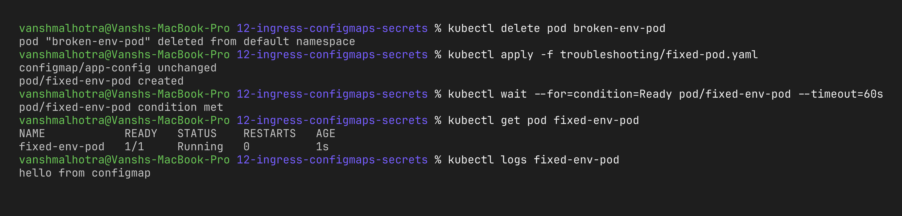

**Learning:** For any pod that is stuck before it starts (`Pending`, `ContainerCreating`, `CreateContainerConfigError`) I should go to `kubectl describe` → Events first, not to `kubectl logs`, because the app never ran.

---

## Cleanup

```bash
kubectl delete -f 01-configmap/ -f 02-secret/ -f 03-ingress/
kubectl delete pod fixed-env-pod --ignore-not-found
```
