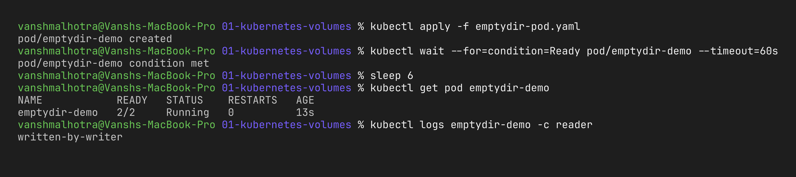
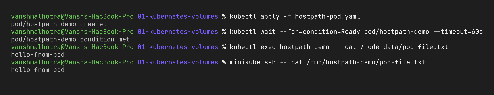
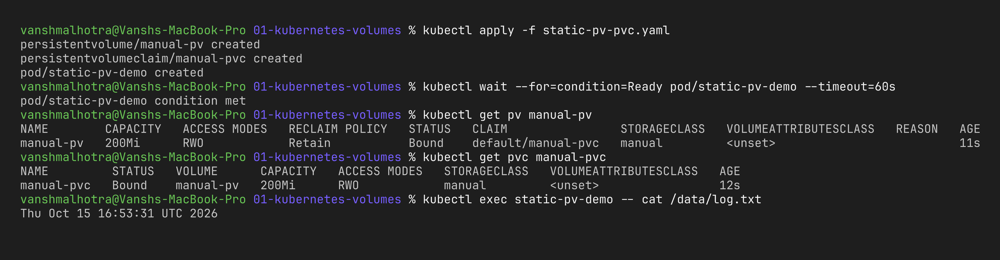
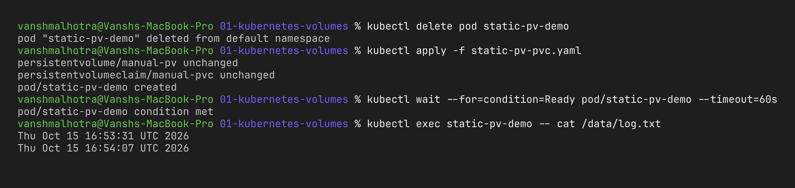
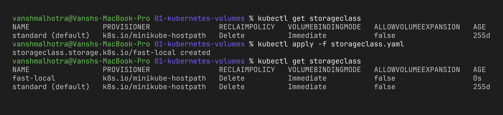
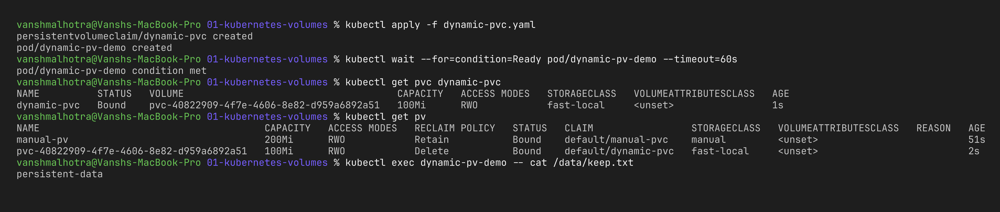

# Session 13 – Task 1: Kubernetes Volumes

**Name:** Vansh Malhotra  
**Roll No:** 24bcs10268

## Why volumes are needed

A container's filesystem is **temporary**. When a container crashes and restarts, or the pod is deleted, everything written inside it is gone. Also, two containers in the same pod cannot see each other's files by default. Volumes solve both problems: they give the pod storage that lives outside the container's own filesystem.

In this task I studied the main storage options and tried each one on minikube. All the YAML files are in this folder:

| File | What it shows |
| :--- | :--- |
| [`emptydir-pod.yaml`](emptydir-pod.yaml) | emptyDir shared between 2 containers |
| [`hostpath-pod.yaml`](hostpath-pod.yaml) | hostPath – files land on the node |
| [`static-pv-pvc.yaml`](static-pv-pvc.yaml) | manually created PV + PVC (static provisioning) |
| [`storageclass.yaml`](storageclass.yaml) | custom StorageClass |
| [`dynamic-pvc.yaml`](dynamic-pvc.yaml) | PVC only → PV created automatically (dynamic provisioning) |

---

## 1. emptyDir

- Created **empty** when the pod is scheduled on a node.
- Shared by **all containers in that pod** (each can mount it at any path).
- Survives a container restart, but is **deleted when the pod is deleted**.
- Can be backed by RAM using `emptyDir: { medium: Memory }`.

**Use cases:** cache, temporary files, sharing files between a main container and a sidecar (e.g. app writes logs, sidecar ships them).

```yaml
volumes:
- name: shared-vol
  emptyDir: {}
```

In my example the `writer` container writes a file and the `reader` container prints it:

```bash
kubectl apply -f emptydir-pod.yaml
kubectl logs emptydir-demo -c reader
```



---

## 2. hostPath

- Mounts a file or directory **from the node's filesystem** into the pod.
- Data stays on that node even after the pod is deleted.
- But if the pod gets scheduled to **another node**, the data is not there – so it is not portable.
- It is a **security risk** (a pod could mount `/` or `/var/run/docker.sock` of the node), so it's usually blocked by policies in real clusters.

**Use cases:** node-level agents like log collectors (Fluent Bit reads `/var/log`), monitoring agents (node-exporter), and single-node testing like minikube.

```yaml
volumes:
- name: node-vol
  hostPath:
    path: /tmp/hostpath-demo
    type: DirectoryOrCreate
```

I checked that the file really exists on the node by SSH-ing into the minikube node:

```bash
kubectl apply -f hostpath-pod.yaml
kubectl exec hostpath-demo -- cat /node-data/pod-file.txt
minikube ssh -- cat /tmp/hostpath-demo/pod-file.txt
```



---

## 3. PersistentVolume (PV)

A **PersistentVolume** is a piece of storage in the cluster that has a **lifecycle independent of any pod**. It is a cluster-level resource (not namespaced). It can be backed by many things: AWS EBS, Azure Disk, NFS, a cloud file share, or hostPath for testing.

Important fields:

- **capacity** – size, e.g. `200Mi`
- **accessModes**
  - `ReadWriteOnce (RWO)` – mounted read-write by one node
  - `ReadOnlyMany (ROX)` – read-only by many nodes
  - `ReadWriteMany (RWX)` – read-write by many nodes (needs NFS/EFS style storage)
  - `ReadWriteOncePod (RWOP)` – only one pod
- **persistentVolumeReclaimPolicy** – what happens when the PVC is deleted
  - `Retain` – keep the data, admin cleans up manually
  - `Delete` – delete the PV and the real disk
- **storageClassName** – which class it belongs to

## 4. PersistentVolumeClaim (PVC)

A **PersistentVolumeClaim** is a **request for storage** made by a user/app: "I need 100Mi with ReadWriteOnce". Kubernetes finds a matching PV and **binds** them one-to-one. The pod then only refers to the PVC by name, so the developer doesn't need to know where the disk actually is.

I think of it like this: **PV = the actual parking spot, PVC = the parking ticket** the app holds.

Static provisioning example ([`static-pv-pvc.yaml`](static-pv-pvc.yaml)) – I create the PV myself and the PVC binds to it because the class (`manual`), access mode and size match:

```bash
kubectl apply -f static-pv-pvc.yaml
kubectl get pv manual-pv
kubectl get pvc manual-pvc
kubectl exec static-pv-demo -- cat /data/log.txt
```



To prove the data survives the pod, I deleted the pod and created it again – the old date line was still in the file and a new line was appended:

```bash
kubectl delete pod static-pv-demo
kubectl apply -f static-pv-pvc.yaml
kubectl exec static-pv-demo -- cat /data/log.txt
```



---

## 5. StorageClass

A **StorageClass** describes a "type" of storage that can be created on demand – like a menu: `standard`, `fast-ssd`, `gp3`, etc. It mainly contains:

- **provisioner** – the plugin that actually creates disks (e.g. `ebs.csi.aws.com`, `pd.csi.storage.gke.io`, `k8s.io/minikube-hostpath`)
- **parameters** – provider specific settings (disk type, IOPS, encryption)
- **reclaimPolicy** – `Delete` (default) or `Retain` for the PVs it creates
- **volumeBindingMode** – `Immediate` or `WaitForFirstConsumer` (wait until a pod is scheduled so the disk is created in the right zone)
- **allowVolumeExpansion** – whether PVCs can be resized later

One StorageClass can be marked as **default**, so PVCs without `storageClassName` use it. On minikube the default is called `standard`.

```bash
kubectl get storageclass
kubectl apply -f storageclass.yaml
kubectl get storageclass
```



## 6. Dynamic provisioning

With static provisioning an admin has to create PVs in advance, which doesn't scale. With **dynamic provisioning** I only write a PVC that names a StorageClass. The StorageClass's provisioner sees the PVC and **creates a brand new PV (and the real disk) automatically**, then binds it.

```
Developer writes PVC ──► StorageClass provisioner ──► creates PV + disk ──► PVC Bound ──► Pod mounts it
```

My example ([`dynamic-pvc.yaml`](dynamic-pvc.yaml)) has no PV at all:

```bash
kubectl apply -f dynamic-pvc.yaml
kubectl get pvc dynamic-pvc
kubectl get pv
kubectl exec dynamic-pv-demo -- cat /data/keep.txt
```



**What I observed:** I never wrote a PV, but `kubectl get pv` showed a new one with a random `pvc-...` name – that was created by the provisioner. Because the class has `reclaimPolicy: Delete`, deleting the PVC also deletes this PV.

---

## Summary table

| Type | Lifetime | Survives pod deletion? | Survives node failure? | Typical use |
| :--- | :--- | :--- | :--- | :--- |
| emptyDir | same as pod | No | No | cache, scratch, sidecar sharing |
| hostPath | same as node | Yes (on that node only) | No | node agents, local testing |
| PV + PVC | independent | Yes | Yes (if network storage like EBS/NFS) | databases, uploads, stateful apps |
| StorageClass | – | – | – | template for creating PVs on demand |

## Cleanup

```bash
kubectl delete -f .
```
