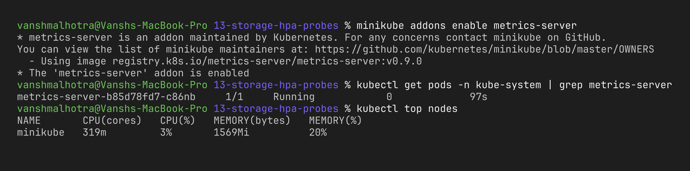
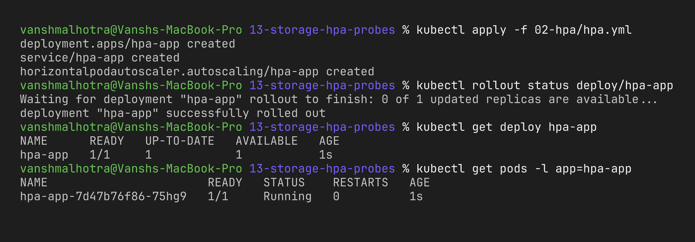
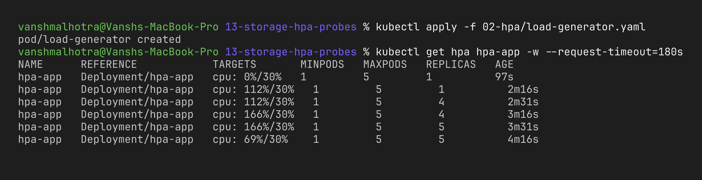
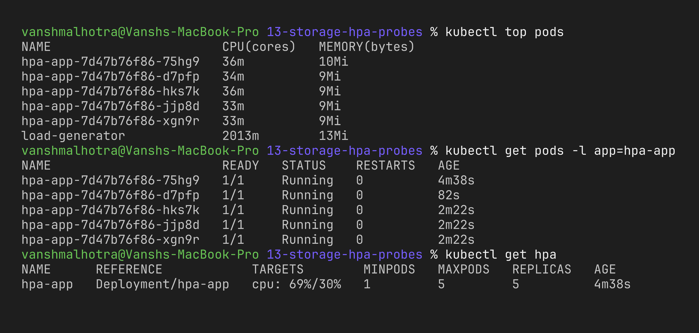
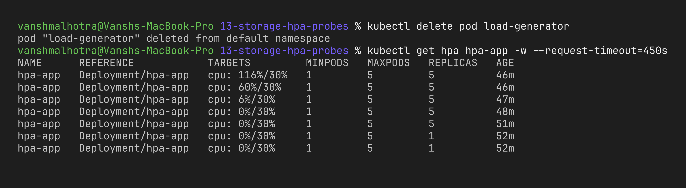
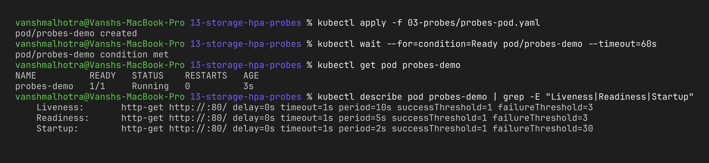
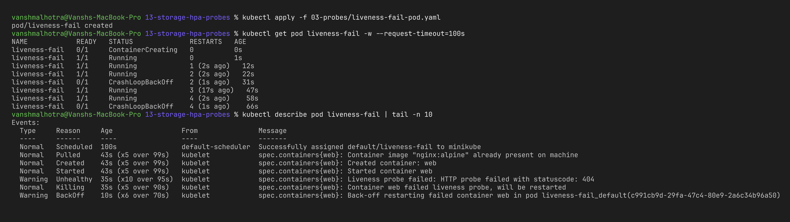

# Session 13 – Kubernetes Storage, HPA & Probes

**Name:** Vansh Malhotra  
**Roll No:** 24bcs10268

This session was about three things a real app needs once it runs on Kubernetes: **storage that survives pods**, **automatic scaling** when traffic increases, and **health checks** so Kubernetes knows when something is wrong. I did all the hands-on parts on minikube.

## Folder structure

```
13-storage-hpa-probes/
├── 01-kubernetes-volumes/   # Task 1 – volume notes + example YAMLs (own README)
├── 02-hpa/
│   ├── hpa.yml              # Task 2 – Deployment + Service + HPA
│   └── load-generator.yaml  # Task 2 – pod that floods the service
├── 03-probes/               # extra – probes demo
├── mini-project/            # Task 3 – notes-app (own README)
└── screenshots/
```

| Task | Where |
| :--- | :--- |
| Task 1 – Kubernetes Volumes | [`01-kubernetes-volumes/README.md`](01-kubernetes-volumes/README.md) |
| Task 2 – HPA hands-on | this file, below |
| Probes (extra) | this file, below |
| Task 3 – Mini project | [`mini-project/README.md`](mini-project/README.md) |

---

## Task 2: HPA Hands-on

### What is HPA?

The **HorizontalPodAutoscaler** automatically changes the number of replicas of a Deployment based on a metric – most commonly average CPU usage. Every ~15 seconds it checks metrics and calculates:

```
desiredReplicas = ceil( currentReplicas × currentCPU% / targetCPU% )
```

For example, 1 pod at 90% with a 30% target → `ceil(1 × 90 / 30) = 3` pods.

Two things are required for this to work:
1. **metrics-server** must be running (it provides the CPU numbers, same thing `kubectl top` uses).
2. The container must have **`resources.requests.cpu`**, because the percentage is calculated against the request. Without it, the HPA shows `<unknown>`.

My [`02-hpa/hpa.yml`](02-hpa/hpa.yml) has:
- Deployment `hpa-app` (nginx, `requests.cpu: 50m`, starts with 1 replica)
- Service `hpa-app`
- HPA: `minReplicas: 1`, `maxReplicas: 5`, target **30% CPU** (kept low so a simple nginx scales in a demo)

[`02-hpa/load-generator.yaml`](02-hpa/load-generator.yaml) is a busybox pod that runs 4 parallel `wget` loops against `http://hpa-app.default.svc.cluster.local` forever.

### Step 1 – Enable metrics-server

```bash
minikube addons enable metrics-server
kubectl get pods -n kube-system | grep metrics-server
kubectl top nodes
```

(It takes about a minute before `kubectl top` starts returning numbers.)



### Step 2 – Deploy the application and configure HPA

```bash
kubectl apply -f 02-hpa/hpa.yml
kubectl rollout status deploy/hpa-app
kubectl get deploy hpa-app
kubectl get pods -l app=hpa-app
```



### Step 3 – Verify HPA (before load)

```bash
kubectl get hpa
kubectl describe hpa hpa-app
kubectl top pods
```


(The `FailedGetResourceMetric` warnings in the events are from the first minute, before metrics-server had scraped the new pod – after that the HPA reads `0%`.)

### Step 4 – Deploy the load generator and increase load

```bash
kubectl apply -f 02-hpa/load-generator.yaml
kubectl get pod load-generator
```

Then in a second terminal I kept watching the HPA and pods:

```bash
kubectl get hpa hpa-app -w
# and in a third terminal
kubectl get pods -l app=hpa-app -w
```



### Step 5 – Observe CPU utilisation and pod scaling

```bash
kubectl top pods
kubectl get pods -l app=hpa-app
kubectl get hpa
```



```bash
kubectl describe hpa hpa-app
```


### Step 6 – Remove load and watch scale down

```bash
kubectl delete pod load-generator
kubectl get hpa hpa-app -w
```



### What I observed

- As soon as the load generator started, CPU per pod went way above the 30% target (112%) and the HPA jumped straight from 1 to 4 pods, then to 5 (the max) a minute later.
- After adding pods, the **average** CPU per pod dropped because the load was shared – that's exactly how HPA reaches a stable number of replicas.
- Scaling **down** was much slower than scaling up. This is on purpose: the HPA has a default **5 minute stabilization window** for scale-down so it doesn't keep adding and removing pods when traffic goes up and down (called "flapping").
- It never went above `maxReplicas: 5`, which protects the cluster from runaway scaling.

### Useful commands summary

| Command | Use |
| :--- | :--- |
| `kubectl get hpa` | current metric vs target, min/max, current replicas |
| `kubectl get hpa -w` | watch it change live |
| `kubectl describe hpa <name>` | conditions + scaling events and reasons |
| `kubectl get pods` | see new replicas being created/terminated |
| `kubectl top pods` | actual CPU/memory usage per pod (from metrics-server) |
| `kubectl autoscale deploy hpa-app --cpu-percent=30 --min=1 --max=5` | create an HPA without YAML |

---

## Probes (extra demo)

Probes are health checks that the **kubelet** runs against a container:

| Probe | Question it answers | What happens on failure |
| :--- | :--- | :--- |
| **startupProbe** | Has the app finished starting? | Liveness/readiness are paused until it passes; if it never passes, container is restarted |
| **readinessProbe** | Can it receive traffic right now? | Pod is **removed from Service endpoints** (no restart) |
| **livenessProbe** | Is it still alive / not stuck? | Container is **restarted** |

Probe types: `httpGet`, `tcpSocket`, `exec` (run a command) and `grpc`.

### Healthy pod with all 3 probes

```bash
kubectl apply -f 03-probes/probes-pod.yaml
kubectl get pod probes-demo
kubectl describe pod probes-demo | grep -E "Liveness|Readiness|Startup"
```



### Failing liveness probe

[`03-probes/liveness-fail-pod.yaml`](03-probes/liveness-fail-pod.yaml) checks `/healthz`, which nginx doesn't have, so it gets 404 every time.

```bash
kubectl apply -f 03-probes/liveness-fail-pod.yaml
kubectl get pod liveness-fail -w            # wait ~1 minute, watch RESTARTS increase
kubectl describe pod liveness-fail | tail -n 10
```



**What I observed:** nginx itself was running perfectly, but because the liveness probe kept failing, the kubelet killed and restarted the container again and again. This showed me that a wrong probe can cause an outage by itself, so the probe path must be something the app really serves.

---

## Task 3: Mini Project

See [`mini-project/README.md`](mini-project/README.md) – a notes app that combines PVC storage, all three probes, resource requests/limits, a Service and an HPA.

## Cleanup

```bash
kubectl delete -f 02-hpa/ -f 03-probes/ --ignore-not-found
```
