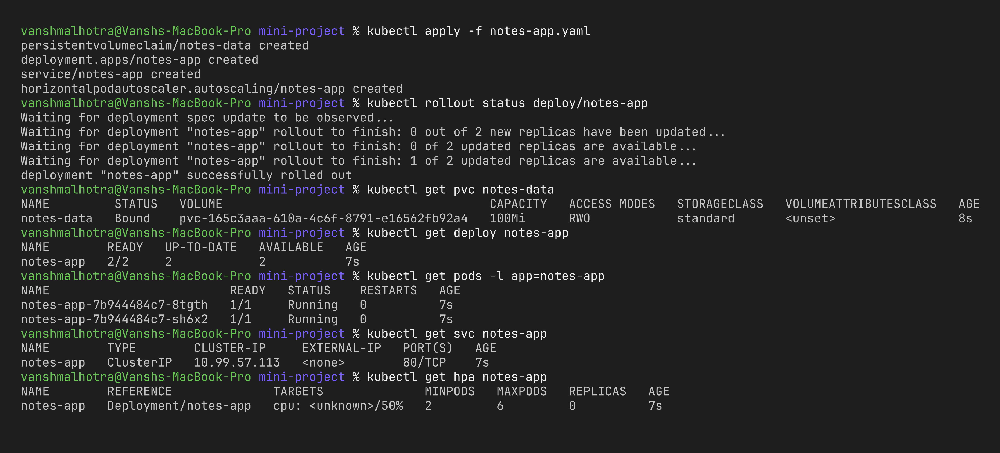
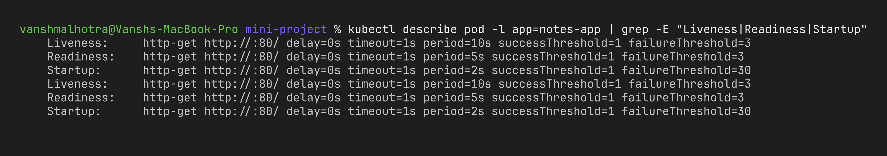
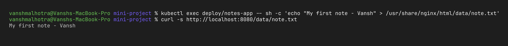
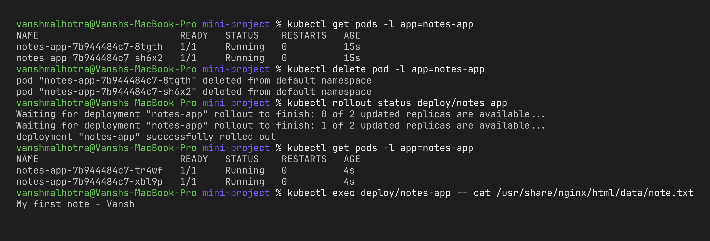
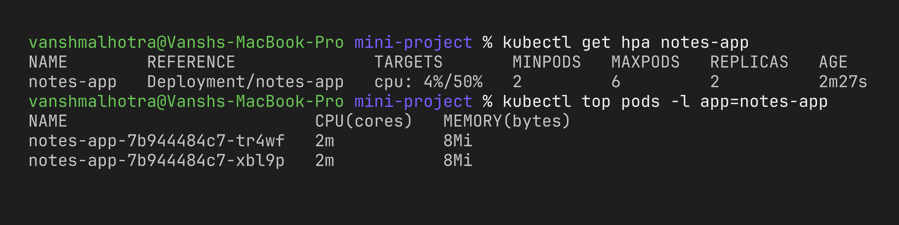

# Session 13 – Task 3: Mini Project (Notes App)

**Name:** Vansh Malhotra  
**Roll No:** 24bcs10268

## Goal

For the mini project I combined everything from this session into one "production style" web app called **notes-app**, all in [`notes-app.yaml`](notes-app.yaml):

| Piece | What it does |
| :--- | :--- |
| `PersistentVolumeClaim notes-data` | 100Mi of persistent storage (dynamically provisioned from the default StorageClass) |
| `Deployment notes-app` | 2 nginx replicas with CPU/memory **requests and limits** |
| startup / readiness / liveness **probes** | Kubernetes knows when the app has started, when it can get traffic and when it must be restarted |
| `Service notes-app` | stable ClusterIP in front of the pods |
| `HorizontalPodAutoscaler notes-app` | scales between 2 and 6 pods at 50% CPU |

```
              ┌────────── HPA (2-6 pods, 50% CPU) ──────────┐
Service ──►   │  notes-app pod  ──┐                          │
              │  notes-app pod  ──┴──► PVC notes-data ──► PV │
              └─────────────────────────────────────────────┘
```

> Note: the PVC is `ReadWriteOnce`. That works here because minikube has a single node, so both replicas run on the same node. On a multi-node cluster I would need `ReadWriteMany` storage (NFS/EFS) or a StatefulSet with one PVC per pod.

## Steps

### 1. Deploy everything

```bash
kubectl apply -f notes-app.yaml
kubectl rollout status deploy/notes-app
kubectl get pvc notes-data
kubectl get deploy notes-app
kubectl get pods -l app=notes-app
kubectl get svc notes-app
kubectl get hpa notes-app
```



### 2. Check the probes

```bash
kubectl describe pod -l app=notes-app | grep -E "Liveness|Readiness|Startup"
```



### 3. Write a note to the persistent volume and read it through the Service

```bash
kubectl exec deploy/notes-app -- sh -c 'echo "My first note - Vansh" > /usr/share/nginx/html/data/note.txt'
kubectl port-forward svc/notes-app 8080:80
# in another terminal
curl -s http://localhost:8080/data/note.txt
```



### 4. Prove the data survives pod deletion

```bash
kubectl delete pod -l app=notes-app
kubectl rollout status deploy/notes-app     # wait for the new pods
kubectl get pods -l app=notes-app
kubectl exec deploy/notes-app -- cat /usr/share/nginx/html/data/note.txt
```



### 5. Check the HPA

```bash
kubectl get hpa notes-app
kubectl top pods -l app=notes-app
```



## What I learnt

- Storage, health checks and autoscaling are not separate topics – a real app needs all of them together.
- **Probes + HPA work together:** new pods created by the HPA only receive traffic once their readiness probe passes, so scaling up doesn't send users to half-started pods.
- **Requests are required for HPA:** without `resources.requests.cpu`, the HPA shows `<unknown>` for CPU because it calculates percentage against the request.
- Data written to the PVC outlived the pods, which a normal container filesystem would not do.

## Cleanup

```bash
kubectl delete -f notes-app.yaml
```
