# Session 14 – Kubernetes Troubleshooting

**Name:** Vansh Malhotra  
**Roll No:** 24bcs10268

This session was all about **debugging**. Instead of only deploying things that work, I broke things on purpose and practised finding out *why* they were broken. I used minikube on my Mac for everything.

## Folder structure

```
14-k8s-troubleshooting/
├── scenarios/                 # Task 2 – one broken + one fixed YAML per issue
│   ├── 01-crashloopbackoff.yaml        / 01-crashloopbackoff-fixed.yaml
│   ├── 02-imagepullbackoff.yaml        / 02-imagepullbackoff-fixed.yaml
│   ├── 03-errimagepull.yaml            / 03-errimagepull-fixed.yaml
│   ├── 04-pending.yaml                 / 04-pending-fixed.yaml
│   ├── 05-containercreating.yaml       / 05-containercreating-fixed.yaml
│   ├── 06-service-connectivity.yaml    / 06-service-connectivity-fixed.yaml
│   ├── 07-dns-issue.yaml               / 07-dns-issue-fixed.yaml
│   ├── 08-pod-networking.yaml          / 08-pod-networking-fixed.yaml
│   └── 09-config-issue.yaml            / 09-config-issue-fixed.yaml
├── mini-project/              # Task 3
│   ├── broken-stack.yaml
│   └── fixed-stack.yaml
└── screenshots/
```

My general approach for every problem:

```
kubectl get  →  kubectl describe (Events)  →  kubectl logs  →  kubectl exec  →  fix  →  verify
  symptom         cluster's view              app's view        poke inside
```

---

## Task 1: Kubernetes troubleshooting commands

To practise the commands I first created a small healthy deployment:

```bash
kubectl create deployment demo-web --image=nginx:alpine --replicas=2
kubectl expose deployment demo-web --port=80
minikube addons enable metrics-server     # needed for kubectl top
```

### 1. `kubectl get` – what is the current state?

Lists resources and their status. First command I run every time.

```bash
kubectl get pods
kubectl get deploy,rs,svc
kubectl get pods -A                # all namespaces
kubectl get pods --show-labels
```

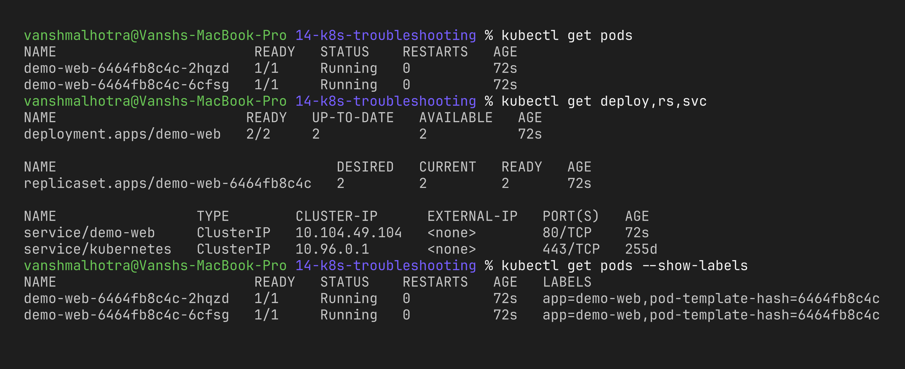

### 2. `kubectl get -o wide` – extra columns

Shows the **pod IP** and the **node** it is running on (and for services, the selector). Very useful for networking problems.

```bash
kubectl get pods -o wide
kubectl get svc -o wide
kubectl get nodes -o wide
```

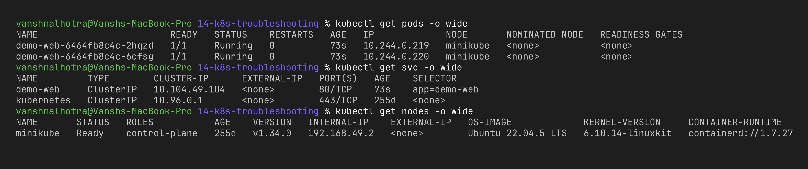

### 3. `kubectl describe` – full details + Events

Shows the full spec plus the **Events** at the bottom (scheduling, image pulls, probe failures, mount errors). This is where most problems are explained.

```bash
kubectl describe pod <demo-web-pod-name>
kubectl describe deploy demo-web
```

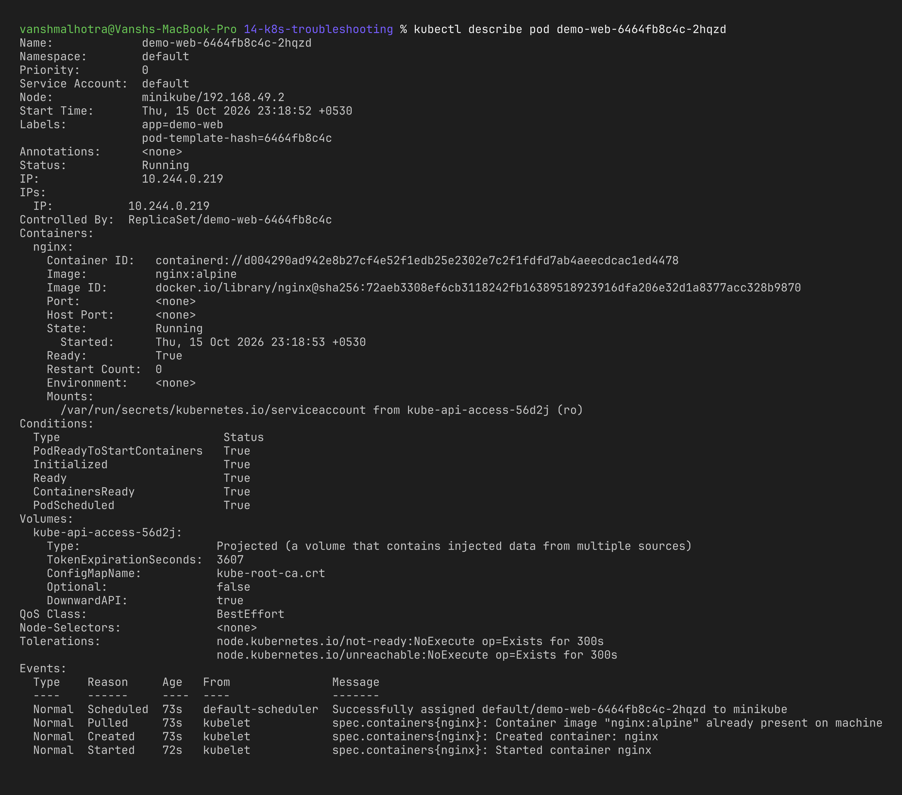

### 4. `kubectl logs` – what did the app print?

Shows stdout/stderr of the container. `--previous` shows the logs of the **last crashed** container, `-f` follows live, `-c` picks a container in multi-container pods.

```bash
kubectl logs deploy/demo-web
kubectl logs <pod-name> --tail=20
kubectl logs <pod-name> --previous     # only works if the container restarted
```

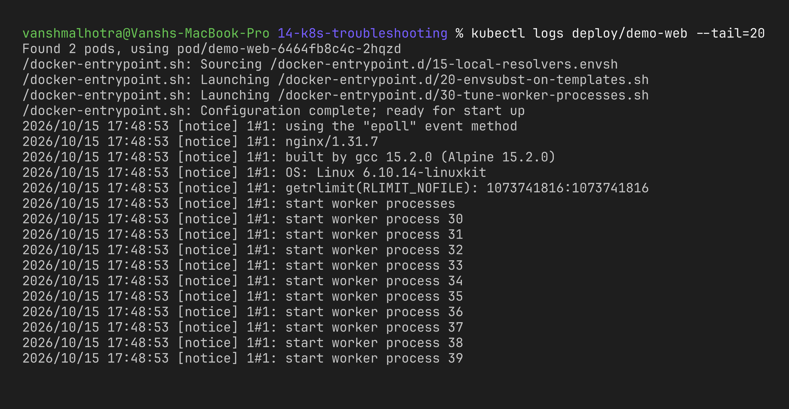

### 5. `kubectl exec` – run commands inside the container

```bash
kubectl exec <pod-name> -- hostname
kubectl exec <pod-name> -- cat /etc/resolv.conf
kubectl exec -it <pod-name> -- sh       # interactive shell, exit with 'exit'
```

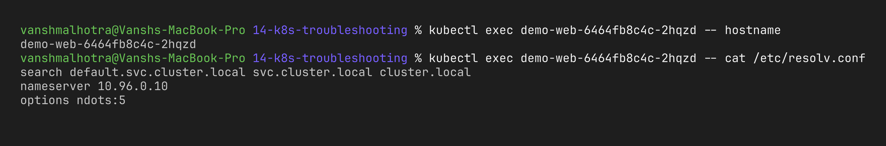

### 6. `kubectl events` / `kubectl get events` – timeline of the cluster

```bash
kubectl events | tail -n 15                      # newer command
kubectl get events --sort-by=.lastTimestamp | tail -n 15   # older style, sorted by time
kubectl events --types=Warning                   # only problems
```

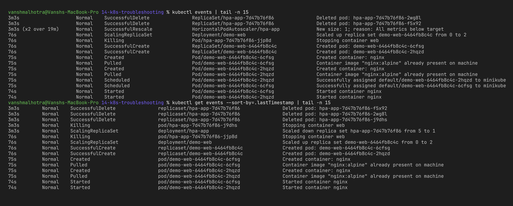

### 7. `kubectl explain` – built-in documentation

When I don't remember a YAML field I can ask the API itself instead of googling.

```bash
kubectl explain pod.spec.containers.livenessProbe
kubectl explain deployment.spec.strategy --recursive
```

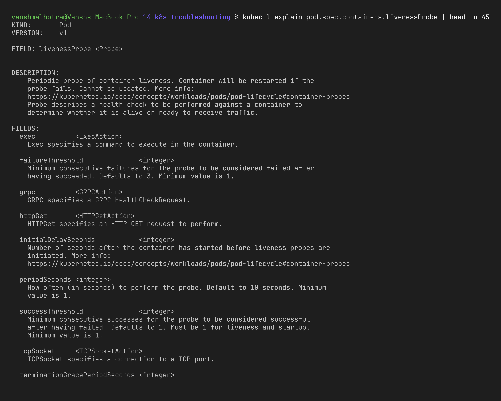

### 8. `kubectl top` – CPU and memory usage

Needs metrics-server. Helps with OOMKilled pods, slow apps and HPA debugging.

```bash
kubectl top nodes
kubectl top pods
kubectl top pods --sort-by=memory -A
```

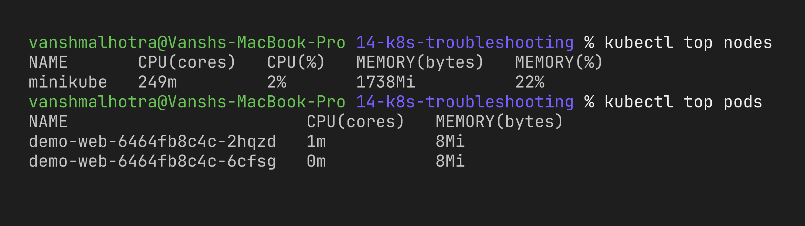

### Summary

| Command | Tells me | Use it when |
| :--- | :--- | :--- |
| `get` | status, ready count, restarts | always first |
| `get -o wide` | pod IP, node | networking / which node |
| `describe` | spec + Events | pod stuck before starting |
| `logs` / `logs --previous` | app output | app crashes or errors |
| `exec` | run commands inside | check files, env, DNS, connectivity |
| `events` | cluster timeline | something happened but not sure what |
| `explain` | field docs | writing/fixing YAML |
| `top` | CPU / memory usage | performance, OOM, HPA |

---

## Task 2: Troubleshooting common issues

For each scenario I applied the broken YAML, investigated, wrote down the root cause, applied the fix and verified it.

> Note: `kubectl run tmp --rm -it` needs a real terminal; when the command is not run interactively I used `--rm -i` (no `-t`), the output is the same.

> Tip I used a lot: pods are mostly immutable, so to replace a pod with the fixed version I used `kubectl replace --force -f <fixed>.yaml` (delete + create in one step).

### Issue 1 – CrashLoopBackOff

**Problem:** Pod `crashy` keeps restarting and shows `CrashLoopBackOff`.

```bash
kubectl apply -f scenarios/01-crashloopbackoff.yaml
kubectl get pod crashy -w --request-timeout=40s   # watch RESTARTS go up, stops by itself after 40s
```

**Investigation:**

```bash
kubectl logs crashy --previous
kubectl describe pod crashy | grep -A5 "Last State"
```

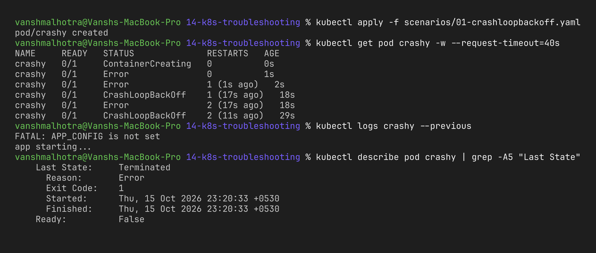

**Root cause:** The container starts fine but the application exits with code 1 because the required environment variable `APP_CONFIG` was never set. Kubernetes restarts it (restartPolicy `Always`), it crashes again, and the kubelet waits longer each time (10s, 20s, 40s ... up to 5 min) – that waiting is the "BackOff". It is an **application/config** problem, not a Kubernetes one, which is why the **logs** told me the answer.

**Fix:** Added the env var in [`01-crashloopbackoff-fixed.yaml`](scenarios/01-crashloopbackoff-fixed.yaml).

```bash
kubectl replace --force -f scenarios/01-crashloopbackoff-fixed.yaml
kubectl get pod crashy
kubectl logs crashy
```

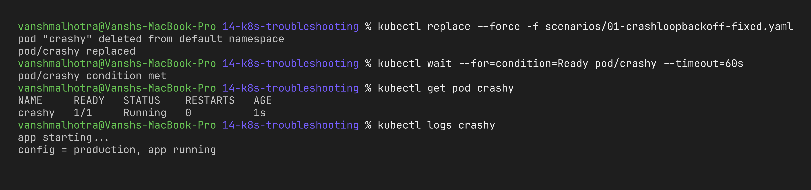

---

### Issue 2 – ImagePullBackOff

**Problem:** Pod `bad-tag` stays `0/1` with status `ImagePullBackOff`.

```bash
kubectl apply -f scenarios/02-imagepullbackoff.yaml
kubectl get pod bad-tag
kubectl describe pod bad-tag | tail -n 10
```


**Root cause:** The registry (Docker Hub) is reachable, but the tag `this-tag-does-not-exist` does not exist for the `nginx` repository, so the pull returns "not found". After failing, the kubelet keeps retrying with increasing delay → `ImagePullBackOff`. Other common causes are typos in the image name and a missing `imagePullSecrets` for private registries.

**Fix:** Use a real tag ([`02-imagepullbackoff-fixed.yaml`](scenarios/02-imagepullbackoff-fixed.yaml)). For a Deployment I could also do `kubectl set image deploy/<name> <container>=nginx:alpine`.

```bash
kubectl replace --force -f scenarios/02-imagepullbackoff-fixed.yaml
kubectl get pod bad-tag
```

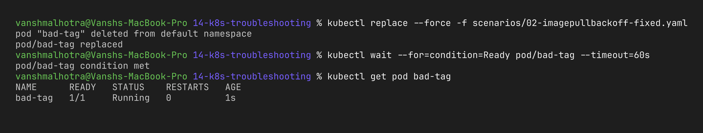

---

### Issue 3 – ErrImagePull

**Problem:** Pod `bad-registry` shows `ErrImagePull` right after creation.

`ErrImagePull` is the status at the **moment a pull fails**; `ImagePullBackOff` is what you see **between retries**. So the two alternate. To catch `ErrImagePull` I watched the pod immediately after applying:

```bash
kubectl apply -f scenarios/03-errimagepull.yaml && kubectl get pod bad-registry -w
kubectl describe pod bad-registry | tail -n 10
```


**Root cause:** This time the problem is not the tag – the **registry host itself** (`registry.does-not-exist.invalid`) cannot be resolved, so the node can't even connect to it. In real life this happens with a typo in a private registry URL, a registry that is down, or a node without internet/proxy access.

**Fix:** Point the image to a registry that exists ([`03-errimagepull-fixed.yaml`](scenarios/03-errimagepull-fixed.yaml)).

```bash
kubectl replace --force -f scenarios/03-errimagepull-fixed.yaml
kubectl get pod bad-registry
```

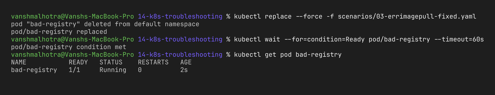

---

### Issue 4 – Pending

**Problem:** Pod `stuck-pending` stays `Pending` forever, with no IP and no NODE.

```bash
kubectl apply -f scenarios/04-pending.yaml
kubectl get pod stuck-pending -o wide
kubectl describe pod stuck-pending | tail -n 5
kubectl describe node minikube | grep -A8 "Allocatable"
```

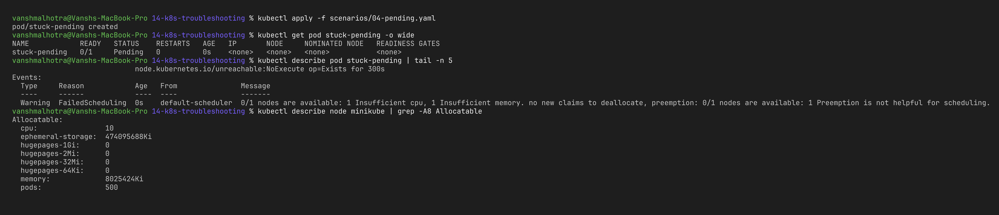

**Root cause:** The scheduler could not find any node that can satisfy the pod's **requests** (`cpu: 64`, `memory: 256Gi`), while my minikube node only has 10 CPUs and about 8 GB of RAM allocatable. `Pending` always means "not scheduled yet". Other causes: nodeSelector/affinity not matching any node, taints without tolerations, or a PVC that is not bound.

**Fix:** Set realistic requests ([`04-pending-fixed.yaml`](scenarios/04-pending-fixed.yaml)).

```bash
kubectl replace --force -f scenarios/04-pending-fixed.yaml
kubectl get pod stuck-pending -o wide
```

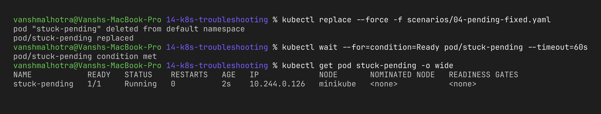

---

### Issue 5 – ContainerCreating (stuck)

**Problem:** Pod `stuck-creating` is scheduled on a node but stays in `ContainerCreating` for minutes.

```bash
kubectl apply -f scenarios/05-containercreating.yaml
kubectl get pod stuck-creating
kubectl describe pod stuck-creating | tail -n 5
kubectl get secret web-tls
```

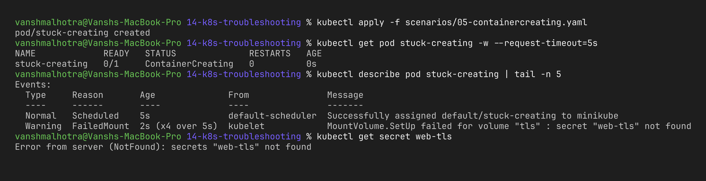

**Root cause:** The pod mounts a volume from Secret `web-tls`, but that Secret was never created. The kubelet can't prepare the volume, so it cannot start the container and keeps retrying the mount. Other causes of a long `ContainerCreating`: a very big image still being pulled, a PVC that can't attach, or CNI (network plugin) problems.

**Fix:** Create the missing Secret ([`05-containercreating-fixed.yaml`](scenarios/05-containercreating-fixed.yaml), fake demo values). I didn't need to recreate the pod – the kubelet retried and the pod started by itself.

```bash
kubectl apply -f scenarios/05-containercreating-fixed.yaml
kubectl get pod stuck-creating -w        # became Running a few seconds later
```

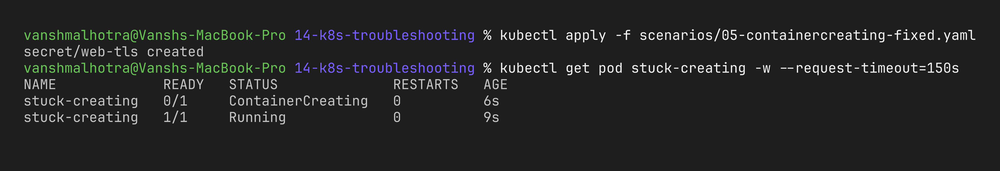

---

### Issue 6 – Service connectivity

**Problem:** The pods of `web-backend` are Running, but calling the Service from another pod fails.

```bash
kubectl apply -f scenarios/06-service-connectivity.yaml
kubectl run tmp --rm -i --image=busybox:1.36 --restart=Never -- wget -T 3 -qO- http://web-backend-svc
```

**Investigation:**

```bash
kubectl get endpoints web-backend-svc
kubectl describe svc web-backend-svc | grep Selector
kubectl get pods -l app=web-backend --show-labels
```

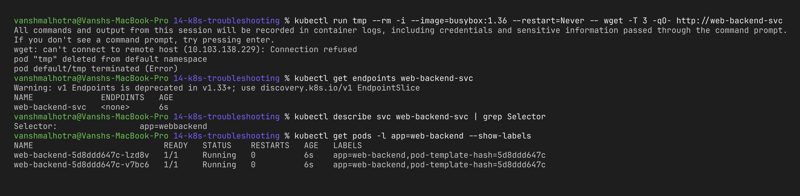

**Root cause:** A Service finds its pods only through its **label selector**. The selector is `app=webbackend` (missing dash) but the pods are labelled `app=web-backend`, so the Service selects zero pods and has **no endpoints**. Kubernetes gives no error for this – it silently does nothing, which is why `kubectl get endpoints` is the most important check for service problems.

**Fix:** Correct the selector ([`06-service-connectivity-fixed.yaml`](scenarios/06-service-connectivity-fixed.yaml)). A quick alternative is `kubectl patch svc web-backend-svc -p '{"spec":{"selector":{"app":"web-backend"}}}'`.

```bash
kubectl apply -f scenarios/06-service-connectivity-fixed.yaml
kubectl get endpoints web-backend-svc
kubectl run tmp --rm -i --image=busybox:1.36 --restart=Never -- wget -T 3 -qO- http://web-backend-svc
```

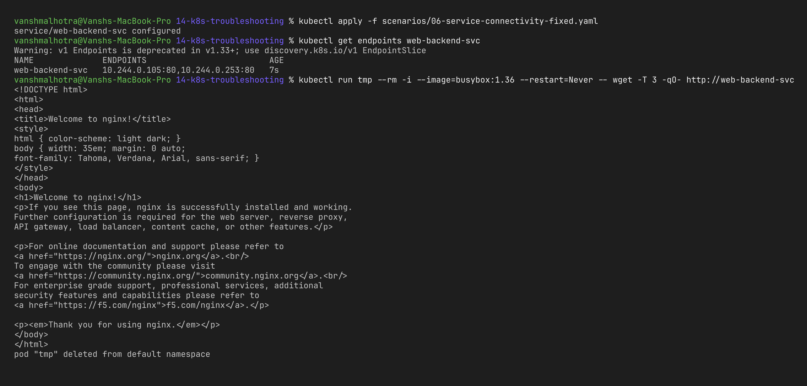

---

### Issue 7 – DNS issue

**Problem:** From pod `dns-client` I can't reach any Service by name, even though the Services exist.

```bash
kubectl apply -f scenarios/07-dns-issue.yaml
kubectl exec dns-client -- nslookup kubernetes.default.svc.cluster.local
kubectl exec dns-client -- cat /etc/resolv.conf
kubectl get svc -n kube-system kube-dns
kubectl get pods -n kube-system -l k8s-app=kube-dns
```

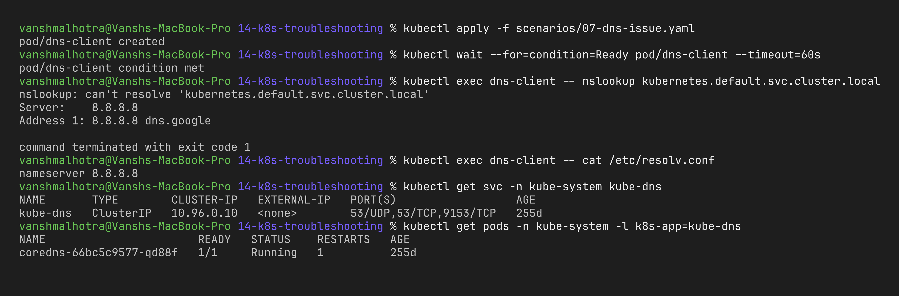

**Root cause:** CoreDNS itself was fine. The pod had `dnsPolicy: None` with a custom `nameserver 8.8.8.8`, so its DNS queries went to Google's public DNS, which knows nothing about `*.cluster.local` names. Normally the kubelet writes the CoreDNS Service IP (`10.96.0.10`) and the search domains into every pod's `/etc/resolv.conf`; that was overridden here. (Other DNS problems I learnt to check: CoreDNS pods crashing, wrong namespace in the short name – `svc` only resolves within the same namespace, use `svc.namespace` otherwise – and NetworkPolicies blocking UDP/TCP 53.)

**Fix:** Remove the custom DNS config so the default `dnsPolicy: ClusterFirst` is used ([`07-dns-issue-fixed.yaml`](scenarios/07-dns-issue-fixed.yaml)).

```bash
kubectl replace --force -f scenarios/07-dns-issue-fixed.yaml
kubectl exec dns-client -- cat /etc/resolv.conf
kubectl exec dns-client -- nslookup kubernetes.default.svc.cluster.local
kubectl exec dns-client -- nslookup web-backend-svc
```

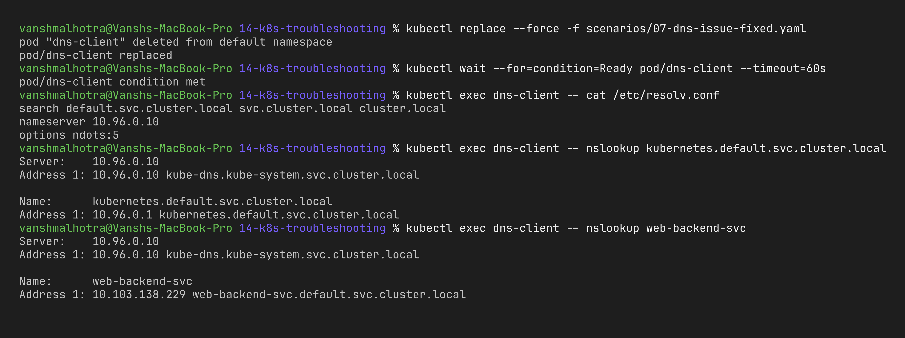

---

### Issue 8 – Pod networking issue

**Setup note:** NetworkPolicies are only enforced if the cluster's network plugin (CNI) supports them. The default minikube bridge network does not. My minikube cluster already runs **Cilium** as its CNI (you can see the `cilium-*` pods in `kube-system`), which enforces NetworkPolicy, so I could do this scenario on the same cluster. On a plain minikube you would start a separate profile with Calico:

```bash
kubectl get pods -n kube-system | grep cilium               # my cluster: Cilium is the CNI
# otherwise: minikube start -p netpol --cni=calico && kubectl config use-context netpol
```

**Problem:** The `api` pod is Running, the Service has endpoints, DNS works – but the `client` pod still can't connect to it (it just hangs).

```bash
kubectl apply -f scenarios/08-pod-networking.yaml
kubectl rollout status deploy/api && kubectl wait --for=condition=Ready pod/client
kubectl exec client -- wget -T 3 -qO- http://api-svc
kubectl get endpoints api-svc
kubectl get pods -o wide
kubectl exec client -- wget -T 3 -qO- http://<api-pod-ip>      # direct to pod IP also fails
kubectl get networkpolicy
kubectl describe networkpolicy api-deny-all
```

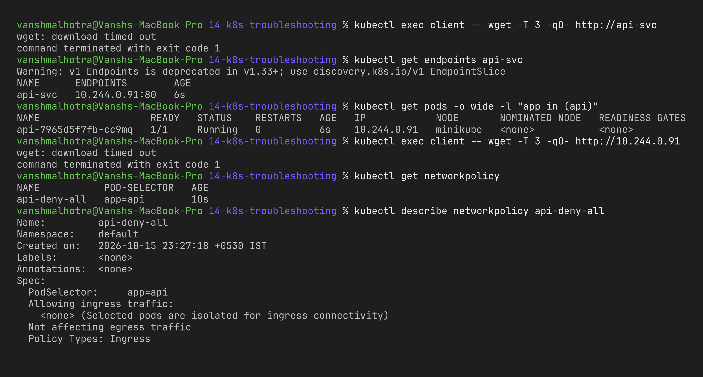

**Root cause:** Since even the direct pod IP timed out, the issue was at the pod network level, not Service/DNS. The NetworkPolicy `api-deny-all` selects the `api` pods and has `policyTypes: [Ingress]` with **no ingress rules**, which means "deny all incoming traffic". A timeout (instead of "connection refused") is the typical sign of packets being dropped by a policy/firewall.

**Fix:** Add a policy that allows the client pods in on port 80 ([`08-pod-networking-fixed.yaml`](scenarios/08-pod-networking-fixed.yaml)). NetworkPolicies are additive, so the allow rule opens just this path while everything else stays blocked.

```bash
kubectl apply -f scenarios/08-pod-networking-fixed.yaml
kubectl exec client -- wget -T 3 -qO- http://api-svc
kubectl run other --rm -i --image=busybox:1.36 --restart=Never -- wget -T 3 -qO- http://api-svc   # no role=client label -> still blocked
```

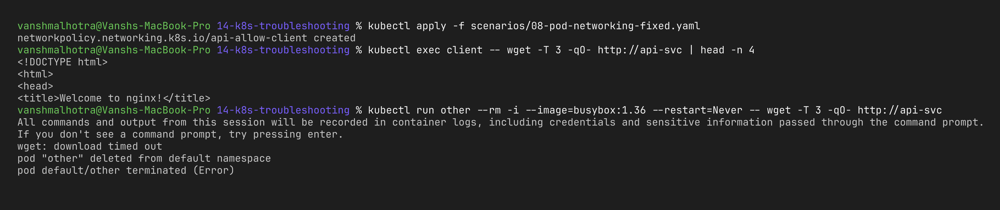

(If you used a separate `netpol` profile: switch back with `kubectl config use-context minikube` and `minikube delete -p netpol`.)

---

### Issue 9 – Configuration issue

**Problem:** Pod `bad-config-pod` shows `CreateContainerConfigError`.

```bash
kubectl apply -f scenarios/09-config-issue.yaml
kubectl get pod bad-config-pod
kubectl describe pod bad-config-pod | tail -n 5
kubectl get configmap shop-config -o yaml
```

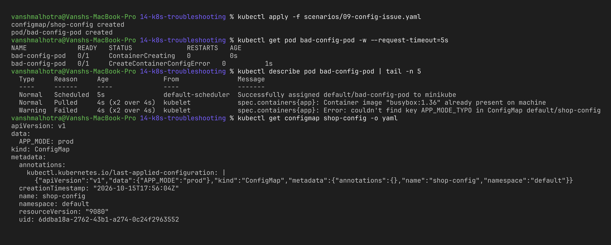

**Root cause:** The ConfigMap exists, but the pod asks for the key `APP_MODE_TYPO`, which isn't in it (the real key is `APP_MODE`). Because a required env var can't be built, the kubelet refuses to create the container. (If the env var were optional I could add `optional: true`, but here the app needs it.)

**Fix:** Use the correct key ([`09-config-issue-fixed.yaml`](scenarios/09-config-issue-fixed.yaml)).

```bash
kubectl replace --force -f scenarios/09-config-issue-fixed.yaml
kubectl get pod bad-config-pod
kubectl logs bad-config-pod
```

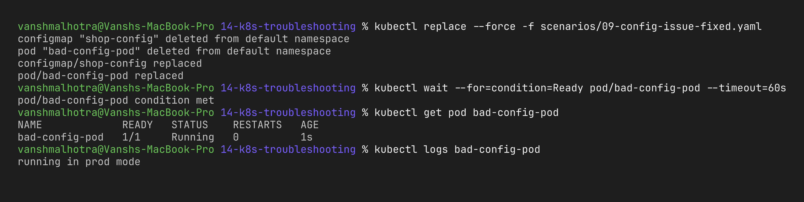

---

### My triage cheat sheet

| Status / symptom | First command | Usual cause |
| :--- | :--- | :--- |
| `Pending` | `describe pod` → Events | not enough resources, selector/taints, unbound PVC |
| `ContainerCreating` (long) | `describe pod` → Events | missing Secret/ConfigMap volume, PVC attach, big image, CNI |
| `ErrImagePull` / `ImagePullBackOff` | `describe pod` → Events | wrong tag/name, registry unreachable, no pull secret |
| `CreateContainerConfigError` | `describe pod` → Events | missing ConfigMap/Secret or key |
| `CrashLoopBackOff` | `logs --previous` | app error, missing env/config, bad command |
| `OOMKilled` | `describe pod` → Last State | memory limit too low |
| Running but Service fails | `get endpoints <svc>` | selector mismatch, wrong targetPort, readiness failing |
| Name doesn't resolve | `exec -- nslookup`, `cat /etc/resolv.conf` | CoreDNS down, wrong namespace, dnsPolicy |
| Timeout even to pod IP | `get networkpolicy` | NetworkPolicy blocking traffic |

---

## Task 3: Mini Project – the broken shop stack

[`mini-project/broken-stack.yaml`](mini-project/broken-stack.yaml) deploys a small `shop-frontend` (Deployment + Secret + Service) that has **three bugs hidden in it**. My job was to find and fix all of them. [`mini-project/fixed-stack.yaml`](mini-project/fixed-stack.yaml) is my final corrected version.

### Problem statement

After `kubectl apply -f mini-project/broken-stack.yaml`, the shop frontend pods never become ready and the Service doesn't serve anything.

```bash
kubectl apply -f mini-project/broken-stack.yaml
kubectl get deploy,pods,svc,endpoints
```

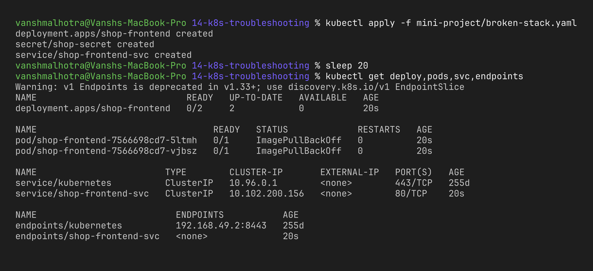

### Bug 1 – ImagePullBackOff

**Investigation:**

```bash
kubectl get pods -l app=shop-frontend
kubectl describe pod <one-pod-name> | grep -A3 "Failed"
```

(Note: with my kubectl v1.37, `kubectl describe pod -l app=...` printed the pods without their Events section, so I described one pod by name.)

**Root cause:** the image is `nginx:does-not-exist` – an invalid tag.

**Fix:**

```bash
kubectl set image deployment/shop-frontend web=nginx:alpine
kubectl get pods -l app=shop-frontend
```


### Bug 2 – CreateContainerConfigError

This one was hidden behind bug 1 – the container never reached the config step while the image couldn't be pulled.

**Investigation:**

```bash
kubectl describe pod <new-pod-name> | grep -i "error"
kubectl get secret shop-secret -o jsonpath='{.data}'; echo
```

**Root cause:** the pod wants key `api-key` from Secret `shop-secret`, but the Secret only contains a key called `token`.

**Fix:** put the expected key into the Secret (demo value `demo-key`):

```bash
kubectl create secret generic shop-secret --from-literal=api-key=demo-key \
  --dry-run=client -o yaml | kubectl apply -f -
kubectl rollout restart deployment/shop-frontend
kubectl rollout status deployment/shop-frontend
kubectl get pods -l app=shop-frontend
```

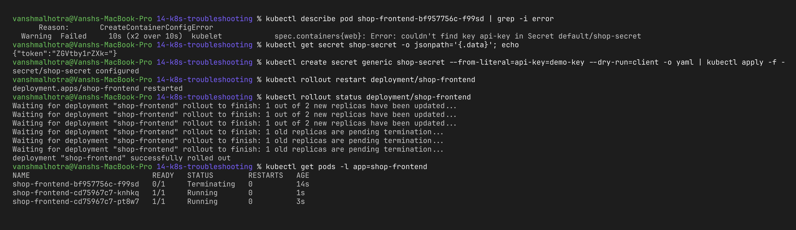

### Bug 3 – Service has no endpoints

Pods were now Running, but the Service still didn't work.

**Investigation:**

```bash
kubectl get endpoints shop-frontend-svc
kubectl describe svc shop-frontend-svc | grep Selector
kubectl get pods -l app=shop-frontend --show-labels
```

**Root cause:** Service selector is `app=shopfront`, pods are labelled `app=shop-frontend`.

**Fix:**

```bash
kubectl patch svc shop-frontend-svc -p '{"spec":{"selector":{"app":"shop-frontend"}}}'
kubectl get endpoints shop-frontend-svc
```

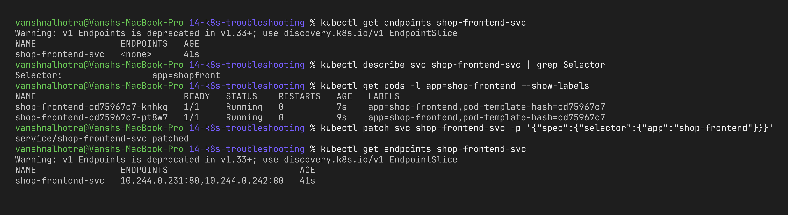

### Final verification (clean apply of the fixed stack)

To make sure my fixed YAML is correct by itself, I deleted everything and applied only `fixed-stack.yaml`:

```bash
kubectl delete -f mini-project/broken-stack.yaml
kubectl apply -f mini-project/fixed-stack.yaml
kubectl rollout status deployment/shop-frontend
kubectl get deploy,pods,endpoints
kubectl run tmp --rm -i --image=busybox:1.36 --restart=Never -- wget -qO- http://shop-frontend-svc | head -n 4
```

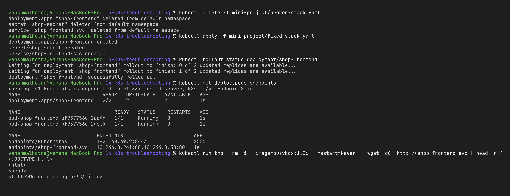

### What I learnt from the mini project

- **Bugs hide behind each other.** Fixing the image only revealed the Secret problem; fixing the pods only revealed the Service problem. So after every fix I have to check again from the start.
- I worked **from the inside out**: can it be scheduled → can the image be pulled → can the config be built → does the app run → can traffic reach it.
- Patching live objects (`set image`, `patch`) is fine for quick debugging, but the real fix must go back into the YAML (or Git), otherwise the next deploy brings the bug back.

## Cleanup

```bash
kubectl delete -f scenarios/ --ignore-not-found
kubectl delete -f mini-project/fixed-stack.yaml --ignore-not-found
kubectl delete deploy,svc demo-web
```
