# Session 15 – Helm

**Name:** Vansh Malhotra  
**Roll No:** 24bcs10268

In this session I learned Helm, which is basically the package manager for Kubernetes (like `apt` for Ubuntu or `npm` for Node). Instead of applying 5–6 YAML files one by one with `kubectl`, Helm lets me bundle them into a **chart**, fill in the changing parts from `values.yaml`, and install/upgrade/rollback the whole thing as one unit.

A few words I kept seeing:

| Term | What it means (in my words) |
| :--- | :--- |
| **Chart** | A folder/package of templated Kubernetes YAML files |
| **Release** | One installed copy of a chart in the cluster (same chart can be installed many times with different names) |
| **Revision** | Every install/upgrade/rollback creates a new numbered revision of a release |
| **values.yaml** | The default settings of a chart; can be overridden with `--set` or `-f file.yaml` |
| **Repository** | A place (URL) where packaged charts are hosted, e.g. Bitnami |
| **Templates** | Kubernetes YAML with Go template placeholders like `{{ .Values.replicaCount }}` |

## Setup

I used my local cluster (minikube / kind on Docker Desktop, macOS).

```bash
brew install helm        # only if helm is not installed
helm version
kubectl get nodes
```

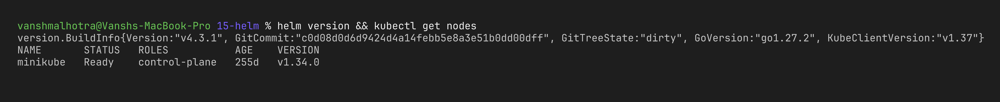

All the commands below are run from inside this `15-helm/` folder.

---

## Task 1: Helm Commands

### 1. `helm create`

**What it does:** Generates a ready-made chart skeleton (Chart.yaml, values.yaml, templates for Deployment, Service, Ingress, HPA, ServiceAccount, and a test pod). By default it deploys nginx, so I can install it directly.

```bash
helm create myapp
tree myapp        # or: find myapp -type f
```

Structure of the generated chart:

```text
myapp/
├── Chart.yaml          # name, chart version, appVersion
├── values.yaml         # default values used by the templates
├── charts/             # sub-charts (dependencies), empty for now
├── templates/
│   ├── deployment.yaml
│   ├── service.yaml
│   ├── ingress.yaml
│   ├── hpa.yaml
│   ├── httproute.yaml  # Gateway API route (disabled by default, new in recent helm versions)
│   ├── serviceaccount.yaml
│   ├── _helpers.tpl    # reusable named templates (name, labels)
│   ├── NOTES.txt       # message printed after install
│   └── tests/test-connection.yaml
└── .helmignore
```

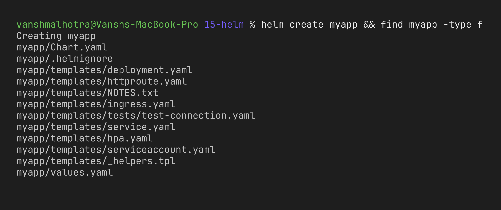

Before installing I also checked the chart for mistakes and looked at the YAML it will produce:

```bash
helm lint ./myapp
helm template myrelease ./myapp | head -40
```

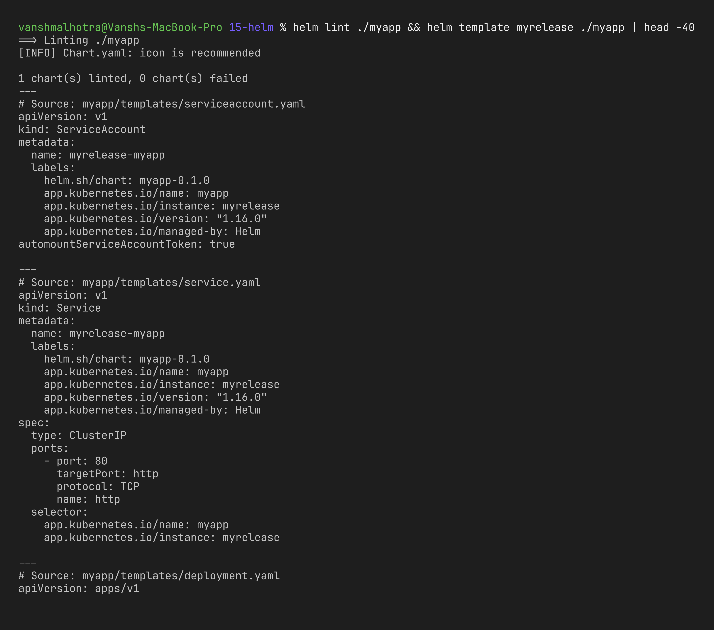

### 2. `helm install`

**What it does:** Renders the templates with the values and creates all the Kubernetes objects. This becomes **revision 1** of the release.

```bash
helm install myrelease ./myapp --set image.tag=alpine --set replicaCount=1
kubectl rollout status deploy/myrelease-myapp     # wait for the pod, otherwise it still shows Pending
kubectl get all -l app.kubernetes.io/instance=myrelease
```

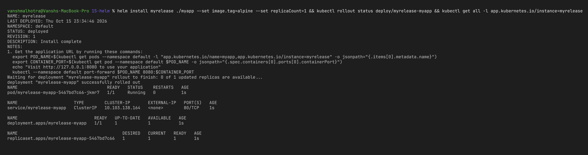

### 3. `helm list`

**What it does:** Shows all releases in the current namespace with their revision, status, chart version and app version. `-A` shows all namespaces.

```bash
helm list
helm list -A
```

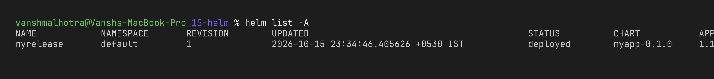

### 4. `helm status`

**What it does:** Shows the current state of one release (deployed / failed / pending), the last deployed time, the revision, and prints NOTES.txt again.

```bash
helm status myrelease
```

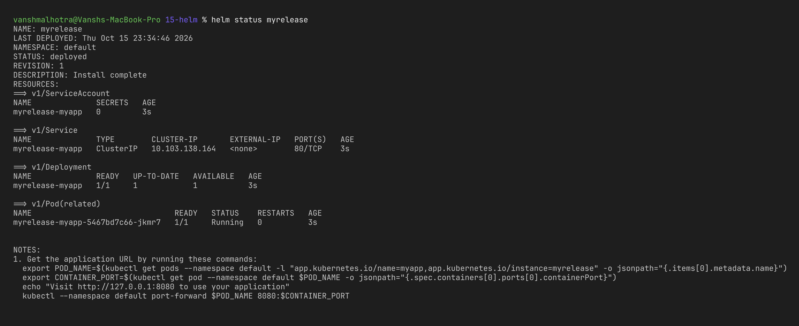

### 5. `helm get`

**What it does:** Pulls stored information about a release out of the cluster. Helm stores every revision as a Secret in the namespace, so this works even if I lost my local files.

```bash
helm get values myrelease          # only the values I overrode (--set)
helm get values myrelease -a       # all computed values (defaults + overrides)
helm get manifest myrelease        # the final YAML that was applied
helm get notes myrelease           # NOTES.txt output
helm get all myrelease             # everything together
```

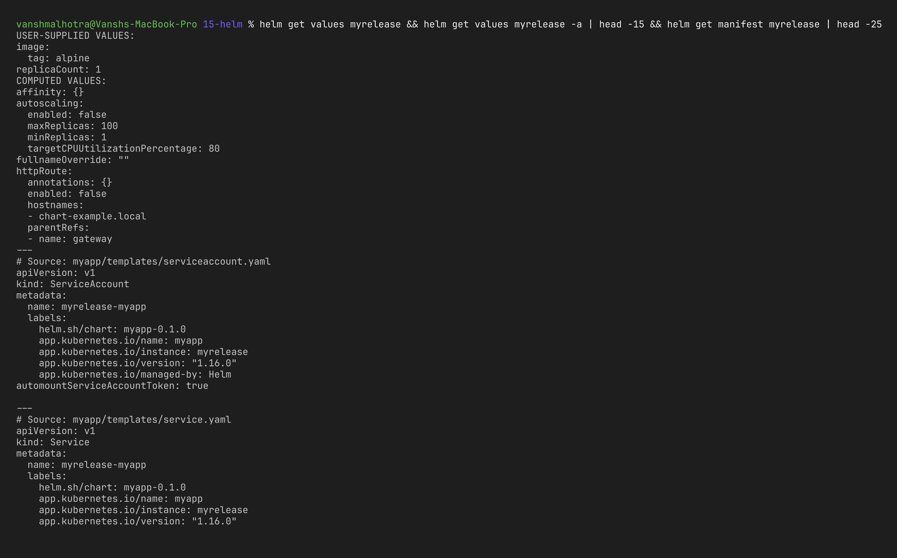

### 6. `helm upgrade`

**What it does:** Applies a new chart version or new values to an existing release. Creates the next revision. `--install` makes it install if the release does not exist yet (very useful in CI/CD).

```bash
helm upgrade myrelease ./myapp --set image.tag=1.27-alpine --set replicaCount=2
kubectl rollout status deploy/myrelease-myapp
kubectl get pods -l app.kubernetes.io/instance=myrelease
```

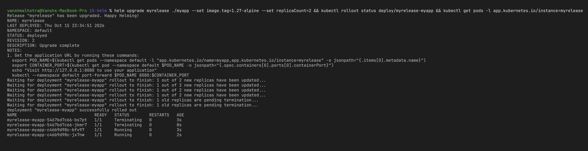

### 7. `helm history`

**What it does:** Lists every revision of a release with its status and a description (Install complete, Upgrade complete, Rollback to X).

```bash
helm history myrelease
```

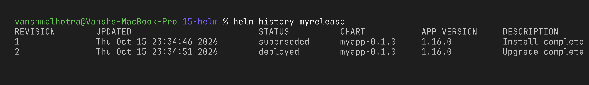

### 8. `helm rollback`

**What it does:** Goes back to an older revision. If I don't give a number, it goes back to the previous one.

```bash
helm rollback myrelease 1
helm history myrelease
```

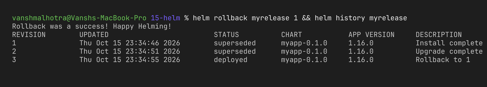

### 9. `helm uninstall`

**What it does:** Deletes the release and every Kubernetes object it created. `--keep-history` keeps the revision records so it can still be rolled back.

```bash
helm uninstall myrelease
kubectl wait --for=delete pod -l app.kubernetes.io/instance=myrelease --timeout=90s   # pods take a few seconds to terminate
helm list
kubectl get all -l app.kubernetes.io/instance=myrelease
```

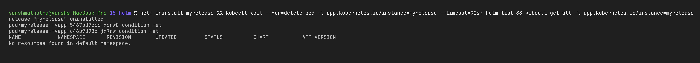

### 10. `helm repo`

**What it does:** Manages chart repositories on my machine — add a repo, refresh its index, list or remove repos.

```bash
helm repo add bitnami https://charts.bitnami.com/bitnami
helm repo add prometheus-community https://prometheus-community.github.io/helm-charts
helm repo update
helm repo list
```

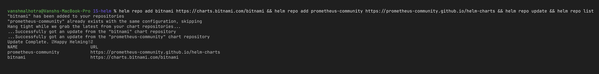

### 11. `helm search`

**What it does:** `helm search repo` searches inside the repos I added (local index). `helm search hub` searches Artifact Hub online (all public charts).

```bash
helm search repo nginx
helm search repo bitnami/nginx --versions | head -5
helm search hub prometheus | head -10
helm show values bitnami/nginx | head -30     # bonus: see a chart's default values before installing
```

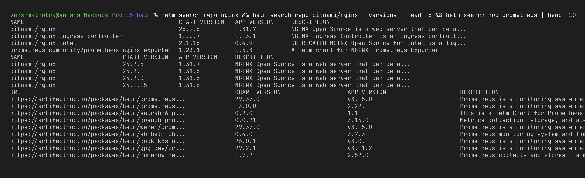

### Command summary

| Command | Purpose |
| :--- | :--- |
| `helm create <name>` | Scaffold a new chart |
| `helm lint <chart>` | Check a chart for errors |
| `helm template <rel> <chart>` | Render YAML locally without installing |
| `helm install <rel> <chart>` | Install a chart → new release (rev 1) |
| `helm list` | List releases |
| `helm status <rel>` | State of one release |
| `helm get values/manifest/all <rel>` | Read stored values / rendered YAML |
| `helm upgrade <rel> <chart>` | New revision with new values or chart |
| `helm history <rel>` | All revisions of a release |
| `helm rollback <rel> <rev>` | Go back to an old revision (creates a new revision) |
| `helm uninstall <rel>` | Delete release and its resources |
| `helm repo add/update/list/remove` | Manage chart repositories |
| `helm search repo/hub <keyword>` | Find charts locally / on Artifact Hub |

---

## Task 2: Helm Rollback Workflow

The flow I followed:

```text
Install (rev 1) → Upgrade (rev 2) → Verify → Upgrade again (rev 3) → Verify → Rollback to rev 1 (rev 4) → Verify
```

I used the `myapp` chart from Task 1 and changed the nginx image tag and replica count in each step so I could clearly see the difference. To verify, I printed the image and replicas from the Deployment.

A small helper to save typing:

```bash
check() { kubectl get deploy myrelease-myapp -o jsonpath='{.spec.template.spec.containers[0].image}{"  replicas="}{.spec.replicas}{"\n"}'; }
```

### Step 1 – Install (revision 1)

```bash
helm install myrelease ./myapp --set image.tag=alpine --set replicaCount=1
check
```

Expected: `nginx:alpine  replicas=1`

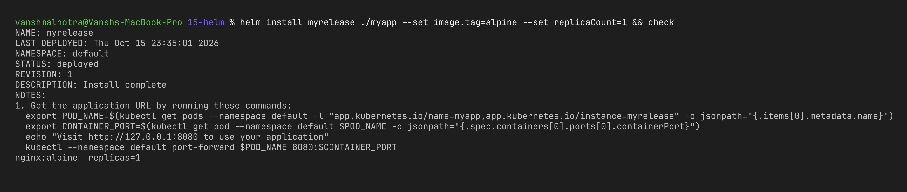

### Step 2 – Upgrade (revision 2) and verify

```bash
helm upgrade myrelease ./myapp --set image.tag=1.27-alpine --set replicaCount=1
kubectl rollout status deploy/myrelease-myapp
check
```

Expected: `nginx:1.27-alpine  replicas=1`

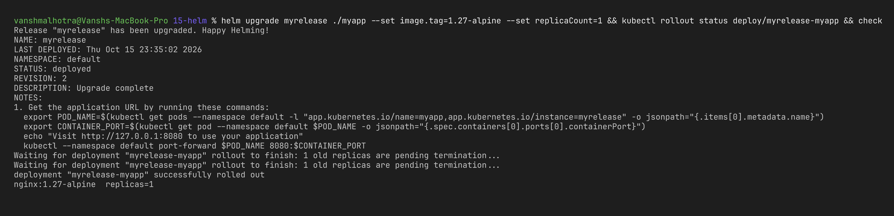

### Step 3 – Upgrade again (revision 3) and verify

```bash
helm upgrade myrelease ./myapp --set image.tag=latest --set replicaCount=3
kubectl rollout status deploy/myrelease-myapp
check
kubectl get pods -l app.kubernetes.io/instance=myrelease
```

Expected: `nginx:latest  replicas=3` and 3 pods Running.

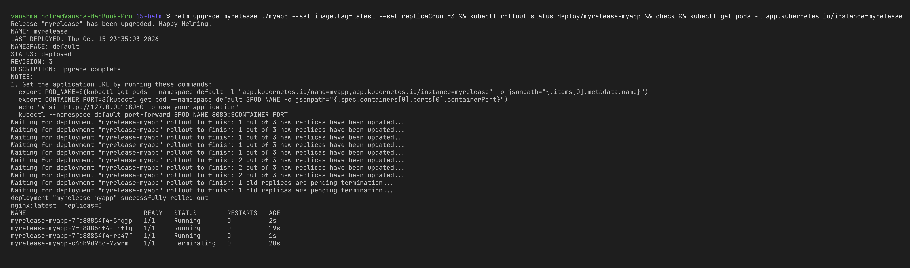

### Step 4 – Rollback to revision 1 and verify

```bash
helm history myrelease          # see what we have before rollback
helm rollback myrelease 1
kubectl rollout status deploy/myrelease-myapp
check
helm history myrelease
```

Expected: `nginx:alpine  replicas=1` again, and history shows a **new revision 4** with description "Rollback to 1".

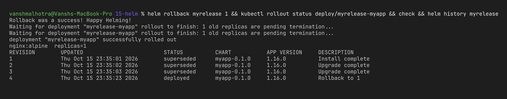

### What I observed

- Every upgrade made a new revision, and the old one got marked as `superseded`.
- The rollback did **not** delete revisions 2 and 3. Instead it created revision 4 which is a copy of revision 1. So the history is never rewritten, and I could even roll back the rollback (`helm rollback myrelease 3`).
- Both the image and the replica count went back, because Helm restores the full set of values + manifest of that revision, not just one field.
- Rollback is a lot faster and safer than manually editing the deployment back, especially at 3am when something breaks.

Cleanup:

```bash
helm uninstall myrelease
```

---

## Task 3: Mini Project – `notes-chart`

For the mini project I made my own chart, [`mini-project/notes-chart`](mini-project/notes-chart/). I started from `helm create notes-chart` and then customised it:

- Added [`templates/configmap.yaml`](mini-project/notes-chart/templates/configmap.yaml) which builds an `index.html` page from `values.yaml` (title, message, list of notes). It also prints the release name and **revision number**, so I can see on the page itself which revision is live.
- The Deployment mounts that ConfigMap into nginx at `/usr/share/nginx/html`.
- Added a `checksum/page` annotation on the pod template, so whenever the page content changes the pods get restarted automatically on `helm upgrade` (otherwise nginx would keep serving the old file for a while).
- Set CPU/memory requests and limits in `values.yaml`.
- [`values-v2.yaml`](mini-project/values-v2.yaml) is an override file for the upgrade: 3 replicas, new message, NodePort service.

```text
mini-project/
├── notes-chart/
│   ├── Chart.yaml
│   ├── values.yaml
│   ├── .helmignore
│   └── templates/
│       ├── _helpers.tpl
│       ├── configmap.yaml       # <- my addition (the web page)
│       ├── deployment.yaml      # <- mounts the page + checksum annotation
│       ├── service.yaml
│       ├── serviceaccount.yaml
│       ├── ingress.yaml         # disabled by default
│       ├── hpa.yaml             # disabled by default
│       ├── httproute.yaml       # disabled by default
│       ├── NOTES.txt
│       └── tests/test-connection.yaml
└── values-v2.yaml
```

### Install

```bash
cd mini-project
helm lint ./notes-chart
helm install notes ./notes-chart
kubectl get pods,svc,cm -l app.kubernetes.io/instance=notes
```

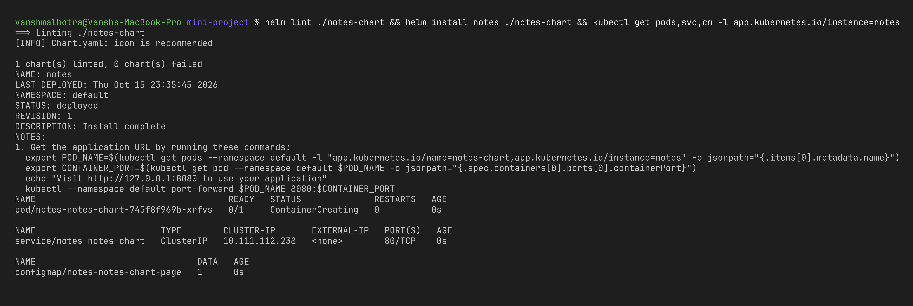

Open the page (keep this running in a second terminal):

```bash
kubectl port-forward svc/notes-notes-chart 8080:80
curl http://localhost:8080
```


### Helm test

```bash
helm test notes
```

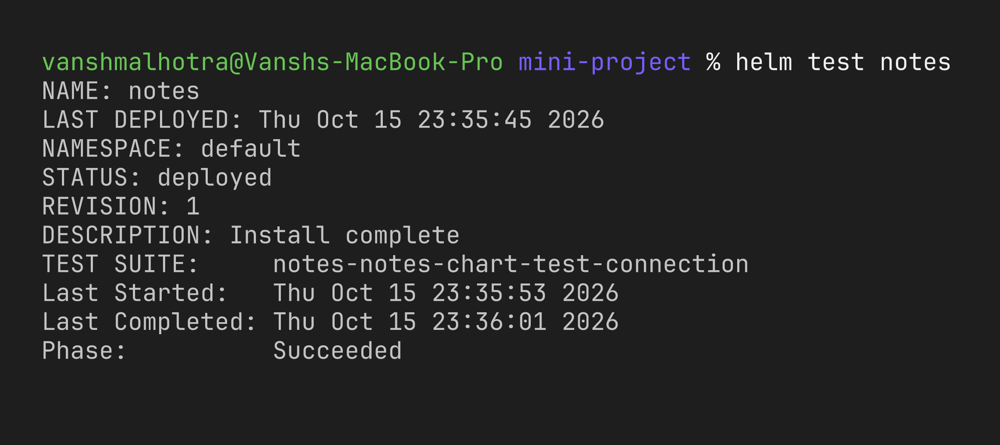

### Upgrade

```bash
helm upgrade notes ./notes-chart -f values-v2.yaml
kubectl rollout status deploy/notes-notes-chart
kubectl get pods,svc -l app.kubernetes.io/instance=notes
```

(restart the port-forward after the upgrade, because the old pods are gone)

```bash
kubectl port-forward svc/notes-notes-chart 8080:80 >/dev/null 2>&1 &
curl -s http://localhost:8080
```

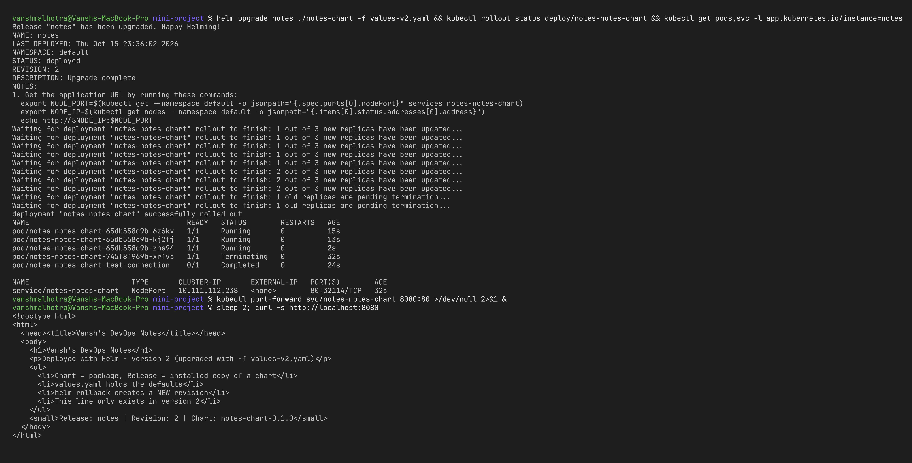

### Rollback

```bash
helm rollback notes 1
kubectl rollout status deploy/notes-notes-chart
helm history notes
kubectl get pods,svc -l app.kubernetes.io/instance=notes
```

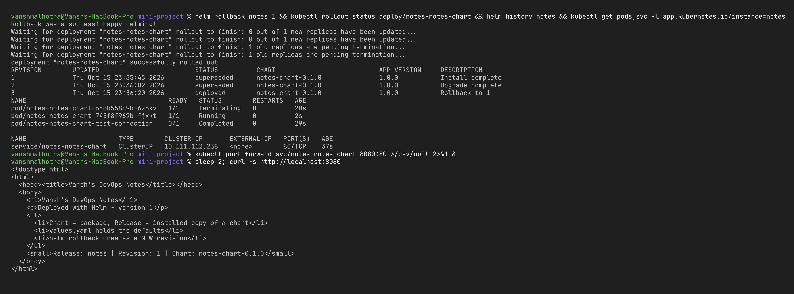

Interesting thing I noticed: I expected the footer to say **Revision: 3** after the rollback, but it actually says **Revision: 1**. `helm history` shows revision 3 "Rollback to 1", but Helm re-applies the manifest that was *rendered* for revision 1, it does not render the templates again. So `{{ .Release.Revision }}` inside the page is still the old number. The history is the place to check the real revision, not the page.

### Uninstall

```bash
helm uninstall notes
helm list
```

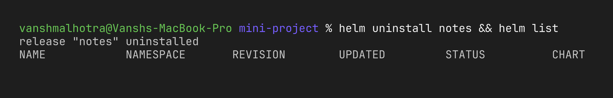

---

## What I learned

- Helm saves me from copy-pasting the same YAML for every environment — one chart, different values files (`values-dev.yaml`, `values-prod.yaml`).
- `helm template` and `helm lint` are great for catching mistakes before touching the cluster.
- Every change is a revision, so there is always a history and a quick way back.
- `helm upgrade --install` is the command I'd use in a CI/CD pipeline, because it works whether the release exists or not.
