# Session 16 – CI/CD & GitHub Actions

**Name:** Vansh Malhotra  
**Roll No:** 24bcs10268

For this task I built a small CI/CD demo project: a tiny Node.js web app with unit tests and a Dockerfile, plus a GitHub Actions workflow that tests it, builds it, uploads artifacts, builds a Docker image, smoke-tests the container, and finally pushes the image to GitHub Container Registry (GHCR).

## Project structure

```text
16-cicd-github-actions/
├── app/server.js              # Node HTTP server (no npm dependencies)
├── tests/server.test.js       # unit tests using the built-in node:test runner
├── package.json
├── Dockerfile                 # node:22-alpine, runs as non-root user
├── .dockerignore
├── workflow/session16-cicd.yml  # the GitHub Actions pipeline
└── README.md
```

The app returns `Hello World from Vansh's CI/CD demo app!` on `/` and `{"status":"ok"}` on `/health`.

---

## Theory

### CI vs CD

| | **CI – Continuous Integration** | **CD – Continuous Delivery / Deployment** |
| :--- | :--- | :--- |
| Idea | Every push is automatically built and tested, so broken code is caught early | Every change that passed CI is automatically packaged and released |
| Question it answers | "Does my code still work?" | "Can I ship it right now?" |
| Output | Test results, build artifact | Docker image in a registry / app running in an environment |
| In my pipeline | `build-and-test` + `docker-build` jobs | `docker-push` job (image → GHCR) |

**Continuous Delivery** means the release is always *ready* and a human can press the button. **Continuous Deployment** goes one step further and deploys to production automatically without any manual approval.

### CI/CD pipeline

A pipeline is the automated chain of steps from code commit to a deliverable. If any stage fails, the later stages don't run, so bad code never reaches the registry. My pipeline:

```text
git push
   │
   ▼
┌──────────────────────┐   ┌───────────────────────────┐   ┌────────────────────────┐
│ CI: Test & Build     │──►│ CI: Docker Build & Smoke  │──►│ CD: Push Image to GHCR │
│ node --test          │   │ docker build              │   │ docker login (token)   │
│ upload test report   │   │ docker run + curl /health │   │ docker push :sha       │
│ upload build artifact│   │                           │   │ docker push :latest    │
└──────────────────────┘   └───────────────────────────┘   └────────────────────────┘
```

### GitHub Actions building blocks

| Concept | Meaning | Where it is in my workflow |
| :--- | :--- | :--- |
| **Workflow** | A YAML file in `.github/workflows/` that describes the whole automation | `session16-cicd.yml` |
| **Event / trigger** | What starts the workflow | `on: push` (main), `pull_request`, `workflow_dispatch` (manual button) |
| **Job** | A group of steps that runs on one runner. Jobs run in parallel unless linked with `needs:` | `build-and-test`, `docker-build`, `docker-push` |
| **Step** | One task inside a job — either a shell command (`run:`) or a reusable action (`uses:`) | e.g. `Checkout code`, `Run unit tests` |
| **Action** | A reusable plugin from the marketplace | `actions/checkout@v4`, `actions/setup-node@v4`, `docker/login-action@v3` |
| **Runner** | The machine that executes a job. GitHub-hosted runners are fresh VMs; you can also host your own (self-hosted) | `runs-on: ubuntu-latest` |
| **Secrets** | Encrypted values (passwords, tokens) injected at runtime; masked as `***` in logs | `${{ secrets.GITHUB_TOKEN }}` for GHCR login |
| **Artifacts** | Files a job saves so you can download them later or pass them to another job | `test-report` (JUnit XML) and `demo-app-build` |
| **Build** | Turning source code into something runnable | `dist/` bundle + `docker build` |
| **Test** | Automatically checking the code works | `node --test` (3 unit tests) + container smoke test with `curl` |
| **Permissions** | What the auto-generated `GITHUB_TOKEN` is allowed to do | `packages: write` only on the push job |

About secrets: `GITHUB_TOKEN` is created automatically by GitHub for every run, so I didn't need to add anything to push to GHCR. If I wanted Docker Hub instead, I would add `DOCKERHUB_USERNAME` and `DOCKERHUB_TOKEN` in **Settings → Secrets and variables → Actions** and use them as `${{ secrets.DOCKERHUB_TOKEN }}`. Secrets must never be hardcoded in the YAML.

---

## Step 1: Run it locally first

Before giving it to the pipeline, I made sure everything works on my laptop.

```bash
cd 16-cicd-github-actions
node --version
npm test
```

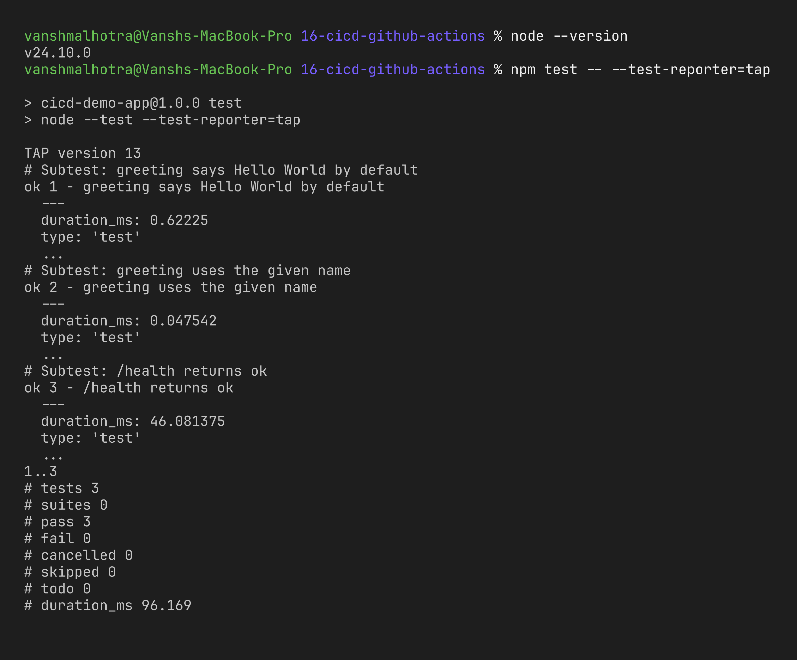

```bash
docker build -t cicd-demo:local .
docker run -d --name cicd-demo -p 3000:3000 cicd-demo:local
curl http://localhost:3000
curl http://localhost:3000/health
```

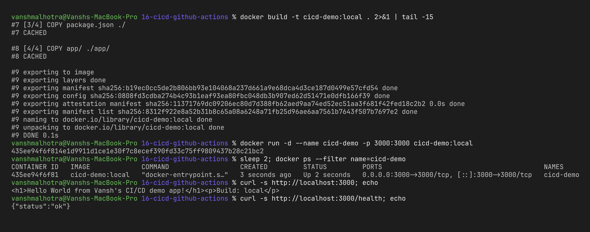

Also open http://localhost:3000 in the browser.

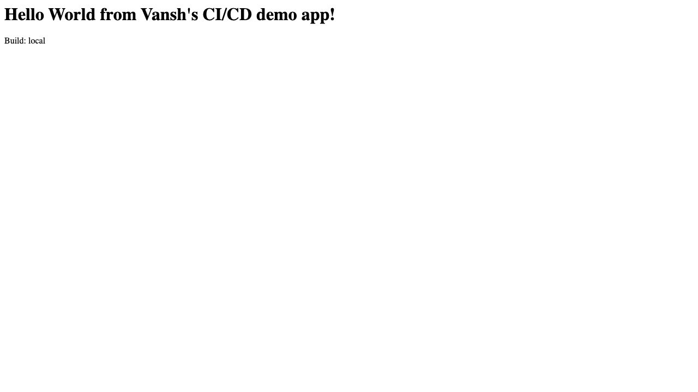

Cleanup: `docker rm -f cicd-demo`

## Step 2: Enable the workflow

GitHub only picks up workflows from `.github/workflows/` at the **root** of the repository, so I copied my workflow file there. All my homework lives in the public repo [vansh-commits/devops-assignments](https://github.com/vansh-commits/devops-assignments), with each session as a folder at the repo root. The working directory in the workflow (`defaults.run.working-directory`) points to `16-cicd-github-actions`, so it works from the repo root.

```bash
# from the repo root
mkdir -p .github/workflows
cp 16-cicd-github-actions/workflow/session16-cicd.yml .github/workflows/
git add .github/workflows/session16-cicd.yml 16-cicd-github-actions
git commit -m "Add session 16 CI/CD demo pipeline"
git push origin main
```

(If this folder were the repo root on its own, remove `16-cicd-github-actions` from the paths and working-directory.)

For the GHCR push, the repo needs: **Settings → Actions → General → Workflow permissions → Read and write permissions** (or at least the `packages: write` permission given in the job, which I already set).

## Step 3: Pipeline execution

After the push, the workflow starts automatically. I opened the **Actions** tab → **Session 16 - CI/CD Demo**.

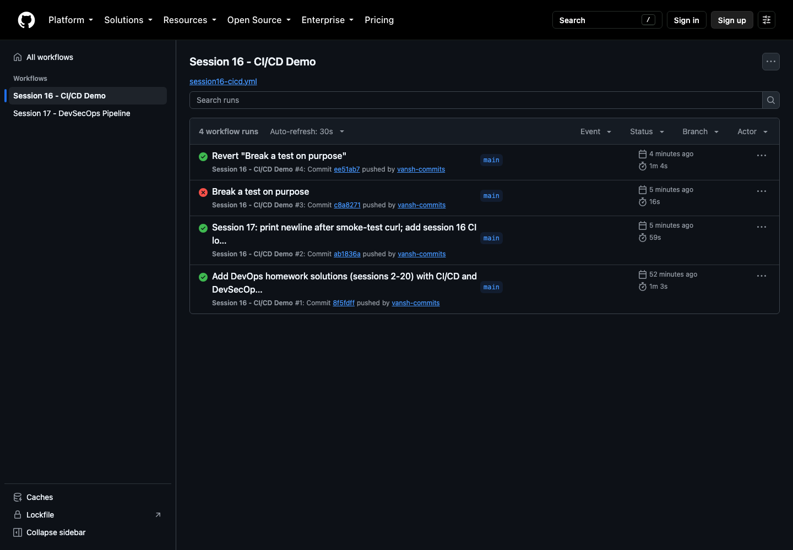

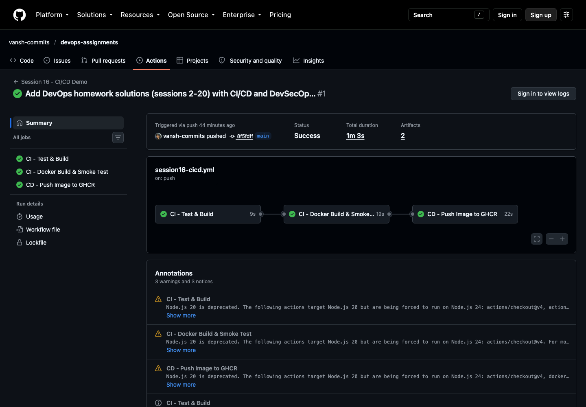

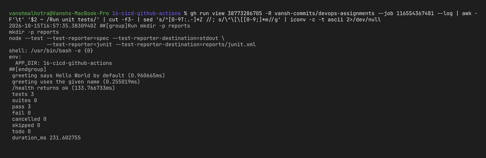

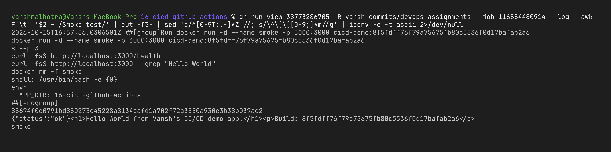

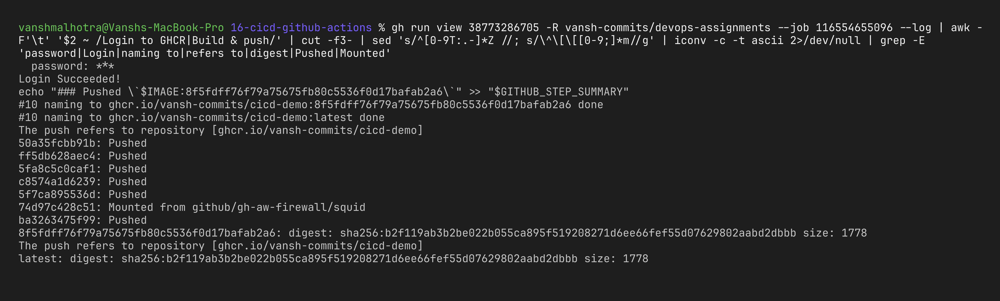

Job logs on GitHub are only visible when signed in, so for the log screenshots I pulled the same logs with the GitHub CLI (`gh run view --log`), keeping only the step I wanted and stripping the timestamps/colour codes.

### Artifacts

At the bottom of the run summary page there is an **Artifacts** section with `test-report` and `demo-app-build`, which can be downloaded as zip files.

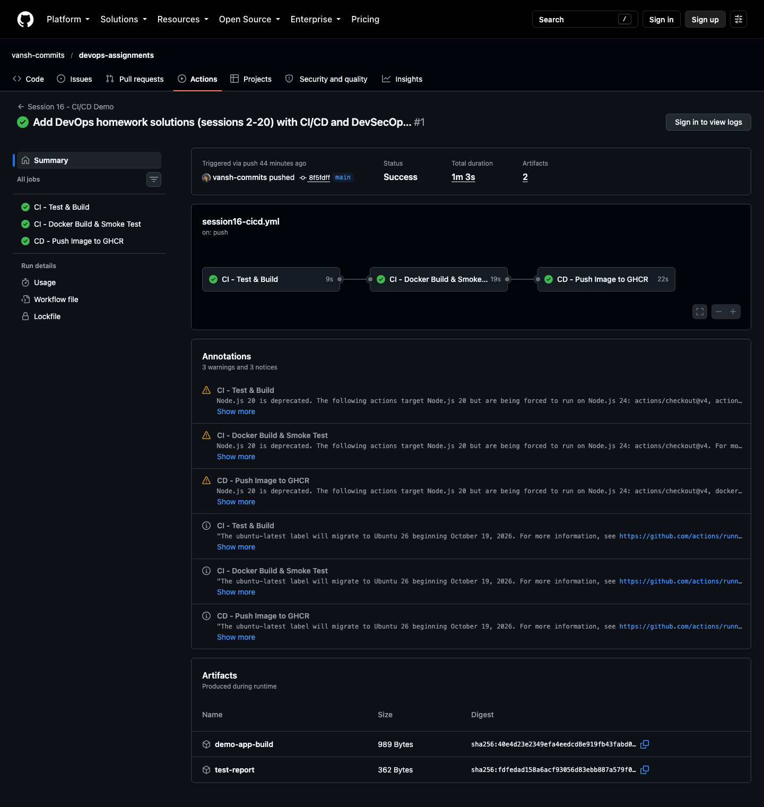

### Image in the registry

The pushed image shows up under my GitHub profile → **Packages** → `cicd-demo`, tagged with the commit SHA and `latest`. I can pull and run it from anywhere:

```bash
docker run -d -p 3000:3000 ghcr.io/vansh-commits/cicd-demo:latest
curl http://localhost:3000
```

(If the pull is denied, either make the package public in its settings, or run `docker login ghcr.io` first.)

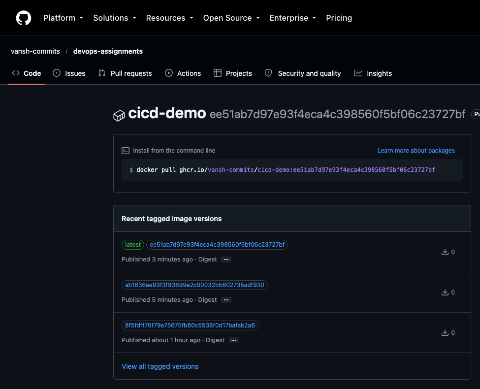

## Step 4: Proving the pipeline actually protects main

To see CI do its job, I broke a test on purpose (changed the expected text in `tests/server.test.js`), pushed, and watched the pipeline fail at the first job. Because of `needs:`, the Docker and push jobs were **skipped**, so the broken code never became an image. Then I reverted the change and pushed again → green.

```bash
# break it
sed -i '' 's/Hello World from/Hi World from/' tests/server.test.js
git commit -am "Break a test on purpose" && git push
# fix it
git revert --no-edit HEAD && git push
```

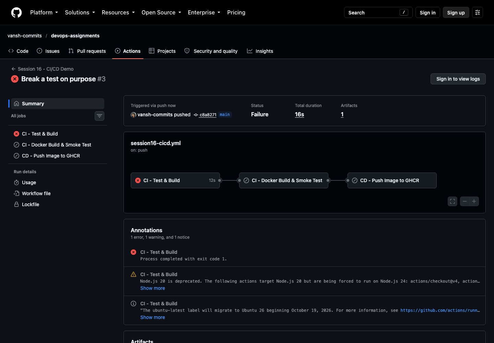

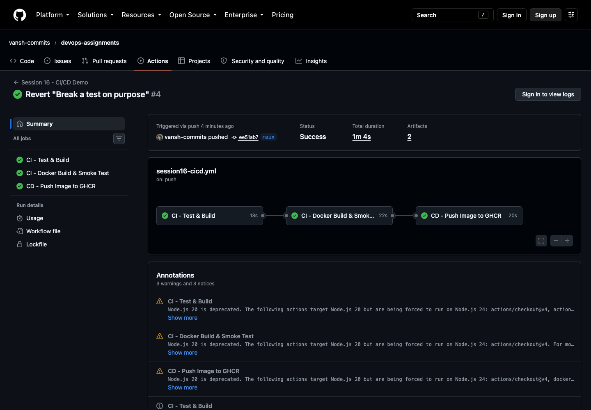

---

## What I learned

- CI gives fast feedback on every push; CD removes the manual "build image and upload it" work once the code is green.
- `needs:` is what turns separate jobs into a real pipeline — later stages only run if earlier ones passed.
- Each job runs on a **fresh runner**, so files are not shared between jobs unless I use artifacts (or rebuild, like I did with the image).
- Secrets stay out of the code. The built-in `GITHUB_TOKEN` is enough for GHCR, and the push job only gets `packages: write` permission (least privilege).
- Running tests and a smoke test *inside* the pipeline is much more reliable than "it works on my machine".
