# Session 17 – Complete CI/CD & DevSecOps

**Name:** Vansh Malhotra  
**Roll No:** 24bcs10268

In Session 16 my pipeline only checked "does the code work?". In this session I added security into the same pipeline — that's what **DevSecOps** means: security checks run automatically on every push, *before* anything reaches the registry or the cluster ("shift left"), instead of a security team checking it once at the end.

I built a small Flask app and a GitHub Actions pipeline with 10 stages that goes all the way from code to a running deployment on Kubernetes, with a **security gate** that blocks the image from being pushed if it has serious vulnerabilities.

## Project structure

```text
17-devsecops/
├── app/
│   ├── __init__.py
│   └── main.py                 # Flask app: "/" and "/health"
├── tests/test_main.py          # pytest unit tests
├── requirements.txt            # runtime deps (scanned by SCA)
├── requirements-dev.txt        # + pytest
├── pytest.ini
├── Dockerfile                  # multi-stage, patched OS packages, non-root UID 10001
├── .dockerignore
├── security/                   # security tools configuration
│   ├── bandit.yaml             # SAST rules
│   ├── .gitleaks.toml          # secret scanning rules + allowlist
│   ├── trivy.yaml              # image scan = security gate policy
│   └── .trivyignore            # reviewed/accepted CVEs (empty)
├── k8s/
│   ├── deployment.yaml         # 2 replicas, probes, limits, hardened securityContext
│   └── service.yaml
├── workflow/session17-devsecops.yml   # the GitHub Actions pipeline
└── README.md
```

## Expected flow (exactly how my pipeline runs)

```text
   Code (git push)
        │
        ▼
 ┌─────────────────┐
 │ 1. Build        │  pip install + compile
 └────────┬────────┘
          ▼
 ┌─────────────────┐
 │ 2. Unit Test    │  pytest (3 tests) → test-results.xml artifact
 └────────┬────────┘
          ▼
 ┌─────────────────┐
 │ 3. SAST         │  Bandit – insecure patterns in MY code
 └────────┬────────┘
          ▼
 ┌─────────────────┐
 │ 4. SCA          │  pip-audit – known CVEs in my DEPENDENCIES
 └────────┬────────┘
          ▼
 ┌─────────────────┐
 │ 5. Secret Scan  │  Gitleaks – passwords / tokens / keys in files
 └────────┬────────┘
          ▼
 ┌─────────────────┐
 │ 6. Docker Build │  build image, save as artifact (image.tar)
 └────────┬────────┘
          ▼
 ┌─────────────────┐
 │ 7. Image Scan   │  Trivy – CVEs in OS packages + libs inside the image
 └────────┬────────┘
          ▼
 ┌─────────────────┐
 │ 8. Security Gate│  fixable HIGH/CRITICAL > 0 or secrets > 0  →  STOP
 └────────┬────────┘
          ▼  (only if gate passed)
 ┌─────────────────┐
 │ 9. Push Image   │  ghcr.io/<owner>/devsecops-demo:<commit-sha> + :latest
 └────────┬────────┘
          ▼
 ┌─────────────────┐
 │ 10. Deploy K8s  │  kind cluster → kubectl apply → rollout status → curl
 └─────────────────┘
```

Every job has `needs:` on the previous one, so if any stage fails, all the stages after it are skipped. The image that gets scanned in stage 7 is the *exact same* image (passed as an artifact) that gets pushed in stage 9 — I didn't rebuild it, because a rebuilt image might not be identical to what was scanned.

## The security tools

| Stage | Type | Tool | What it catches | Config |
| :--- | :--- | :--- | :--- | :--- |
| 3 | **SAST** – Static Application Security Testing | Bandit | Dangerous code in my source: `eval`, `subprocess(shell=True)`, hardcoded passwords, binding to all interfaces, weak crypto, `debug=True`… | `security/bandit.yaml` |
| 4 | **SCA** – Software Composition Analysis | pip-audit | Third-party packages in `requirements.txt` (and their sub-dependencies) with known CVEs | flags in workflow (`--strict`) |
| 5 | **Secret scanning** | Gitleaks | API keys, GitHub tokens, AWS keys, private keys committed by mistake | `security/.gitleaks.toml` |
| 7 | **Container image scanning** | Trivy | CVEs in the base OS packages (Debian) and in the Python libs baked into the image, plus secrets inside layers | `security/trivy.yaml`, `.trivyignore` |
| 8 | **Security gate** | jq on Trivy JSON | The policy: no fixable HIGH/CRITICAL CVE and no secret is allowed to ship | workflow step |

SAST vs SCA in one line: **SAST checks the code I wrote, SCA checks the code I downloaded.**

A few hardening things I did in the app itself so that the scanners pass properly (not just by ignoring findings):

- Multi-stage Dockerfile, so pip and build leftovers are not in the final image.
- `apt-get upgrade` in the runtime stage to pick up Debian security patches.
- Runs as a non-root user with a **numeric UID 10001** (Kubernetes `runAsNonRoot` can only verify numeric UIDs).
- In Kubernetes: `readOnlyRootFilesystem`, `allowPrivilegeEscalation: false`, all Linux capabilities dropped, seccomp `RuntimeDefault`, no service account token, resource limits, readiness/liveness probes.
- The Flask dev server only listens on localhost; in the container gunicorn serves the app (this also avoids Bandit's B104 warning).

---

## Part A: Running every stage locally

I first ran every stage on my Mac so I understood what each tool does before putting it in the pipeline.

```bash
cd 17-devsecops
python3 -m venv .venv && source .venv/bin/activate
```

### 1–2. Build + unit tests

```bash
pip install -r requirements-dev.txt
pytest -v
```

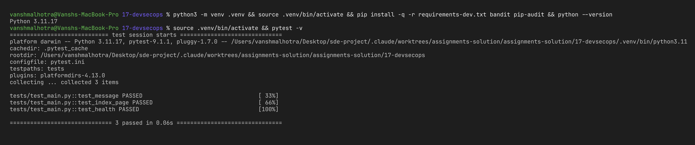

### 3. SAST with Bandit

```bash
pip install bandit
bandit -c security/bandit.yaml -r app -ll
```

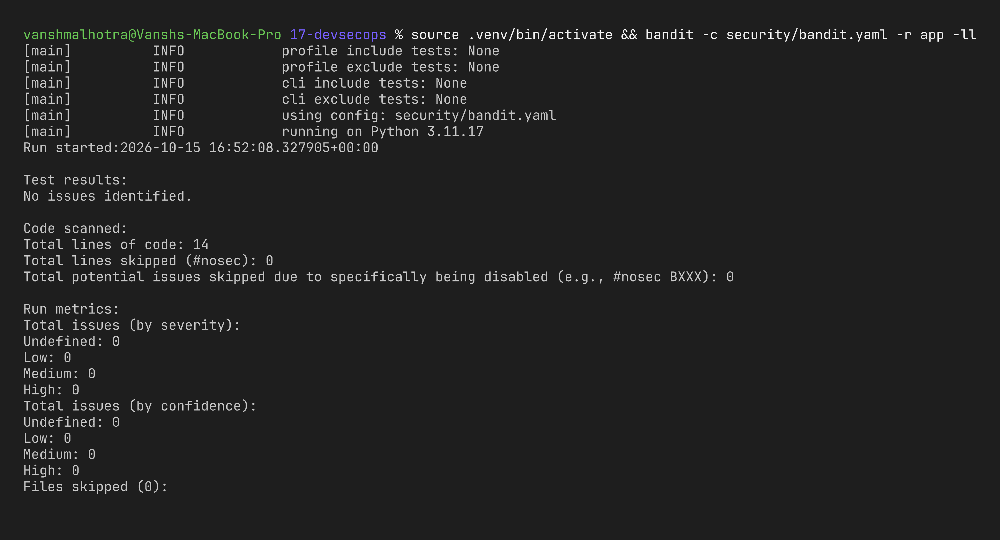

### 4. SCA with pip-audit

```bash
pip install pip-audit
pip-audit -r requirements.txt --strict
```

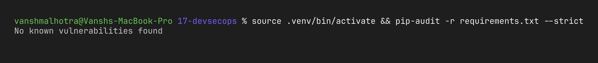

### 5. Secret scan with Gitleaks

```bash
docker run --rm -v "$PWD:/scan" ghcr.io/gitleaks/gitleaks:v8.28.0 \
  dir /scan --config /scan/security/.gitleaks.toml --redact --verbose
```

(`.venv/` is allowlisted in the config so my local virtualenv isn't scanned. Alternative without Docker: `brew install gitleaks` and run `gitleaks dir . --config security/.gitleaks.toml`.)

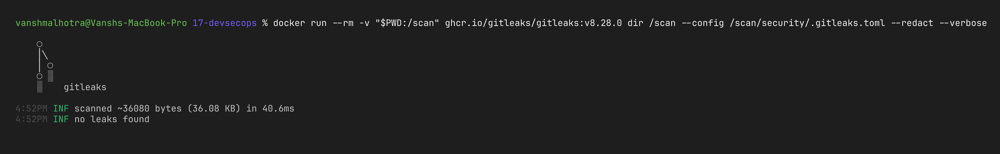

### 6–8. Docker build + Trivy scan + gate

```bash
docker build -t devsecops-demo:local .
docker run --rm -v /var/run/docker.sock:/var/run/docker.sock -v "$PWD:/work" -w /work \
  aquasec/trivy:latest image --no-progress --config security/trivy.yaml devsecops-demo:local
echo "exit code: $?"
```

(`--no-progress` just hides the vulnerability-DB download progress bar; for the screenshot I built with `docker build -q` so the build prints only the image ID.)

Because `trivy.yaml` has `exit-code: 1`, Trivy itself acts as the gate locally: exit code 0 = pass, 1 = blocked.

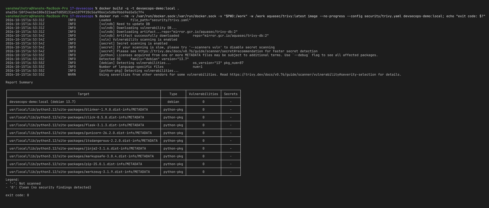

### 10. Deploy to my local Kubernetes

```bash
# kind:
kind load docker-image devsecops-demo:local
# OR minikube:
minikube image load devsecops-demo:local

kubectl apply -f k8s/
kubectl rollout status deployment/devsecops-demo
kubectl get deploy,pods,svc -o wide
kubectl port-forward svc/devsecops-demo 8080:80
```

Then open http://localhost:8080 (and http://localhost:8080/health).

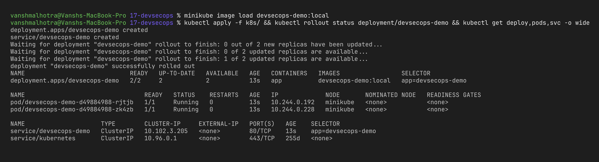

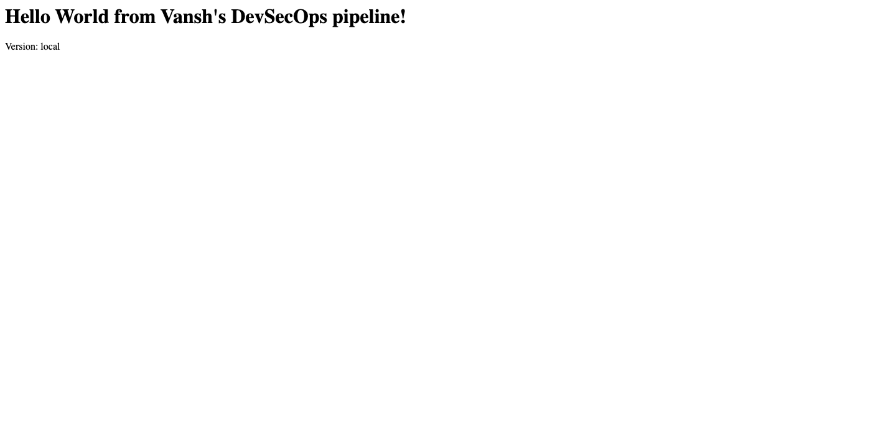

Cleanup: `kubectl delete -f k8s/`

---

## Part B: The pipeline on GitHub Actions

### Enabling it

GitHub only runs workflows from `.github/workflows/` at the **root** of the repo, so I copied my file there. The repo is [vansh-commits/devops-assignments](https://github.com/vansh-commits/devops-assignments) with each session as a folder at the root, so the paths inside (`defaults.run.working-directory`, `APP_DIR`) point at `17-devsecops`.

```bash
# from the repo root
mkdir -p .github/workflows
cp 17-devsecops/workflow/session17-devsecops.yml .github/workflows/
git add .github/workflows/session17-devsecops.yml 17-devsecops
git commit -m "Add session 17 DevSecOps pipeline"
git push origin main
```

(If this folder were the repo root on its own, remove `17-devsecops` from the paths/working-directory.)

Repo settings needed: **Settings → Actions → General → Workflow permissions → Read and write**, so `GITHUB_TOKEN` can push to GHCR. No other secrets are needed — the deploy job creates its own temporary kind cluster inside the runner. For a real cloud cluster (EKS/GKE), I'd store the kubeconfig as a secret `KUBECONFIG` and use that instead of kind.

### Successful run

Job logs on GitHub are only visible when signed in, so for the log screenshots I pulled the same logs with the GitHub CLI (`gh run view --log`), keeping only the step I wanted and stripping the timestamps/colour codes.

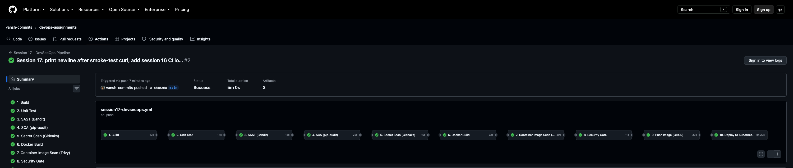

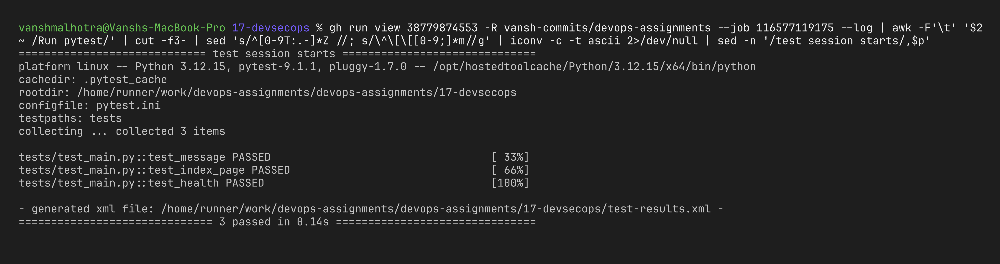

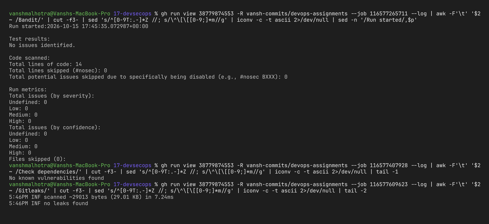

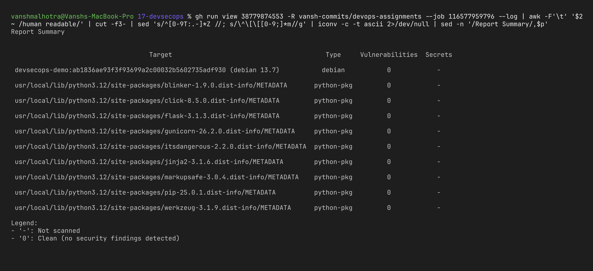

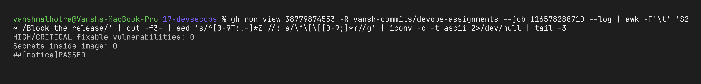

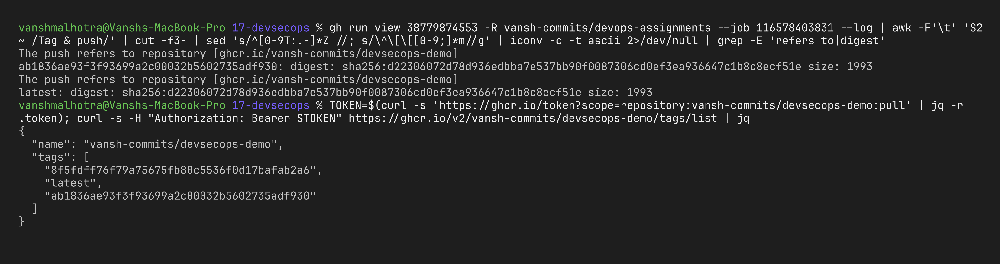

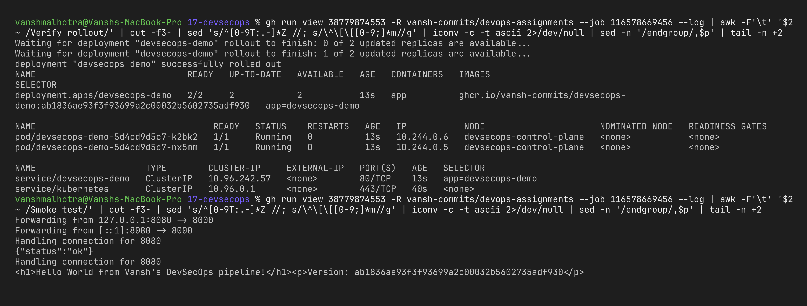

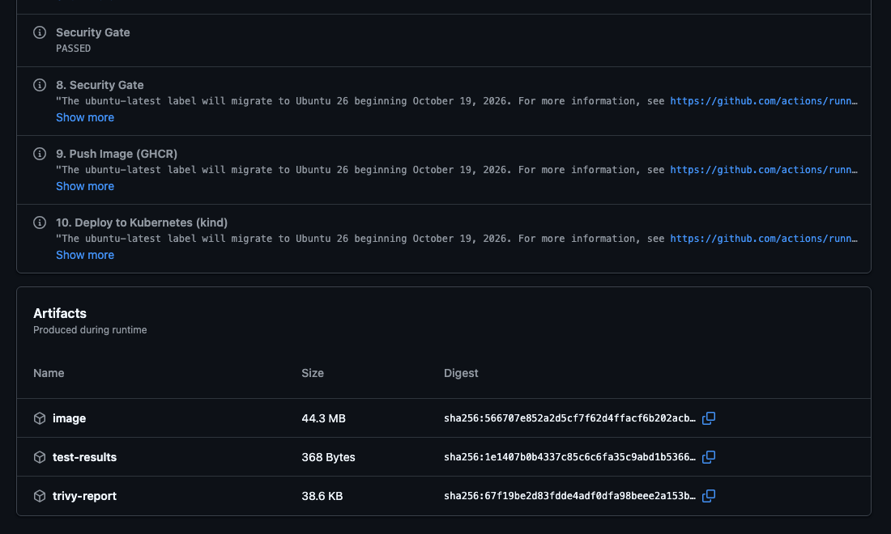

### Proving the gates actually block things

A pipeline that is always green doesn't prove much, so I broke it on purpose twice.

**Test 1 – leaked secret.** I created a file with a fake GitHub token (generated randomly, so it's not a real token):

```bash
echo "GITHUB_TOKEN = \"ghp_$(openssl rand -hex 18)\"" > app/leak.py
git add app/leak.py && git commit -m "Oops, committed a token" && git push
```

Result: stage 5 (Gitleaks) failed with a `github-pat` finding, and stages 6–10 were skipped — nothing was built or pushed.


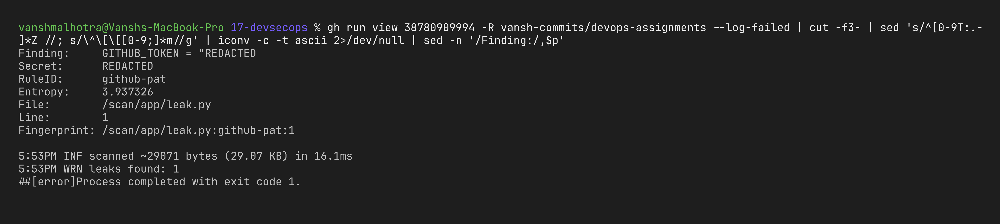

```bash
git rm app/leak.py && git commit -m "Remove leaked token" && git push
```

(In real life a leaked token must also be **revoked**, because it is still in the git history — deleting the file is not enough.)

**Test 2 – vulnerable dependency.** I pinned an old Flask version that has known vulnerabilities:

```bash
sed -i '' 's/flask==3.1.3/flask==3.1.0/' requirements.txt
git commit -am "Downgrade flask to 3.1.0" && git push
```

(My first try was `flask==2.2.0`, but that old Flask doesn't work with the current Werkzeug, so the pipeline already stopped at stage 2 – the unit tests couldn't even import Flask – and SCA never ran. That's also the pipeline doing its job, but to demo SCA I picked 3.1.0, which still works but has advisories.)

Result: stage 4 (pip-audit) failed with "Found 4 known vulnerabilities in 1 package" – Flask 3.1.0 advisories `PYSEC-2026-1377` (fixed in 3.1.1) and `PYSEC-2026-2151` (fixed in 3.1.3) – and stages 5–10 were skipped.

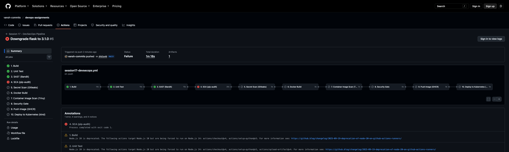

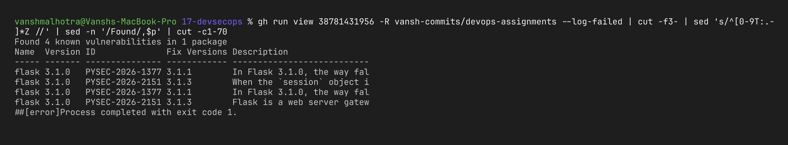

Then I put the original pin back (`HEAD~2` is the commit before both downgrade commits):

```bash
git checkout HEAD~2 -- requirements.txt
git commit -m "Revert flask downgrade" && git push
```

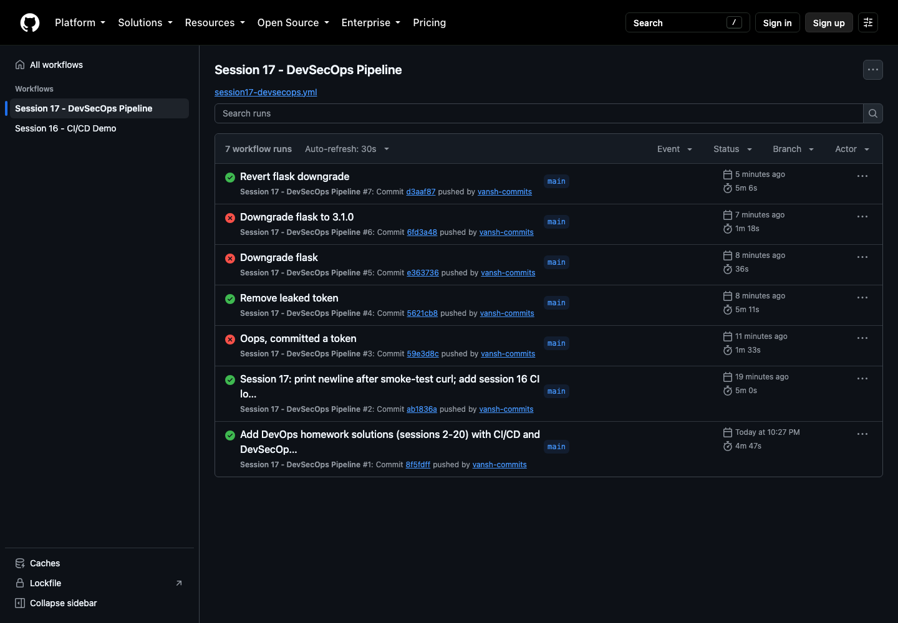

---

## What I learned

- Finding a vulnerability in the pipeline costs minutes; finding it in production costs a lot more. That's the whole point of shifting security left.
- Each tool looks at a different layer: Bandit = my code, pip-audit = my dependencies, Gitleaks = my secrets, Trivy = everything inside the final image. One tool alone is not enough.
- A **security gate** is just a rule with an exit code. Without `exit 1`, a scan is only a report that nobody reads.
- `--ignore-unfixed` keeps the gate practical — blocking on CVEs that have no fix yet would block every release with nothing I can do about it. Accepted risks go into `.trivyignore` with a reason, not silently.
- Scan the image you ship: build once, scan it, and push that same image.
