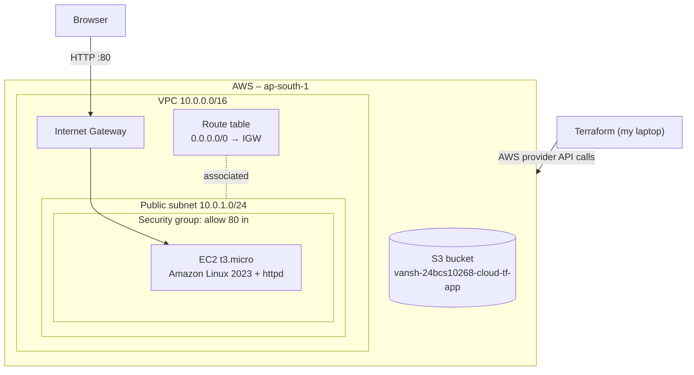

# Session 19 – Cloud & Terraform in Action

**Name:** Vansh Malhotra  
**Roll No:** 24bcs10268

In this project I built a small but complete AWS setup using only Terraform: a custom **VPC**, a **public subnet**, an **Internet Gateway + route table**, a **security group**, an **EC2** web server that shows a Hello page, and an **S3** bucket. Then I checked everything in the AWS console and destroyed it at the end.

## Architecture



ASCII version (in case mermaid doesn't render):

```text
             Terraform
                 │
                 ▼
 ┌────────────── AWS (ap-south-1) ─────────────────────┐
 │                                                      │
 │  ┌──────────── VPC 10.0.0.0/16 ──────────────┐      │
 │  │                                           │      │
 │  │  Internet Gateway ◄── Route table         │      │
 │  │        │              (0.0.0.0/0 → IGW)   │      │
 │  │        ▼                                  │      │
 │  │  ┌── Public subnet 10.0.1.0/24 ──┐        │      │
 │  │  │  [SG: port 80]                │        │      │
 │  │  │     EC2 (httpd, Hello page)   │        │      │
 │  │  └───────────────────────────────┘        │      │
 │  └───────────────────────────────────────────┘      │
 │                                                      │
 │  S3 bucket (private)                                 │
 └──────────────────────────────────────────────────────┘
```

## Files

```text
19-cloud-terraform/
├── provider.tf        # terraform block, AWS provider, default tags
├── variables.tf       # region, project prefix, CIDRs, instance type, bucket name
├── main.tf            # VPC, IGW, subnet, route table, SG, EC2, S3
├── outputs.tf         # vpc id, subnet id, instance IP, website URL, bucket name
├── terraform.tfvars   # my values
└── README.md
```

## Concepts this project demonstrates

### 1. Providers

`provider.tf` tells Terraform to use the `hashicorp/aws` provider (version `~> 5.0`) in region `var.aws_region`. I also used `default_tags` so every resource automatically gets `Project`, `ManagedBy` and `Owner` tags.

### 2. Variables

All values that could change (region, CIDRs, instance type, bucket name) are in `variables.tf` with types and descriptions, and my actual values are in `terraform.tfvars`. Nothing is hard-coded in `main.tf`.

### 3. Resources

| Resource | Purpose |
| :--- | :--- |
| `aws_vpc.main` | my own private network `10.0.0.0/16` |
| `aws_internet_gateway.igw` | door between the VPC and the internet |
| `aws_subnet.public` | `10.0.1.0/24` in the first AZ, gives instances a public IP |
| `aws_route_table.public` + association | sends `0.0.0.0/0` to the IGW → makes the subnet public |
| `aws_security_group.web` | allows HTTP (80) in, all traffic out |
| `aws_instance.web` | t3.micro running Apache with a Hello page (via `user_data`) |
| `aws_s3_bucket.app` + public access block | private bucket for app files |

I also used two **data sources** (read-only lookups): `aws_ami.al2023` finds the latest Amazon Linux 2023 AMI, and `aws_availability_zones` picks an AZ so nothing region-specific is hard-coded.

### 4. Outputs

After `apply` Terraform prints `vpc_id`, `public_subnet_id`, `security_group_id`, `instance_id`, `instance_public_ip`, `website_url` and `bucket_name`.

### 5. Dependencies

Terraform builds a **dependency graph** and creates things in the right order.

- **Implicit dependency** – when one resource references another's attribute. Example: `aws_subnet.public` uses `vpc_id = aws_vpc.main.id`, so the VPC is always created first. Same for IGW → VPC, SG → VPC, EC2 → subnet + SG.
- **Explicit dependency (`depends_on`)** – when there's a hidden dependency Terraform can't see. My EC2 `user_data` installs `httpd` from the internet, which only works after the route to the IGW exists. The instance doesn't reference the route table, so I added:
  ```hcl
  depends_on = [aws_route_table_association.public]
  ```

Creation order works out roughly as:

```text
VPC ─┬─► IGW ──────► Route table ─► RT association ─┐
     ├─► Subnet ────────────────────────────────────┼─► EC2
     └─► Security group ────────────────────────────┘
S3 bucket ─► public access block        (independent, created in parallel)
```

You can see the graph with `terraform graph` (paste into https://dreampuf.github.io/GraphvizOnline).

### 6. Terraform state

After `apply`, Terraform saves `terraform.tfstate` – a JSON file mapping my code to the real AWS IDs. `plan` compares code vs state vs real AWS to find differences. I kept the state local for this homework (it's in `.gitignore`); in a team it should be in a **remote backend** like S3 with locking.

---

## Prerequisites

- AWS account (free tier: t2.micro/t3.micro EC2 750 hrs/month, S3 5 GB).
- `brew install awscli terraform`
- `aws configure` with my IAM user's access keys, region `ap-south-1`.
- Check: `aws sts get-caller-identity`.

> A public IPv4 address is billed a small hourly amount, so I ran `terraform destroy` as soon as I was done checking everything.  
> If `bucket_name` is already taken globally, change it in `terraform.tfvars`.

---

## Step-by-step commands and outputs

All commands run inside `19-cloud-terraform/`.

### Step 1 – `terraform init`

Downloads the AWS provider and sets up `.terraform/`.

```bash
terraform init
```

### Step 2 – `terraform fmt` and `terraform validate`

```bash
terraform fmt
terraform validate
```

### Step 3 – `terraform plan`

Preview of what will be created. It should show **9 to add** (VPC, IGW, subnet, route table, RT association, SG, EC2, S3 bucket, public access block).

```bash
terraform plan -out=tfplan
```

### Step 4 – `terraform apply`

Creates the infrastructure. Using the saved plan file means it applies exactly what I reviewed.

```bash
terraform apply tfplan
```

### Step 5 – `terraform output`

```bash
terraform output
terraform output -raw website_url
```

### Step 6 – Test the website

Wait about 1 minute for `user_data` to install Apache, then:

```bash
curl $(terraform output -raw website_url)
```

### Step 7 – Terraform state

```bash
terraform state list
terraform state show aws_instance.web
```

`state list` shows every resource Terraform is tracking; `state show` shows all attributes of one resource (AMI, private/public IP, subnet, SG…).

### Step 8 – Verify in the AWS console

### Step 9 – Change detection (bonus)

To see how Terraform handles a change, I changed a tag / instance type in `terraform.tfvars` and ran `terraform plan` again. It only showed the one resource to update (`~`), not a full rebuild.

```bash
terraform plan
```

### Step 10 – `terraform destroy`

Deletes everything in reverse dependency order (EC2 first, VPC last).

```bash
terraform destroy
```

---

## Command summary

| Command | What it did |
| :--- | :--- |
| `terraform init` | downloaded AWS provider |
| `terraform fmt` | formatted the code |
| `terraform validate` | checked syntax/references |
| `terraform plan -out=tfplan` | showed 9 resources to create and saved the plan |
| `terraform apply tfplan` | created the infra |
| `terraform output` | printed IP, URL, IDs |
| `terraform state list / show` | inspected what Terraform tracks |
| `terraform graph` | dependency graph (optional) |
| `terraform destroy` | removed everything |

## What I learned

- A "public subnet" isn't a setting – it's just a subnet whose route table points `0.0.0.0/0` at an Internet Gateway.
- Terraform figures out the order from references (implicit deps); `depends_on` is only for hidden dependencies.
- Data sources (`aws_ami`) make the code portable across regions and always use the latest image.
- The state file is very important – lose it and Terraform forgets what it created. For teams use an S3 remote backend.
- Always `destroy` after a demo to avoid surprise bills.
