# Session 20 – Task 1: Monitoring Demo

**Name:** Vansh Malhotra  
**Roll No:** 24bcs10268

**Monitoring** means continuously collecting data about a system and checking it against things we already know to watch for – "is CPU too high?", "is the pod alive?", "are there errors in the logs?" – and getting **alerted** when something is wrong.

In this demo I set up **Prometheus + Grafana + Alertmanager** (using the `kube-prometheus-stack` Helm chart) on Minikube, deployed a small app, and showed metrics, logs, alerts, CPU/memory utilisation and application health.

## Files

| File | What it is |
| :--- | :--- |
| `demo-app.yaml` | nginx Deployment (2 replicas) with CPU/memory requests+limits, readiness & liveness probes, and a Service |
| `cpu-stress.yaml` | busybox pod that burns CPU in a loop, to create load |
| `high-cpu-alert.yaml` | `PrometheusRule` with two alerts: `HighPodCPU` and `PodNotReady` |

## Prerequisites

- Docker Desktop running
- `brew install minikube kubectl helm`

---

## Step 1 – Start the cluster and enable metrics-server

`metrics-server` gives the basic CPU/memory numbers used by `kubectl top` and HPA.

```bash
minikube start --cpus 4 --memory 6144
minikube addons enable metrics-server
kubectl get nodes
```

My minikube was already running from the earlier sessions (with more CPU/RAM than this), so for the screenshot I checked `minikube status` instead of starting it again.

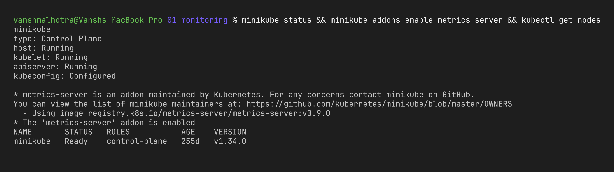

## Step 2 – Install the monitoring stack with Helm

`kube-prometheus-stack` installs: Prometheus (collects & stores metrics), Alertmanager (sends alerts), Grafana (dashboards), node-exporter (node metrics) and kube-state-metrics (Kubernetes object state).

```bash
helm repo add prometheus-community https://prometheus-community.github.io/helm-charts
helm repo update
helm install monitoring prometheus-community/kube-prometheus-stack \
  --namespace monitoring --create-namespace
kubectl get pods -n monitoring
```

(Wait 2–3 minutes until all pods are `Running`.)

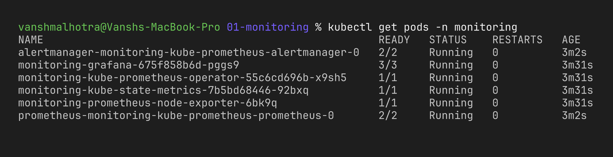

## Step 3 – Deploy the demo app

```bash
kubectl apply -f demo-app.yaml
kubectl get pods -l app=demo-web -o wide
```

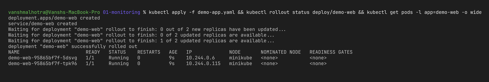

---

## Metrics – CPU & memory utilisation

### With kubectl top (metrics-server)

```bash
kubectl top nodes
kubectl top pods
```

Now I start the CPU stress pod and check again after ~1 minute:

```bash
kubectl apply -f cpu-stress.yaml
kubectl top pods
kubectl top nodes
```

`cpu-stress` should be close to its limit of `500m` (half a CPU core) while `demo-web` pods use almost nothing. Memory is shown in `Mi`.

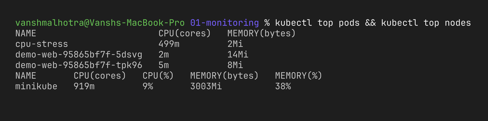

### With Prometheus (PromQL)

```bash
kubectl port-forward -n monitoring svc/monitoring-kube-prometheus-prometheus 9090:9090
```

Open http://localhost:9090 and run these queries (Graph tab):

| What | PromQL |
| :--- | :--- |
| CPU cores used per pod | `sum by (pod) (rate(container_cpu_usage_seconds_total{namespace="default",container!=""}[2m]))` |
| Memory used per pod | `sum by (pod) (container_memory_working_set_bytes{namespace="default",container!=""})` |
| Node CPU % | `100 - (avg(rate(node_cpu_seconds_total{mode="idle"}[2m])) * 100)` |
| Pod restarts | `kube_pod_container_status_restarts_total{namespace="default"}` |

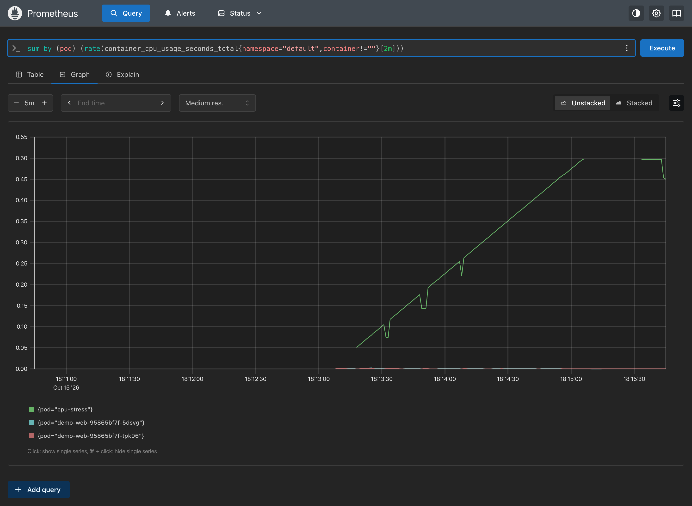

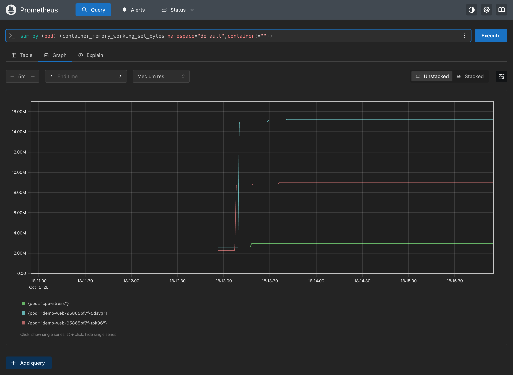

### With Grafana dashboards

```bash
# admin password
kubectl get secret -n monitoring monitoring-grafana -o jsonpath="{.data.admin-password}" | base64 -d; echo
kubectl port-forward -n monitoring svc/monitoring-grafana 3000:80
```

Open http://localhost:3000, login as `admin`, then go to **Dashboards → Kubernetes / Compute Resources / Namespace (Pods)** and pick namespace `default`.

Note: for my screenshot I turned on Grafana's anonymous **read-only** (Viewer) access so the dashboard opens without the login page. Only for this local demo, never on a real cluster:

```bash
helm upgrade monitoring prometheus-community/kube-prometheus-stack -n monitoring --reuse-values \
  --set 'grafana.grafana\.ini.auth\.anonymous.enabled=true' \
  --set 'grafana.grafana\.ini.auth\.anonymous.org_role=Viewer'
```

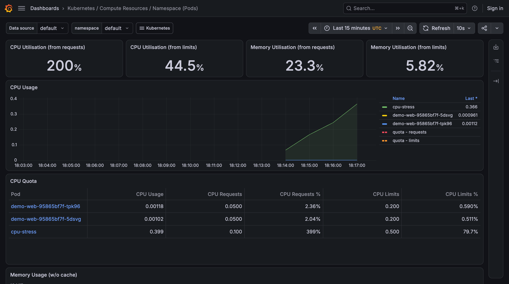

---

## Logs

Kubernetes captures whatever a container writes to stdout/stderr.

```bash
kubectl logs deploy/demo-web --tail=10          # nginx access logs
kubectl logs cpu-stress                          # "starting cpu burn"
kubectl logs -l app=demo-web -f                  # follow logs of all replicas
kubectl logs <pod> --previous                    # logs of the crashed (previous) container
```

To generate some access logs first:

```bash
kubectl run curl --rm -i --image=curlimages/curl --restart=Never -- sh -c 'for i in 1 2 3 4 5; do curl -s -o /dev/null http://demo-web; done'
kubectl logs deploy/demo-web --tail=10
```

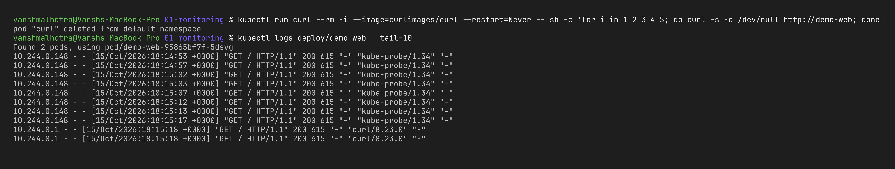

In a real setup logs are shipped to a central system (Loki + Grafana, or the EFK stack) so you can search across all pods even after they are deleted.

---

## Alerts

I created two custom alert rules:

- **HighPodCPU** – fires when a pod uses more than 0.3 CPU cores for over 1 minute.
- **PodNotReady** – fires when a pod has been not-ready for 2 minutes.

```bash
kubectl apply -f high-cpu-alert.yaml
kubectl get prometheusrules -n monitoring | grep demo
```

Since `cpu-stress` is still running, after ~2–3 minutes `HighPodCPU` goes **Pending → Firing**.

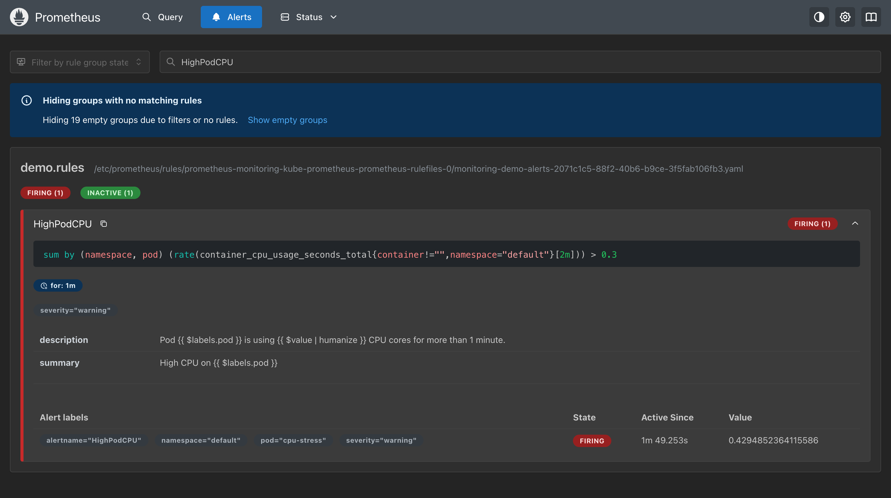

Alertmanager receives the firing alerts and would route them to Slack / email / PagerDuty if a receiver is configured.

```bash
kubectl port-forward -n monitoring svc/monitoring-kube-prometheus-alertmanager 9093:9093
```

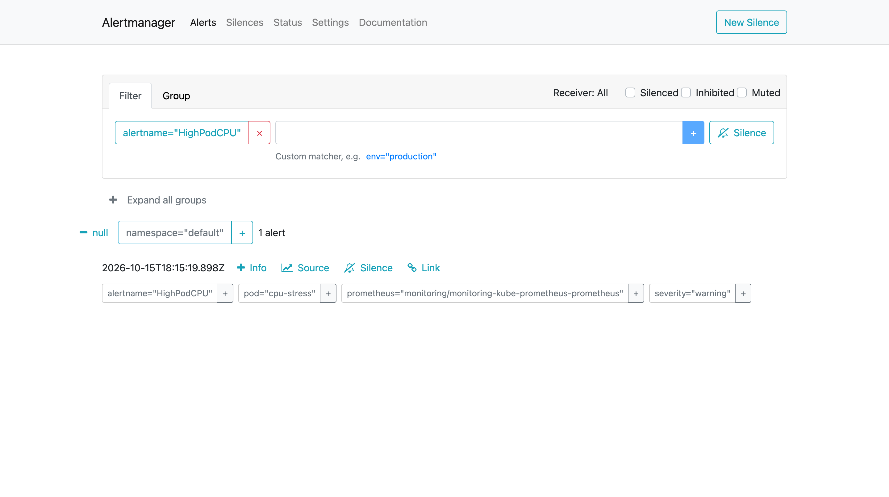

Then I deleted the stress pod and watched the alert resolve:

```bash
kubectl delete pod cpu-stress
```

---

## Application health

Kubernetes checks app health using **probes**:

- **Readiness probe** – if it fails, the pod is taken **out of the Service** (no traffic) but not restarted.
- **Liveness probe** – if it fails, the container is **restarted**.
- **Startup probe** – gives slow apps time to start before liveness kicks in.

### Healthy state

```bash
kubectl get pods -l app=demo-web
kubectl get endpoints demo-web
kubectl describe pod -l app=demo-web | grep -A3 -E "Liveness|Readiness"
```

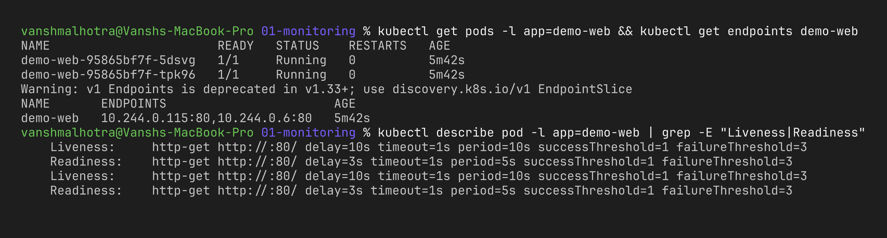

### Breaking the readiness probe on purpose

I patched the readiness probe to check a path that doesn't exist, so nginx returns 404:

```bash
kubectl patch deployment demo-web --type=json \
  -p='[{"op":"replace","path":"/spec/template/spec/containers/0/readinessProbe/httpGet/path","value":"/does-not-exist"}]'
sleep 30; kubectl get pods -l app=demo-web
kubectl get events --field-selector reason=Unhealthy --sort-by=.lastTimestamp | grep demo-web | tail -5
```

New pods stay `0/1` READY and the events show `Readiness probe failed: HTTP probe failed with statuscode: 404`. Because of the rolling update the old healthy pods keep serving traffic – so the app doesn't go down. If it stays broken for 2 minutes the `PodNotReady` alert would fire too (I rolled back after ~30 seconds, so I didn't wait for it).

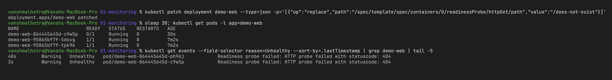

Fix it again:

```bash
kubectl rollout undo deployment demo-web
kubectl rollout status deployment demo-web
```


---

## Cleanup

```bash
kubectl delete -f demo-app.yaml -f high-cpu-alert.yaml
kubectl delete pod cpu-stress --ignore-not-found
helm uninstall monitoring -n monitoring
kubectl delete namespace monitoring
```

## What I learned

- **metrics-server** is enough for `kubectl top` and HPA, but **Prometheus** stores history and lets me query it with PromQL.
- **Grafana** turns those metrics into dashboards; kube-prometheus-stack comes with good Kubernetes dashboards out of the box.
- **Alerts** are just PromQL expressions + a duration (`for:`). The `release` label on the `PrometheusRule` must match the Helm release, otherwise it's silently ignored.
- **Probes** are built-in health monitoring – readiness protects users from broken pods, liveness auto-heals stuck ones.
