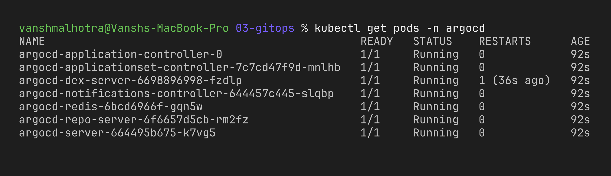
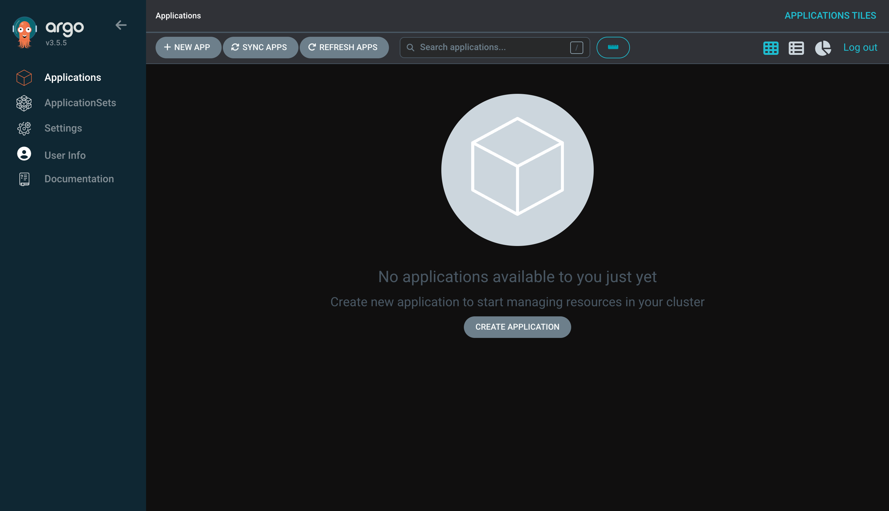
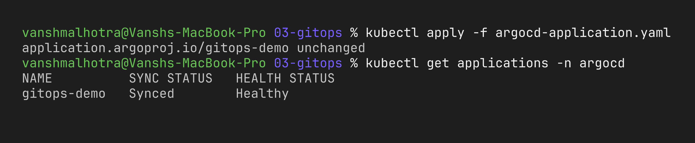
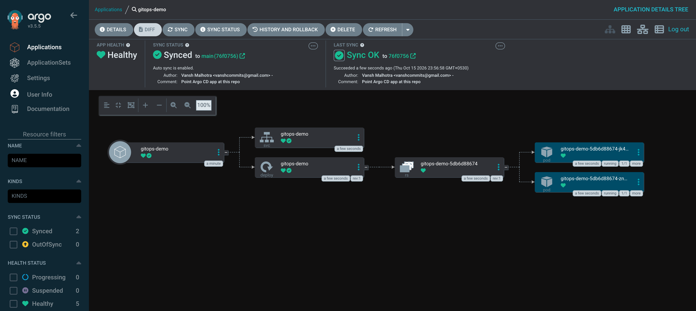
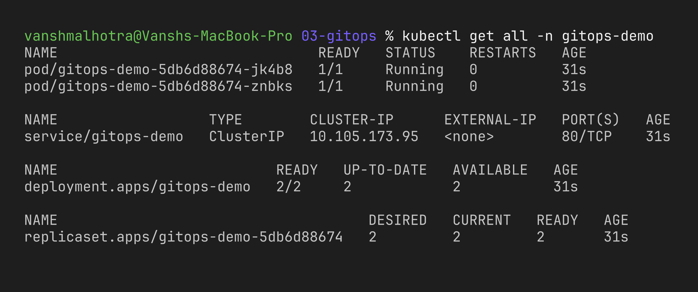
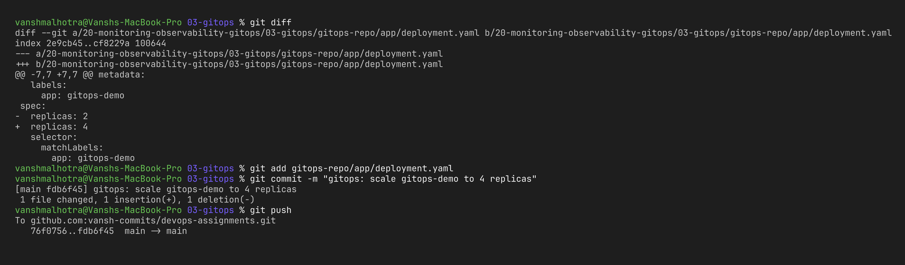
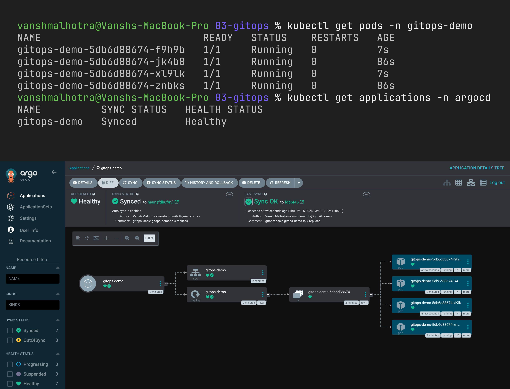
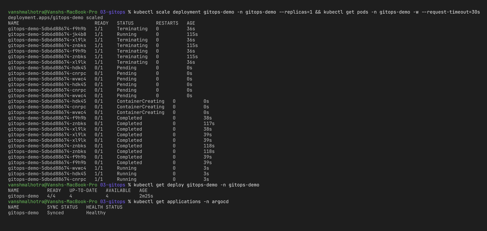
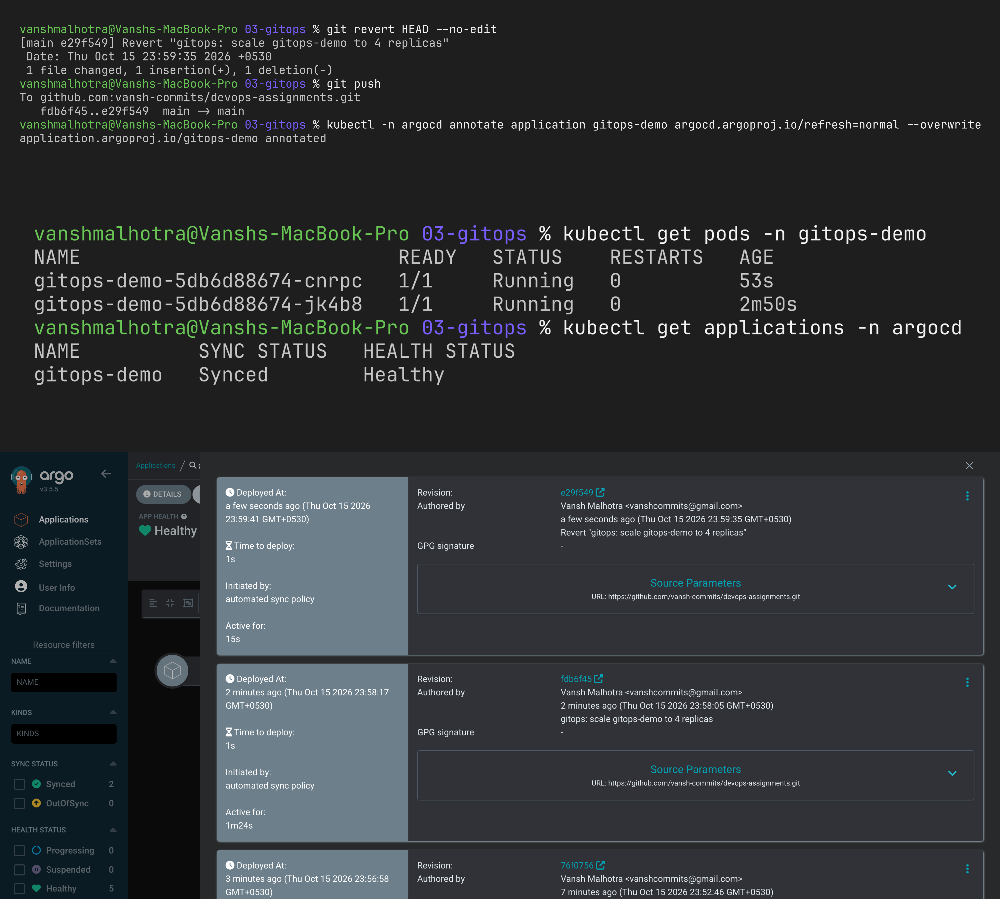

# Session 20 – Task 3: GitOps

**Name:** Vansh Malhotra  
**Roll No:** 24bcs10268

## What is GitOps?

**GitOps** is a way of managing infrastructure and applications where **Git is the single source of truth** for what should be running. You describe the desired state in files (YAML, Helm, Kustomize, Terraform) in a Git repo, and an automated **agent** makes sure the real system always matches what's in Git.

So instead of running `kubectl apply` or clicking in a console, the only way to change production is: **make a commit → open a PR → merge**. The GitOps tool does the deployment.

The idea was introduced by Weaveworks in 2017 and the principles are now maintained by the CNCF **OpenGitOps** project.

## Git as the source of truth

- The Git repo contains the **complete desired state** of the cluster/app.
- If it's not in Git, it shouldn't exist in the cluster.
- Benefits:
  - **History & audit** – `git log` shows who changed what, when and why.
  - **Review** – every change goes through a pull request.
  - **Rollback** – `git revert <commit>` and the cluster goes back.
  - **Disaster recovery** – point a GitOps tool at the repo on a brand-new cluster and everything is rebuilt.

## Declarative configuration

**Declarative** = you describe **what** the end result should be, not the **steps** to get there.

```yaml
# declarative: "there should be 3 replicas of nginx"
spec:
  replicas: 3
```

vs imperative:

```bash
# imperative: a sequence of commands
kubectl create deployment web --image=nginx
kubectl scale deployment web --replicas=3
```

Declarative config can be stored in Git, diffed, reviewed and re-applied any number of times with the same result (idempotent). That's what makes GitOps possible.

## Continuous reconciliation

A GitOps agent runs a **control loop** all the time:

```text
        ┌──────────────────────────────────────┐
        ▼                                      │
  1. Observe: read desired state from Git      │
  2. Observe: read actual state from cluster   │
  3. Diff: are they the same?                  │
  4. Act: if not → apply changes (sync)  ──────┘   (every ~3 min, or on webhook)
```

This handles two situations:

- **New commit in Git** → cluster is updated automatically.
- **Drift** (someone ran `kubectl edit` / `kubectl scale` / deleted something by hand) → the agent detects it and **puts it back** to match Git (self-healing).

## The four GitOps principles (OpenGitOps)

| Principle | Meaning |
| :--- | :--- |
| **Declarative** | the whole system is described declaratively |
| **Versioned and immutable** | desired state is stored in Git with full history |
| **Pulled automatically** | agents pull the desired state from the repo (the cluster pulls, CI doesn't push) |
| **Continuously reconciled** | agents keep checking and correcting actual vs desired state |

## GitOps workflow

```text
 Developer                Git repo                 Argo CD (in cluster)          Kubernetes
    │  edit YAML              │                            │                          │
    ├──── git push / PR ─────►│                            │                          │
    │                         │◄──── poll / webhook ───────┤                          │
    │                         │      "new commit!"         │                          │
    │                         │                            ├──── apply diff ─────────►│
    │                         │                            │◄──── health status ──────┤
    │                         │                            │  Synced Healthy      │
    │                         │                            │                          │
    │      someone runs kubectl scale manually ─────────────────────────────────────►│
    │                         │                            ├──── detects drift ───────┤
    │                         │                            ├──── reverts to Git ─────►│
```

With CI/CD it usually looks like:

1. **CI** (GitHub Actions): test → build image → push to registry → **update the image tag in the GitOps repo** (commit).
2. **CD** (Argo CD / Flux): sees the new commit → syncs to the cluster.

So CI never needs cluster credentials – more secure than "push-based" deployments.

### Push vs pull deployment

| Push (traditional CI/CD) | Pull (GitOps) |
| :--- | :--- |
| CI pipeline runs `kubectl apply` / `helm upgrade` | agent inside the cluster pulls from Git |
| CI needs cluster admin credentials | credentials never leave the cluster |
| drift is not detected | drift is detected and fixed |
| state of cluster = whatever last ran | state of cluster = what's in Git |

## Kubernetes + GitOps

Kubernetes is a perfect fit for GitOps because it's already **declarative** (everything is YAML) and itself works on **reconciliation loops** (controllers make actual = desired). GitOps just extends that loop to Git.

Popular tools:

- **Argo CD** – CNCF graduated, has a nice web UI showing sync & health status, supports Helm/Kustomize/plain YAML, app-of-apps pattern, multi-cluster.
- **Flux CD** – CNCF graduated, a set of controllers (source, kustomize, helm, image-automation), CLI-focused, can auto-update image tags.

---

# GitOps Demo with Argo CD

In this demo Argo CD watches the folder [`gitops-repo/app/`](gitops-repo/app/) **in my GitHub repo** ([vansh-commits/devops-assignments](https://github.com/vansh-commits/devops-assignments)) and keeps the `gitops-demo` namespace in sync with it.

## Files

| File | Purpose |
| :--- | :--- |
| `gitops-repo/app/deployment.yaml` | nginx Deployment, `replicas: 2` – the desired state |
| `gitops-repo/app/service.yaml` | ClusterIP Service for it |
| `argocd-application.yaml` | Argo CD `Application` pointing at the folder above, with auto-sync, prune and self-heal |

## Prerequisites

- Minikube running (`minikube start`), `kubectl`.
- This repo pushed to **my own public GitHub repo**: https://github.com/vansh-commits/devops-assignments
- `argocd-application.yaml` points at that repo (`targetRevision: main`, `path: 20-monitoring-observability-gitops/03-gitops/gitops-repo/app`). Argo CD needs it public (or repo credentials) to clone it.

## Step 1 – Install Argo CD

```bash
kubectl create namespace argocd
kubectl apply -n argocd --server-side --force-conflicts \
  -f https://raw.githubusercontent.com/argoproj/argo-cd/stable/manifests/install.yaml
kubectl get pods -n argocd -w
```

(`--server-side` is needed because some Argo CD CRDs are too big for normal client-side apply.)



## Step 2 – Open the Argo CD UI

```bash
# initial admin password
kubectl -n argocd get secret argocd-initial-admin-secret -o jsonpath="{.data.password}" | base64 -d; echo
kubectl port-forward svc/argocd-server -n argocd 8080:443
```

Open https://localhost:8080 (accept the self-signed certificate), login as `admin`.

> **Note (what I actually did locally):** my browser refused the self-signed cert, so for this local demo I switched argocd-server to HTTP mode and forwarded port 80 instead:
>
> ```bash
> kubectl -n argocd patch cm argocd-cmd-params-cm -p '{"data":{"server.insecure":"true"}}'
> kubectl -n argocd rollout restart deploy argocd-server
> kubectl port-forward svc/argocd-server -n argocd 8080:80   # then open http://localhost:8080
> ```
>
> I also set my own demo admin password (bcrypt hash patched into `argocd-secret` as `admin.password`) instead of copying the generated one. Both are only OK for a throwaway local cluster.



## Step 3 – Create the Application

```bash
kubectl apply -f argocd-application.yaml
kubectl get applications -n argocd
```

Argo CD clones my repo, sees the Deployment + Service, creates the `gitops-demo` namespace and deploys them. Status becomes **Synced** and **Healthy**.





```bash
kubectl get all -n gitops-demo
```



## Step 4 – Change the app through Git

I changed `replicas: 2` to `replicas: 4` in `gitops-repo/app/deployment.yaml` and pushed. **No kubectl command.**

```bash
# edit replicas: 2 -> 4 in gitops-repo/app/deployment.yaml
git add gitops-repo/app/deployment.yaml
git commit -m "gitops: scale gitops-demo to 4 replicas"
git push
```

Argo CD polls every ~3 minutes. To not wait, I clicked **Refresh** in the UI (or run `kubectl -n argocd annotate application gitops-demo argocd.argoproj.io/refresh=normal --overwrite`).

```bash
kubectl get pods -n gitops-demo
```





## Step 5 – Self-heal (drift correction)

Now I try to change the cluster by hand, bypassing Git:

```bash
kubectl scale deployment gitops-demo -n gitops-demo --replicas=1
kubectl get pods -n gitops-demo -w
```

Almost immediately Argo CD notices the live state (1) doesn't match Git (4) and scales it **back to 4** – in my watch output the 3 new pods were already Pending while the old ones were still terminating. The OutOfSync window was so short that `kubectl get applications` already showed **Synced** again right after.



Same thing if I delete the Service: `kubectl delete svc gitops-demo -n gitops-demo` → Argo CD recreates it.

## Step 6 – Rollback with Git

```bash
git revert HEAD --no-edit
git push
```

Argo CD syncs the revert and the app goes back to 2 replicas. The rollback is just another reviewed commit in history.



## Cleanup

```bash
kubectl delete -f argocd-application.yaml     # prune deletes gitops-demo resources too
kubectl delete namespace gitops-demo --ignore-not-found
kubectl delete -n argocd -f https://raw.githubusercontent.com/argoproj/argo-cd/stable/manifests/install.yaml
kubectl delete namespace argocd
```

## What I learned

- With GitOps, **Git is the only place to make changes**; the cluster follows it automatically.
- `selfHeal: true` means manual `kubectl` changes get undone – this stops "config drift" where prod slowly differs from what's documented.
- `prune: true` deletes things from the cluster when I delete them from Git.
- Rollback is simply `git revert`, which is safe, reviewable and recorded.
- CI builds and tests; GitOps (Argo CD) deploys. The cluster pulls, so CI doesn't need kubeconfig secrets.
